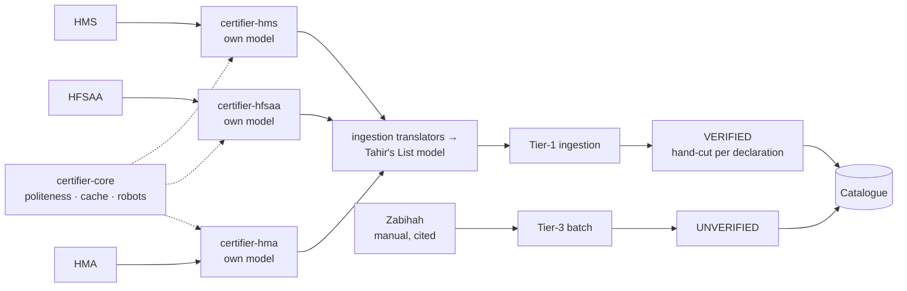

# SC-211 — Sample ingestion pipeline for halal directory sources

> **Purpose:** lock the requirement and its verbatim ACs · **Derived from:** SC-211 + founder directive 2026-11-07 · **Delta:** new story

| Field | Value |
|---|---|
| Shortcut | https://app.shortcut.com/halal-food-finder/story/211 |
| Epic | M1 Core Search & Discovery (111) — placement flagged (D-2) |
| Iteration | M1 Sprint 7 — Directory Ingestion & Data Coverage (210) |
| Type · label | feature · `ready for design` |
| Priority | Founder-directed; backlog position unverified — Q-5 (Adnan) |
| Workflow | `@tahirs-feature-workflow`; approval before implementation |

> **Access verified 2026-11-08:** a live probe returned HMS 370 restaurants · HFSAA 313 entries · HMA 76 outlets; Dallas 43, NYC 58 (HMS 32 + HFSAA 26), Toronto 28 before dedupe. Evidence: `docs/research/certifier-libraries-2026-11-08.md`.

| Prefix | Persona | Relevance |
|---|---|---|
| **DC** (new, D-1) | Data Curator — internal operator | Runs all four use cases |
| U | User | Sees sample listings in search; no new flow |
| VC | Verification Committee | Not a participant; registry verification is not committee review |
| ET | Extension Trigger | Unaffected |

## Locked decisions (founder, 2026-11-07)

| # | Decision |
|---|---|
| 1 | Automated Tier-1: HMS (Dallas + NYC), HFSAA (NYC), HMA (Toronto/GTA). |
| 2 | Tier-3: hand-curated, individually cited Zabihah sample; no scraping. |
| 3 | Excluded from automation: Crave Halal, Muslim Foodies, AVA/Achada. |
| 4 | Tier-1 rows: `VERIFIED` (the certifier is authoritative for halal), backed by a claim. |
| 5 | Hand-cut is separate: `TRUE` only if the certifier declares hand-cut, `FALSE` otherwise (declared not hand-cut **or silent**). `NULL` only where there is no certifier claim (manual rows). Tier is not a hand-cut proxy. |
| 6 | Tier-3 rows: `UNVERIFIED` + `is_hand_cut = NULL`. |
| 7 | Load: committed artifacts → generated, idempotent Flyway migration. |
| 8 | Metros: Dallas, NYC, Toronto; 15–25 rows each. |
| 9 | Photon-only geocoding; non-matching rows rejected — no invented coordinates. |
| 10 | One independent library per certifier (`certifier-hms`, `certifier-hfsaa`, `certifier-hma`), each with its **own** domain model and a translator into the Tahir's List model; in-repo for now, no separate repository. |
| 11 | Access is confirmed (2026-11-08 spike): 3 requests cover the whole Tier-1 sample. Zabihah bulk access is licensed-only — manual cited rows, never a scraper. |
| 12 | Pre-flight: one Photon test query runs before any directory fetch; a failure aborts the run with no artifacts. |

## Acceptance criteria (amended 2026-11-08; Shortcut sync pending re-auth)

> AC-4/AC-5 were amended to remove the retired counter-category wording, and to make a silent certifier declaration yield FALSE rather than NULL. The Shortcut story still carries the older text until its token is re-authorized.

> **AC-1** A containerized, re-runnable command (`scripts/ingest-sample.sh`)
> fetches the Tier-1 directories for the three metros with polite throttling and
> writes committed artifacts (raw snapshots, `candidates.json`, `report.md`).

> **AC-2** Every candidate is geocoded via the existing `GeocoderPort` (Photon)
> with match-confirmation (country/state + name-token); non-matching rows are
> excluded and listed with reasons. No invented coordinates.

> **AC-3** The sample yields 15–25 listings per metro, deduplicated within-run by
> tier priority and normalized location; the report maps every listing to its
> source(s).

> **AC-4** A generated, idempotent Flyway migration loads the sample with
> per-source provenance: Tier-1 rows as `VERIFIED`; `is_hand_cut` derived from
> the certifier's own hand-cut declaration (TRUE only when it declares
> hand-cut; FALSE when it declares not hand-cut **or is silent**); manual
> Zabihah rows as `UNVERIFIED` + `NULL`; plus
> `external_certification_claims` rows citing source URL (+ certifier/expiry
> where published); brands upserted by name.

> **AC-5** Every `VERIFIED` row is backed by a Tier-1 claim. `is_hand_cut = TRUE`
> requires a claim whose certifier declares hand-cut; every other Tier-1
> declaration — including silence — yields FALSE. Manual Zabihah rows
> are never marked verified or hand-cut.

> **AC-6** Re-applying the migration adds no duplicates, and no existing V7 seed
> row is duplicated (e.g. Paramount Fine Foods); a matched existing row is
> upgraded to `VERIFIED` rather than skipped.

> **AC-7** Sample listings are returned by the existing search API for their
> metros on the live stack; Tier-1 rows display as Verified and are included by
> the hand-cut-only filter; manual Zabihah rows are unverified and excluded from
> that filter.

> **AC-8** The report honestly lists rejects/quarantines with reasons and known
> gaps; design artifacts 00–10 complete.

> **AC-9** Before any directory request, a single Photon pre-flight query (a
> stable, well-known address) confirms the geocoder is reachable. A failure
> aborts the run with no snapshots, candidates, or partial load.

## Edge cases

| # | Edge case | Handling |
|---|---|---|
| E-1 | HFSAA publishes no partner API; the locator RPC is undocumented | Use the public locator RPC; on `401`, re-discover the publishable key from the public bundle once; if still failing, fall back to HMS-only NYC |
| E-2 | HMS markup changes (page is server-rendered — confirmed) | Fixture tests catch drift; parse failure quarantines the source; no JS fallback needed |
| E-3 | Zabihah exposes no unlicensed bulk path (robots + `/developers`) | Manual cited batch; licensed API is a future path (D-13), never a scraper |
| E-4 | Same venue from two sources | Tier-priority merge; report suspected duplicates |
| E-5 | Partial address (no city/postal) | `NULL` structured fields; never guess |
| E-6 | Photon no-match / wrong region | Reject with reason; no coordinates taken |
| E-7 | Source rate-limits / unreachable | Backoff, mark source failed; run continues; report says what was missed |
| E-8 | Metro below 15 rows | Report the shortfall; never pad |
| E-9 | Certification expires or is revoked | Expiry stored on the claim; revocation stays an open flag (D-10) |
| E-10 | Tier-1 venue matches an existing row | Upgrade that row to `VERIFIED`; hand-cut per the claim's declaration; attach claims (AC-6) |
| E-11 | Future Tier-1 certifier does not require hand-cut, or is silent on it | `VERIFIED` (halal), `is_hand_cut = FALSE` in both cases — never auto-TRUE |
| E-12 | HFSAA publishable key rotates | Re-discover from the public locator bundle, retry once; otherwise fail the source honestly |
| E-13 | HMS row has an empty `data-city-name` | Derive the city from the address line; if absent, the row is geocoded or rejected — never invented |
| E-14 | Photon is down at pre-flight | Abort before fetching any directory; report the outage; no artifacts |

## Open questions

| # | Unknown | Owner | Needed by |
|---|---|---|---|
| Q-1 | ~~HFSAA NY chapter format~~ — resolved 2026-11-08: 26 New York entries via the public locator RPC | Aisha / Hamza | closed |
| Q-2 | ~~Zabihah pages fetchable~~ — resolved 2026-11-08: no unlicensed bulk access; `/developers` licence is the only path | Aisha | closed |
| Q-3 | If/when external claims surface in the UI | Founder / Adnan | Future story |
| Q-4 | ODbL / certifier attribution display policy | Founder | Open flag (sc-138 §5) |
| Q-5 | Backlog priority against the two prioritization docs | Adnan | Sprint sign-off |
| Q-6 | Artifact home: `docs/research/ingest-sample-2026-11/` | Founder | Walkthrough (D-5) |
| Q-7 | Zabihah Developer API licence terms and cost | Adnan / Aisha | Before any Tier-3 automation |
