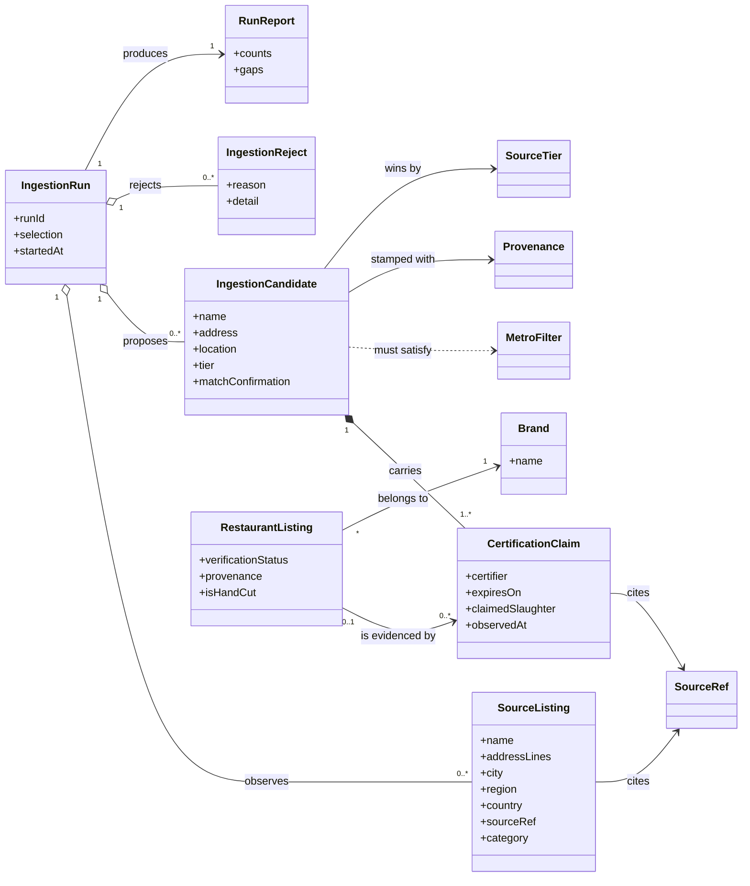
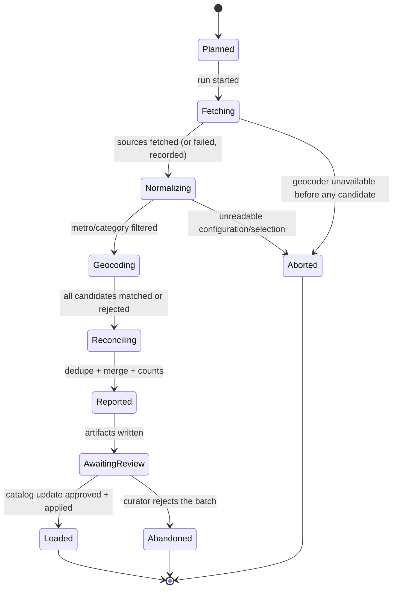
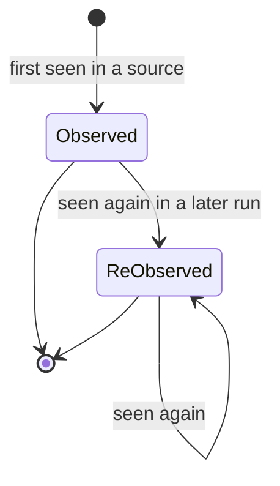

# SC-211 — Phase 1: Domain model

**Technology-free.** No tables, columns, HTTP, or frameworks in this document.

## 1. Scope

This feature introduces a new domain capability — **external directory
ingestion** — and extends the existing restaurant/catalogue model with
**externally observed certification claims**. It does not change the product's
verification process: nothing ingested here becomes *our* Verified status.

## 2. Aggregates and consistency boundaries

| Aggregate root | Consistency boundary | Why |
|---|---|---|
| **RestaurantListing** (existing) | The listing's identity, location, halal attributes, trust status, provenance | Unchanged aggregate; ingestion only *creates* members of it in the `UNVERIFIED` state |
| **IngestionRun** (new) | One pipeline execution: its selection, source observations, candidates, rejections, and report | A run is the unit of auditability; partial results are meaningful only as a whole run, not as orphan rows |
| **Brand** (existing) | Brand identity shared by locations | Unchanged; ingestion resolves locations to brands by name |

**Entities inside the IngestionRun boundary:** *Source Listing*, *Ingestion
Candidate*, *Ingestion Reject*, *Run Report*.
**Entities inside the RestaurantListing boundary:** *Certification Claim*
(lifecycle: observed → re-observed; never mutates the listing's verification
status).

### 2.1 Domain events

No domain events are introduced. The run report is a produced value artifact,
not an event stream; there is no subscriber in scope.

## 3. Entities

### 3.1 RestaurantListing (existing — used, not changed)

The existing aggregate. Ingestion adds members with:

- `verificationStatus = UNVERIFIED` **always** (INV-1);
- `isHandCut = TRUE` **iff** the venue was observed in a Tier-1 certifier
  directory during the run and the certification claim is recorded (INV-3);
- `provenance` = the highest-tier source that supplied the venue (INV-6);
- `owner = none`, `cuisine = unknown` (consistent with the seed precedent).

### 3.2 CertificationClaim (new entity)

A dated, cited **observation** by an external source that a venue holds a halal
certification. Not a certification *record of ours* — it is evidence, retained
verbatim, that the product may later choose to surface.

| Attribute | Meaning |
|---|---|
| source | Which directory made the claim (HMS, HFSAA, HMA, Zabihah) |
| sourceTier | The credibility tier assigned to that directory (1 or 3 in this feature) |
| sourceRef | The source's own record identity (page slug/id) + the URL + observation date |
| certifier | Issuing body named by the source, where published |
| expiresOn | Certificate expiry date, where published (HMS publishes it) |
| claimedSlaughter | What the source asserts about slaughter method (HAND / UNSPECIFIED) |
| observedAt | First observation; updates to a *last observed* date on re-observation |

**Lifecycle:** `OBSERVED → RE_OBSERVED` (last-seen advances). Expiry is an
attribute, **not** an automatic state change and **not** a revocation mechanism
in this feature (INV-8).

### 3.3 Source Listing (value object of the IngestionRun)

The pristine, source-shaped record as fetched: display name, address lines,
city, region, country, postal (if any), phone, category, and source reference.
It is never mutated into a candidate in place; a candidate is derived from it.

### 3.4 Ingestion Candidate (entity of the IngestionRun)

A proposed listing with:

- normalized name/address/location (location only after geocode confirmation);
- the set of claims gathered for the venue **across sources**;
- the winning source tier and therefore the intended provenance;
- a **match-confirmation** record (which geocoder result was accepted and why).

### 3.5 Ingestion Reject (entity of the IngestionRun)

A source listing that did not become a candidate. It always carries a **reason
from a closed vocabulary**, the source reference, and a human-readable detail:

`NO_GEOCODER_MATCH`, `AMBIGUOUS_GEOCODER_MATCH`, `WRONG_REGION`,
`NOT_A_RESTAURANT`, `MISSING_ADDRESS`, `DUPLICATE_MERGED`,
`INVALID_MANUAL_ENTRY`, `SOURCE_UNAVAILABLE`, `SOURCE_PARSE_FAILED`.

`DUPLICATE_MERGED` is recorded for transparency (the row *was* ingested, through
another source) and does not count against the run's failure budget.

### 3.6 Run Report (entity/value of the IngestionRun)

Counts by source × metro (fetched, parsed, filtered-in, geocoded, merged,
rejected), the full reject list with reasons, suspected cross-source duplicates
(including against pre-existing catalogue rows), claims coverage, and a list of
known gaps. The report is the audit surface for the amanah rule.

## 4. Value objects

| Value object | Definition | Invariant |
|---|---|---|
| **Provenance** | Origin stamp of a listing: one of the ratified source stamps (existing `research-seed / photon-geocode` plus new per-directory stamps) | Closed vocabulary; an unknown stamp is rejected |
| **SourceTier** | 1 (audited certifier registry) or 3 (crowdsourced/curated) — tier 2 is not automated in this feature | Only 1 or 3 are produced here |
| **SourceRef** | (source, source record id, URL, accessed-at) | A URL is mandatory for every claim and every manual row |
| **MetroFilter** | Metro name + country + region code + city allowlist | A candidate must resolve inside exactly one metro |
| **MatchConfirmation** | The accepted geocoder result with the evidence (country + region agreement, name-token overlap) | No candidate exists without one |
| **RejectReason** | Closed vocabulary (see 3.5) | Rejects cannot be free-text-only |

## 5. Relationships

Cardinality notes:

- A **venue** may be described by many source listings (one per directory); the
  run reconciles them into **one candidate** (INV-6).
- A candidate carries **1..\*** claims (each source that observed it).
- A loaded listing is evidenced by **0..\*** claims — zero only for manual rows
  with no certification assertion (their claim records the tier-3 observation
  itself; a manual row always produces a claim, so in practice ≥1).

## 6. Invariants (each becomes a test name)

| ID | Invariant |
|----|-----------|
| INV-1 | Every listing created by ingestion is `UNVERIFIED`; no source can set another verification status. |
| INV-2 | Every ingested listing carries a provenance stamp from the closed vocabulary; an unknown stamp fails the batch. |
| INV-3 | `isHandCut = TRUE` **only** when at least one claim with tier 1 and `claimedSlaughter = HAND` exists for that listing; Tier-3-only rows are `NULL`. |
| INV-4 | Every candidate location came from a confirmed geocoder match; no location is synthesized, offset, or copied from another row. |
| INV-5 | Claims are unique per (listing, source, source record) and every claim cites a source URL. |
| INV-6 | Two source listings describing the same venue produce **one** candidate; the highest tier wins the provenance; all sources' claims are retained. |
| INV-7 | Loading a batch is idempotent: applying it twice produces no duplicate listing and no duplicate claim. |
| INV-8 | Claim expiry/first-seen/last-seen never changes a listing's verification status or its hand-cut assertion within this feature. |
| INV-9 | A run never emits a candidate for a metro it did not select, and never exceeds the configured per-metro cap. |
| INV-10 | A run report always accounts for every fetched row: it is a candidate or a reject with a reason (no silent drops). |

## 7. State machines

### 7.1 Ingestion run

Guards: a run may enter `Aborted` only before any candidate artifact is
published as a success; `Loaded` is reachable only through the reviewed catalog
update (use case 3).

### 7.2 Certification claim

`expiresOn` is an attribute; **no automatic transition** on expiry (INV-8).

### 7.3 Listing verification

Unchanged from the agreed model (`UNVERIFIED → …` through the owner
claim/certificate flow). Ingestion only ever enters at `UNVERIFIED` and never
participates in transitions.

## 8. Glossary

| Term | Definition |
|---|---|
| **Directory source** | A public external registry of halal establishments (HMS, HFSAA, HMA) or a curated platform (Zabihah) |
| **Tier** | Credibility grouping from the supply-side research: 1 = audited certifier registry, 2 = vetted platforms, 3 = crowdsourced/curated |
| **Source listing** | One record as published by one directory |
| **Candidate** | A proposed listing derived from one or more source listings, geocoded and reconciled |
| **Claim** | A source's dated, cited assertion about a venue's certification/slaughter |
| **Match confirmation** | The explicit evidence that a geocoder result is the same venue (country + region agreement and name-token overlap) |
| **Provenance** | The listing's source stamp (which directory supplied the winning record) |
| **Batch** | The set of candidates from one reviewed run, materialized as a catalog update |
| **Metro** | A named geographic target with a country, region code, and city allowlist |
| **Hand-cut** | The product's boolean assertion that a listing is hand-slaughtered (Zabiha); `NULL` = unknown/not claimed |
| **Manual batch** | The hand-curated, individually cited Tier-3 sample |
| **Suspected duplicate** | A candidate whose normalized location matches an existing catalogue row that the run could not formally merge (e.g. differing name), surfaced for human review |

## 9. Reconciliation with ARCHITECTURE.md §1.2

- **Unchanged:** User / RestaurantOwner / VerifiedRestaurantOwner; Restaurant ↔
  HalalCertification; RestaurantListing → Verified/Unverified; committees.
- **Extended:** **Restaurant ↔ 0..\* CertificationClaim** — external,
  source-attributed observations, deliberately separate from the owner-submitted
  `HalalCertification` review flow. A claim is evidence; it is not a
  certification of ours.
- **Extended:** the listing's provenance vocabulary gains per-directory stamps.
- **New capability:** an *ingestion* boundary that produces candidates and run
  reports; its output enters the catalogue only through the reviewed batch.
- **Explicitly not changed:** verification statuses, the verification state
  machine, trust badges, and the meaning of "Verified".

Decision D-3 (claims as a separate listing-associated entity) and D-4 (run
reconciliation rules) are the architecture-level items for founder approval.
