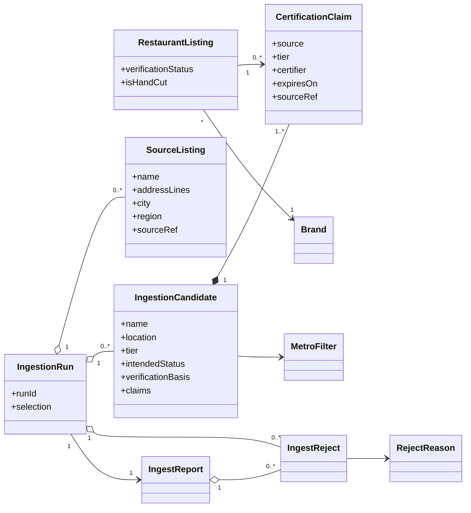

# SC-211 — Phase 1: Domain model

> **Purpose:** the domain vocabulary the use cases rely on · **Derived from:** 00 · **Delta:** extends (`CertificationClaim`, `VerificationBasis`) + changes (`VERIFIED` route)

**ARCHITECTURE.md §1.2 impact: changes** — `VERIFIED` gains a second route (`CERTIFIER_REGISTRY`); `Restaurant ↔ 0..* CertificationClaim`. Committee flow unchanged.

## Entities

| Entity | Role | Lifecycle |
|---|---|---|
| RestaurantListing (existing) | Catalogue root; trust + halal attributes | Unverified → Verified (two routes) |
| Brand (existing) | Location grouping | Persistent |
| CertificationClaim (new) | Cited certifier observation; verification evidence | Observed → ReObserved |
| IngestionRun (new) | Audit unit for one pipeline execution | Planned → … → Loaded / Abandoned / Aborted |
| IngestionCandidate (new) | Proposed listing derived from one or more source listings | Created per run |
| SourceListing (new) | Raw directory record | Immutable |
| IngestReject (new) | Excluded row with a closed-vocabulary reason | Immutable |
| IngestReport (new) | Run accounting + rejects + gaps | Produced once |
| Provenance · SourceTier · SourceRef · VerificationBasis · MetroFilter · MatchConfirmation | Value objects | Immutable |

## Invariants

| # | Invariant | Becomes test |
|---|---|---|
| INV-1 | Ingested listing is `VERIFIED` iff a recognized Tier-1 claim backs it; otherwise `UNVERIFIED` | `IngestSampleMigrationTest.loadsTierOneAsVerifiedWithClaims` |
| INV-2 | Every ingested listing carries a closed-vocabulary provenance stamp | `ProvenanceTest.rejectsUnknownVocabulary` |
| INV-3 | `isHandCut = TRUE` only with a Tier-1 `HAND` claim; every `VERIFIED` row has a cited basis | `LoadIngestionBatchTest.refusesVerifiedWithoutClaim` |
| INV-4 | Every candidate location came from a confirmed geocoder match | `MatchConfirmationPolicyTest.rejectsWrongRegion` |
| INV-5 | Claims are unique per (listing, source, record) and cite a source URL | `CertificationClaimTest.requiresCitation` |
| INV-6 | Same venue → one candidate; highest tier wins provenance; all claims retained | `RunSampleIngestionTest.mergesTierPriority` |
| INV-7 | Loading is idempotent (no duplicate listing or claim) | `IngestSampleMigrationTest.isIdempotent` |
| INV-8 | Expiry/first-seen/last-seen never changes status or hand-cut in this feature | — (open flag D-10) |
| INV-9 | A run never emits outside its metros or above the per-metro cap | `RunSampleIngestionTest.filtersToMetroAndCap` |
| INV-10 | Every fetched row is a candidate or a reject with a reason | `AuditIngestionRunTest.flagsUnaccountedRow` |
| INV-11 | A Tier-1 match upgrades the existing row; never duplicates or skips | `IngestSampleMigrationTest.upgradesMatchedSeedRow` |
| INV-12 | The committee path is untouched; registry-verified is distinguishable | `VerificationCommitteeTest` (existing) |

## States

| From | Event | To | Guard |
|---|---|---|---|
| Planned | Run started | Fetching | — |
| Fetching | Sources fetched (or failures recorded) | Normalizing | — |
| Normalizing | Metro/category filtered | Geocoding | — |
| Geocoding | All matched or rejected | Reconciling | — |
| Reconciling | Dedupe + counts | Reported | — |
| Reported | Artifacts written | AwaitingReview | — |
| AwaitingReview | Approved + applied | Loaded | Reviewed batch |
| AwaitingReview | Batch rejected | Abandoned | — |
| Fetching | Geocoder unavailable before candidates | Aborted | No candidates artifact |
| Observed | Claim seen again | ReObserved | Same (listing, source, record) |
| Unverified | Committee approves owner claim | Verified | `COMMITTEE_REVIEW` |
| Unverified | Tier-1 registry claim attached | Verified | `CERTIFIER_REGISTRY` + cited claim |

## Glossary

| Term | Meaning |
|---|---|
| Directory source | Public halal registry (HMS/HFSAA/HMA) or curated platform (Zabihah) |
| Tier | 1 = audited certifier registry · 2 = vetted platform · 3 = crowdsourced/curated |
| Source listing | One record as published by one directory |
| Candidate | Proposed listing derived from geocoded, reconciled source listings |
| Claim | A source's dated, cited certification/slaughter assertion |
| Match confirmation | Country/region agreement + name-token overlap evidence |
| Provenance | Listing's origin stamp (winning directory) |
| Verification basis | Why `VERIFIED`: `COMMITTEE_REVIEW` or `CERTIFIER_REGISTRY` |
| Registry verification | `VERIFIED` conferred by a recognized Tier-1 entry + claim |
| Batch | One reviewed run's candidates, materialized as a catalogue update |
| Hand-cut | Product boolean (Zabiha); `NULL` = unknown/not claimed |
| Suspected duplicate | Candidate at an existing row's location |
