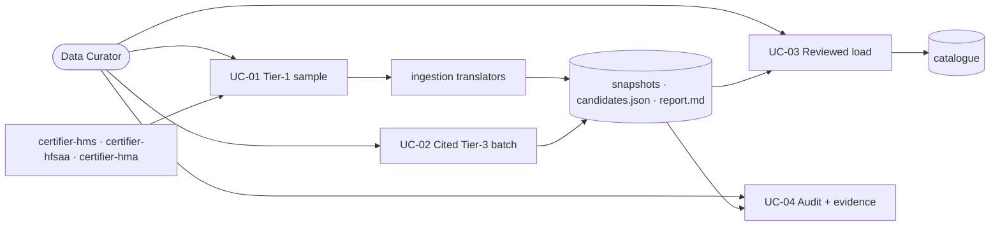

# SC-211 — Phase 2: Use cases

> **Purpose:** the actor goals and their flows (the one artifact where text leads) · **Derived from:** 01 · **Delta:** new UC-01…UC-04

## UC-01 — Run a sample directory ingestion

- **Primary actor:** Data Curator · **Supporting:** certifier libraries (HMS, HFSAA, HMA), Photon (external)
- **Goal:** produce a geocoded, reconciled candidate batch + honest run report for three metros
- **Trigger:** curator starts the sample-ingestion command with a metro selection
- **Preconditions:** design approved; network to sources + Photon; metros/caps configured; no unreviewed run (or the operator chose to archive it)
- **Business rules:** BR-1 restaurants only · BR-2 metro allowlist · BR-3 confirmed Photon match only · BR-4 highest tier wins provenance, all claims kept · BR-5 every fetched row accounted for · BR-6 throttled, identified client, no prohibited scraping, one request per directory where the source allows it; HTTPS only, per-certifier host allow-list, bounded re-checked redirects, response-size cap, fail-closed robots · BR-6a Tier-1 claim ⇒ `VERIFIED`; hand-cut TRUE only if the certifier declares hand-cut, FALSE otherwise (declared not or silent); no Tier-1 claim ⇒ `UNVERIFIED` + `NULL` · BR-6b each library's own model is mapped by its translator, never leaked into the app model · BR-6c a single Photon pre-flight query must pass before any directory request · BR-6d run artifacts are immutable and per-run; a pending run blocks a new run unless archived, and archives use unique names

**Main success scenario**

1. Curator selects Dallas, NYC, Toronto and per-metro caps (15–25), then starts with a pending-run policy.
2. System checks the artifact root for unreviewed runs: default abort; `archive` moves each to a unique `archive/<runId>-<timestamp>-<token>/`; `ignore` leaves them.
3. System runs one Photon pre-flight query against a stable address; only on success does it proceed.
4. System asks the HMS library for certified restaurants (one cached request; directory coordinates kept as evidence only).
5. System asks the HFSAA library for New York locator entries (one public RPC).
6. System asks the HMA library for the GTA list (one REST request; all content inline).
7. Each library returns its own records; its translator maps them to the app's source listings.
8. System filters fetched rows to restaurants inside the metro city allowlists.
9. System geocodes each row via Photon; accepts only confirmed matches; directory coordinates never become the accepted location.
10. System reconciles same-venue rows, merges claims, records the intended verification and hand-cut outcomes.
11. System writes raw snapshots, `candidates.json` (outcome/basis), `report.md`, and a `run.json` manifest under `runs/<runId>/`.
12. System reports per-source/per-metro counts and rejected rows with reasons.

**Flows**

| ID | From | Condition → flow | Ends in |
|---|---|---|---|
| A1 | 6–7 | Several branches/entries → one source listing each; translator maps the library model | Step 10 reconciliation |
| A2 | 4 | HMS unavailable → recorded source failure; cached snapshot replayed if fresh | Step 5 |
| A3 | 9 | Fewer rows than the cap → continue, report the shortfall | Step 11 |
| A4 | — | Repeat run → cached snapshots, no fetch | Step 11, marked cache-sourced |
| A5 | 5 | HFSAA publishable key rotated → re-discover from the public bundle, retry once; otherwise NYC draws from HMS only and the gap is reported | Step 6 |
| P1 | 2 | Unreviewed run exists → abort with its id, or archive under a unique name | No fetch until resolved |
| P2 | 3 | Photon pre-flight fails → abort before any directory request | `Aborted`, no complete run |
| E1 | 4–6 | Source unreachable → `SOURCE_UNAVAILABLE`, run continues | Partial report |
| E2 | 9 | Photon down mid-run → abort before publishing candidates | `Aborted`, no manifest |
| E3 | 4–7 | Parse failure → `SOURCE_PARSE_FAILED` quarantine | Source skipped; follow-up |
| E4 | 8 | Zero metro matches → reported | No load for that metro |
| E5 | 9 | Wrong-region/ambiguous match → row rejected with the match | Reject list |

- **Postconditions:** success — one immutable `runs/<runId>/` artifact set exists, every fetched row classified, no DB writes; failure — no manifest, so the run is incomplete, never pending; pre-flight failure — nothing fetched, nothing written.
- **Data:** read — library responses, geocoder results · created — run directory (snapshots, `candidates.json`, `report.md`, `run.json`) only
- **ACs:** AC-1, AC-2, AC-3, AC-5, AC-8, AC-9, AC-10 · **Open:** Q-6, Q-7

## UC-02 — Compile a cited manual Tier-3 batch

- **Primary actor:** Data Curator · **Supporting:** Zabihah listings (read by hand), founder research (secondary), Photon
- **Goal:** hand-curate a cited Zabihah sample and merge it into the candidate batch by tier priority
- **Trigger:** curator decides to include the Tier-3 sample
- **Preconditions:** research reviewed; run artifact directory exists or is created
- **Business rules:** BR-7 hand-curated only, no scraping · BR-7a Zabihah bulk access is licensed-only (D-13); the pipeline never fetches it and never spoofs a permitted crawler · BR-8 every row has a URL + access date · BR-9 Tier-3 never sets `VERIFIED` or hand-cut; cross-contamination is explicit in the curated file (default `UNCERTAIN`; only `NO_CROSS_CONTAMINATION` is index-qualified) · BR-10 merge follows UC-01 BR-4

**Main success scenario**

1. Curator reads a small set of Zabihah listings in a browser and the founder research.
2. Curator records each venue: name, address, city, region, country, URL, access date, tier 3, and cross-contamination evidence (or unknown).
3. System validates the curated file against the manual-entry schema.
4. System geocodes each valid row via Photon with match-confirmation.
5. System merges with Tier-1 candidates (Tier-1 keeps provenance + `VERIFIED`; Tier-3 claim added).
6. System updates `candidates.json` and `report.md`.
7. System reports merged/rejected manual rows with reasons.

**Flows**

| ID | From | Condition → flow | Ends in |
|---|---|---|---|
| A1 | 2 | Partial address → accept with `NULL` structured fields | Gap noted |
| A2 | 1 | Page unavailable → cite research as secondary, or omit | Row dropped or secondary |
| E1 | 3 | Invalid entry → `INVALID_MANUAL_ENTRY` with field detail | Rest proceeds |
| E2 | 4 | No confirmed geocode → reject; never reuse coordinates | Reject list |
| E3 | 5 | Duplicate of a Tier-1 candidate → merged | `DUPLICATE_MERGED` |

- **Postconditions:** success — curated rows validated, geocoded, merged, reported; failure — invalid rows rejected, rest proceeds.
- **Data:** read — curator-entered rows, research · created/updated — curated input, `candidates.json`, `report.md`
- **ACs:** AC-2, AC-3, AC-5, AC-8 · **Open:** Q-6, Q-7

## UC-03 — Load a reviewed ingestion batch into the catalog

- **Primary actor:** Data Curator · **Supporting:** none external; existing search API for verification
- **Goal:** turn a reviewed batch into searchable listings with the correct trust outcome, provenance, and claims — idempotently
- **Trigger:** curator asks `LoadIngestionBatch` to preview the approved candidates, reviews the diff, then executes the load
- **Preconditions:** artifacts reviewed; the run is pending (not already loaded or abandoned); V22 schema merged; database available; the runtime write path (`RestaurantListingRepository`) is deployed
- **Business rules:** BR-11 `VERIFIED` iff a Tier-1 claim backs the row; hand-cut TRUE only if that claim declares hand-cut, FALSE otherwise (declared not or silent) · BR-12 idempotent · BR-13 one transaction per batch · BR-14 matched rows upgrade, never duplicate/skip · BR-15 brands resolved by name before locations · BR-16 the load uses the same aggregate and repository as Add Listing, never generated SQL · BR-17 Tier-1 certified rows are index-qualified (`NO_CROSS_CONTAMINATION`); manual/web rows keep their explicit value (default `UNCERTAIN`) · BR-18 the load verifies the candidate checksum, marks the run loaded, and refuses an already-loaded run · BR-19 match order: existing claim `(source, source_record_ref)` → `venue_key` (normalized name + address + city/region/country) → normalized-location fallback · BR-20 a location-only match is held as `SUSPECTED_DUPLICATE` — not inserted and not merged — until a curator resolves it · BR-21 claims are globally unique per `(source, source_record_ref)`; a claim conflict that points at a different listing aborts the batch

**Main success scenario**

1. Curator asks `LoadIngestionBatch` for a preview of the approved `candidates.json`.
2. System validates every candidate (claim citation, tier, hand-cut declaration, metro, location); for each candidate it checks the existing claim by `(source, source_record_ref)`, then `venue_key`, then the normalized-location fallback; it resolves brands read-only.
3. System returns a diff summary: inserts, upgrades, skipped, rejected (with reasons) — no writes.
4. Curator reviews the diff and executes the load.
5. System opens one transaction: brands resolved, listings inserted/updated with verification + hand-cut outcomes, children written, claims attached, search mirror updated under the index gate.
6. System commits and reports counts (inserted, upgraded, skipped, rejected).
7. Curator verifies search per metro, Verified display, and the hand-cut filter (declared hand-cut rows only) on the live stack.
8. Curator records the batch and evidence in the traceability matrix.

**Flows**

| ID | From | Condition → flow | Ends in |
|---|---|---|---|
| A1 | 2 | Some rows previously rejected → survivors only | Header references report |
| A2 | 5 | Already loaded → no-op | Counts zero |
| A3 | 5 | Matched existing row → upgrade to `VERIFIED`; hand-cut per its claim's declaration | Claim attached, no duplicate |
| A4 | 3 | Preview finds a blocking trust error → no execute offered | Rejected with reason |
| A5 | 2 | Older/archived batch replayed after a newer one → claim-first match, then `venue_key` | Existing listing updated, no duplicate |
| A6 | 2 | Location matches but name/address does not | Held as `SUSPECTED_DUPLICATE`; no write until resolved |
| E1 | 5 | Constraint/DB failure → transaction rolls back | No partial load |
| E2 | 2 | V22 schema missing → fail fast | Nothing written |
| E3 | 7 | Missing/wrong trust state → blocking | Not accepted until fixed |
| E4 | 2 | Duplicate candidates within the batch → merged by venue | One write plan |

- **Postconditions:** success — new/upgraded listings with correct trust + claims, searchable, idempotent; failure — no partial load.
- **Data:** created — listings, upgrades, claims, search projection · read — existing listings, brands, search results
- **ACs:** AC-4, AC-5, AC-6, AC-7 · **Open:** none blocking (D-4 design decision)

## UC-04 — Audit an ingestion run and record evidence

- **Primary actor:** Data Curator · **Supporting:** cited source URLs (spot-checks)
- **Goal:** confirm the run is honest and complete, record evidence, track gaps as stories
- **Trigger:** curator opens the run report
- **Preconditions:** a run completed (UC-01/02); optionally loaded (UC-03)
- **Business rules:** BR-16 every fetched row accounted for · BR-17 spot-check rows against citations · BR-18 gaps become stories, not TODOs · BR-19 `VERIFIED` without a Tier-1 claim, or hand-cut TRUE without a declaration of hand-cut, is blocking

**Main success scenario**

1. Curator opens the run report.
2. System presents per-source/metro counts, rejects, suspected duplicates, claims/basis coverage, gaps, and the run status (pending / loaded / abandoned).
3. Curator spot-checks a sample of rows against their cited URLs.
4. Curator records evidence in the traceability matrix.
5. Curator raises follow-ups as Shortcut stories.

**Flows**

| ID | From | Condition → flow | Ends in |
|---|---|---|---|
| A1 | 2 | Source failed → record and raise a re-run/fix story | Gap recorded |
| A2 | 2 | Metro shortfall → record as a known gap with cause | Gap recorded |
| E1 | 2 | Unaccounted fetched row → blocking | Run not accepted |
| E2 | 3 | Spot-check mismatch → blocking | Quarantine + re-run |
| E3 | 2 | `VERIFIED` without a Tier-1 claim, or hand-cut TRUE without a hand-cut declaration → blocking | Generator must refuse |

- **Postconditions:** success — report accepted, evidence recorded, gaps tracked; failure — no load until fixed.
- **Data:** read — artifacts · created — traceability entries, follow-up stories
- **ACs:** AC-8 · **Open:** Q-3, Q-4 (recorded, not resolved)
