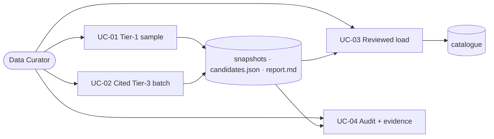

# SC-211 — Phase 2: Use cases

> **Purpose:** the actor goals and their flows (the one artifact where text leads) · **Derived from:** 01 · **Delta:** new UC-01…UC-04

## UC-01 — Run a sample directory ingestion

- **Primary actor:** Data Curator · **Supporting:** HMS, HFSAA, HMA, Photon (external)
- **Goal:** produce a geocoded, reconciled candidate batch + honest run report for three metros
- **Trigger:** curator starts the sample-ingestion command with a metro selection
- **Preconditions:** design approved; network to sources + Photon; metros/caps configured
- **Business rules:** BR-1 restaurants only · BR-2 metro allowlist · BR-3 confirmed Photon match only · BR-4 highest tier wins provenance, all claims kept · BR-5 every fetched row accounted for · BR-6 throttled, identified client, no prohibited scraping · BR-6a Tier-1 claim ⇒ `VERIFIED` + hand-cut, else `UNVERIFIED` + `NULL`

**Main success scenario**

1. Curator selects Dallas, NYC, Toronto and per-metro caps (15–25), then starts.
2. System requests the HMS certified-restaurant directory (throttled).
3. System discovers HFSAA chapter links and requests the New York chapter.
4. System requests the HMA GTA list and the sampled detail pages.
5. System filters fetched rows to restaurants inside the metro city allowlists.
6. System geocodes each row via Photon; accepts only confirmed matches.
7. System reconciles same-venue rows, merges claims, records the intended verification outcome.
8. System writes raw snapshots, `candidates.json` (outcome/basis), and `report.md`.
9. System reports per-source/per-metro counts and rejected rows with reasons.

**Flows**

| ID | From | Condition → flow | Ends in |
|---|---|---|---|
| A1 | 4 | Several branches/entries → one source listing each | Step 7 reconciliation |
| A2 | 2 | HMS unavailable → ShariahBoard table fallback, recorded | Step 3 |
| A3 | 6 | Fewer rows than the cap → continue, report the shortfall | Step 8 |
| A4 | — | Repeat run → cached snapshots, no fetch | Step 8, marked cache-sourced |
| E1 | 2–4 | Source unreachable → `SOURCE_UNAVAILABLE`, run continues | Partial report |
| E2 | 6 | Photon down → abort before publishing candidates | `Aborted`, no candidates file |
| E3 | 2–4 | Parse failure → `SOURCE_PARSE_FAILED` quarantine | Source skipped; follow-up |
| E4 | 5 | Zero metro matches → reported | No load for that metro |
| E5 | 6 | Wrong-region/ambiguous match → row rejected with the match | Reject list |

- **Postconditions:** success — artifacts exist, every fetched row classified, no DB writes; failure — no candidates artifact published as success.
- **Data:** read — directory pages, geocoder results · created — artifact files only
- **ACs:** AC-1, AC-2, AC-3, AC-5, AC-8 · **Open:** Q-1, Q-2, Q-6

## UC-02 — Compile a cited manual Tier-3 batch

- **Primary actor:** Data Curator · **Supporting:** Zabihah public pages, founder research (secondary), Photon
- **Goal:** hand-curate a cited Zabihah sample and merge it into the candidate batch by tier priority
- **Trigger:** curator decides to include the Tier-3 sample
- **Preconditions:** research reviewed; run artifact directory exists or is created
- **Business rules:** BR-7 hand-curated only, no scraping · BR-8 every row has a URL + access date · BR-9 Tier-3 never sets `VERIFIED` or hand-cut · BR-10 merge follows UC-01 BR-4

**Main success scenario**

1. Curator consults a small set of public Zabihah listings and the founder research.
2. Curator records each venue: name, address, city, region, country, URL, access date, tier 3.
3. System validates the curated file against the manual-entry schema.
4. System geocodes each valid row via Photon with match-confirmation.
5. System merges with Tier-1 candidates (Tier-1 keeps provenance + `VERIFIED`; Tier-3 claim added).
6. System updates `candidates.json` and `report.md`.
7. System reports merged/rejected manual rows with reasons.

**Flows**

| ID | From | Condition → flow | Ends in |
|---|---|---|---|
| A1 | 2 | Partial address → accept with `NULL` structured fields | Gap noted |
| A2 | 1 | Page unavailable → cite research as secondary, or omit | Row dropped or secondary |
| E1 | 3 | Invalid entry → `INVALID_MANUAL_ENTRY` with field detail | Rest proceeds |
| E2 | 4 | No confirmed geocode → reject; never reuse coordinates | Reject list |
| E3 | 5 | Duplicate of a Tier-1 candidate → merged | `DUPLICATE_MERGED` |

- **Postconditions:** success — curated rows validated, geocoded, merged, reported; failure — invalid rows rejected, rest proceeds.
- **Data:** read — pages/research · created/updated — curated input, `candidates.json`, `report.md`
- **ACs:** AC-2, AC-3, AC-5, AC-8 · **Open:** Q-2, Q-6

## UC-03 — Load a reviewed ingestion batch into the catalog

- **Primary actor:** Data Curator · **Supporting:** none external; existing search API for verification
- **Goal:** turn an approved batch into searchable listings with the correct trust outcome, provenance, and claims — idempotently
- **Trigger:** curator generates the catalogue update from the approved candidates and merges it
- **Preconditions:** artifacts reviewed; V22 schema merged; database available
- **Business rules:** BR-11 `VERIFIED` + hand-cut iff a Tier-1 claim backs the row · BR-12 idempotent · BR-13 one transaction per batch · BR-14 matched rows upgrade, never duplicate/skip · BR-15 brands upsert before locations

**Main success scenario**

1. Curator asks for the catalogue update from the approved `candidates.json`.
2. System generates the Flyway migration (brands, listings, upgrades, claims, projection) + diff summary.
3. Curator reviews the migration and diff, then merges it.
4. System applies pending migrations at startup in one transaction.
5. System reports applied counts (inserted, upgraded, skipped).
6. Curator verifies search per metro, Verified display, and the hand-cut filter on the live stack.
7. Curator records the batch and evidence in the traceability matrix.

**Flows**

| ID | From | Condition → flow | Ends in |
|---|---|---|---|
| A1 | 2 | Some rows previously rejected → survivors only | Header references report |
| A2 | 4 | Already applied → no-op | Counts zero |
| A3 | 4 | Matched existing row → upgrade to `VERIFIED` + hand-cut | Claim attached, no duplicate |
| E1 | 4 | Constraint violation → transaction rolls back | No partial load |
| E2 | 4 | Schema missing → fail fast | V22 first |
| E3 | 6 | Missing/wrong trust state → blocking | Not accepted until fixed |

- **Postconditions:** success — new/upgraded listings with correct trust + claims, searchable, idempotent; failure — no partial load.
- **Data:** created — listings, upgrades, claims, projection, migration · read — search results
- **ACs:** AC-4, AC-5, AC-6, AC-7 · **Open:** none blocking (D-4 design decision)

## UC-04 — Audit an ingestion run and record evidence

- **Primary actor:** Data Curator · **Supporting:** cited source URLs (spot-checks)
- **Goal:** confirm the run is honest and complete, record evidence, track gaps as stories
- **Trigger:** curator opens the run report
- **Preconditions:** a run completed (UC-01/02); optionally loaded (UC-03)
- **Business rules:** BR-16 every fetched row accounted for · BR-17 spot-check rows against citations · BR-18 gaps become stories, not TODOs · BR-19 `VERIFIED`/hand-cut without a claim is blocking

**Main success scenario**

1. Curator opens the run report.
2. System presents per-source/metro counts, rejects, suspected duplicates, claims/basis coverage, gaps.
3. Curator spot-checks a sample of rows against their cited URLs.
4. Curator records evidence in the traceability matrix.
5. Curator raises follow-ups as Shortcut stories.

**Flows**

| ID | From | Condition → flow | Ends in |
|---|---|---|---|
| A1 | 2 | Source failed → record and raise a re-run/fix story | Gap recorded |
| A2 | 2 | Metro shortfall → record as a known gap with cause | Gap recorded |
| E1 | 2 | Unaccounted fetched row → blocking | Run not accepted |
| E2 | 3 | Spot-check mismatch → blocking | Quarantine + re-run |
| E3 | 2 | `VERIFIED`/hand-cut without a claim → blocking | Generator must refuse |

- **Postconditions:** success — report accepted, evidence recorded, gaps tracked; failure — no load until fixed.
- **Data:** read — artifacts · created — traceability entries, follow-up stories
- **ACs:** AC-8 · **Open:** Q-3, Q-4 (recorded, not resolved)
