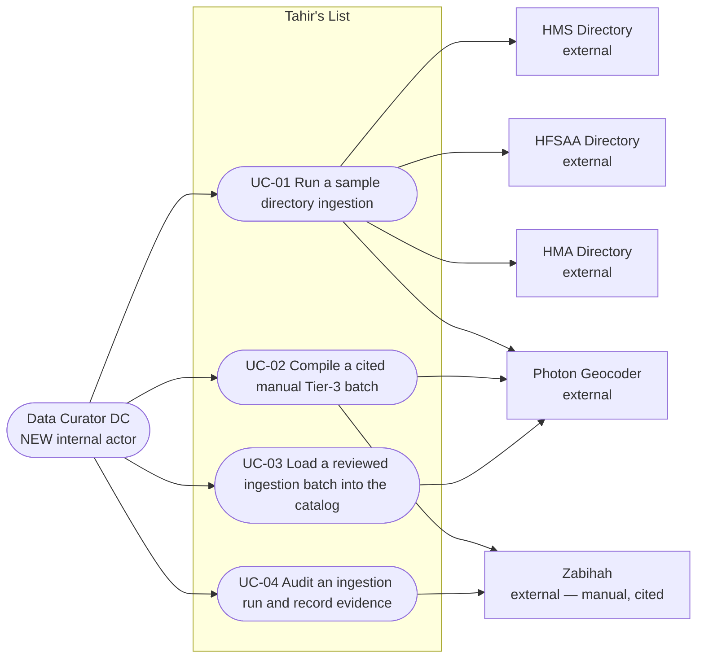
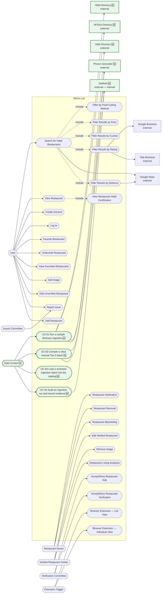

# SC-211 — Phase 3: Use case diagram

**System boundary:** "Tahir's List".

## 1. This feature's use cases

Notes:

- **No `«include»` relationships.** The geocoding/confirmation step is shared by
  UC-01 and UC-02, but it is an internal step of those goals, not an actor goal
  in its own right; modelling it as an included use case would add a diagram
  without adding meaning. `UC-04` reads the artifacts of `UC-01`/`UC-02` but is
  independently triggered by the curator, so it is an association, not an
  extend.
- UC-03's external participant is the live search surface, which is *inside*
  Tahir's List; the diagram shows only the external directory/geocoder
  dependencies.
- The Data Curator talks to the system through the containerized sample
  command, the curated batch file, the generated catalog update, and the run
  report — all internal tooling surfaces, not end-user product routes.

## 2. Updated system-wide use case diagram

New items are marked **🆕**; everything else is the existing, agreed model from
Shortcut's *Use Case Diagram* document.

## 3. Legend

| Mark | Meaning |
|---|---|
| 🆕 / green | New in SC-211 |
| plain | Existing, agreed model (unchanged) |
| dotted arrow | `«include»` |
| solid arrow | actor association / external dependency |

## 4. Known gaps

- The **Data Curator** is a new actor. The README persona table has no internal
  operations persona; D-1 asks the founder to ratify the naming and home of this
  actor.
- `Compose candidate batch`, `Generate catalog update` are *steps*, not
  use cases; they are intentionally not drawn at this level.
