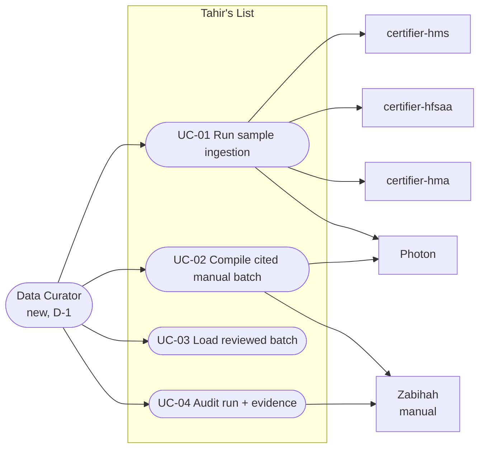
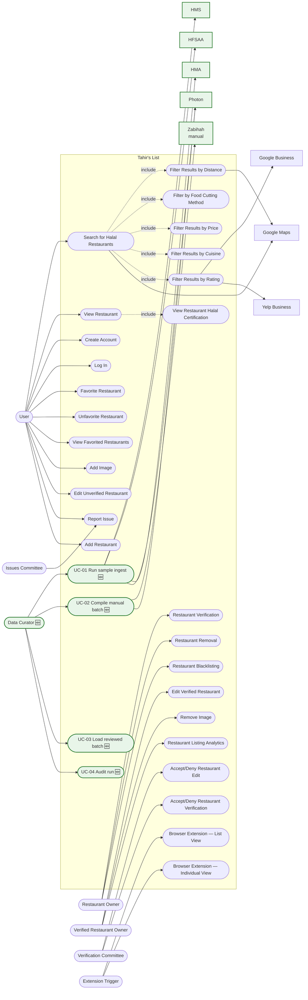

# SC-211 — Phase 3: Use case diagram

> **Purpose:** place the new use cases against the agreed system model · **Derived from:** 02 · **Delta:** new UC-01…UC-04 + new actor DC

## Feature scope

Each Tier-1 dependency is a standalone module with its own domain model; the `:ingestion` translators sit between it and the app (D-12).

No `«include»`: the shared geocoding step is internal to UC-01/02, not an actor goal. UC-04 is independently triggered.

## System-wide (new items green)

| Mark | Meaning |
|---|---|
| 🆕 / green | New in SC-211 |
| Solid arrow | Actor association / external dependency |
| Dotted arrow | `«include»` |

Known gap: the Data Curator is a new internal actor; README/Shortcut persona table update follows D-1.
