# SC-211 — Phase 4: Black-box — UC-01 Run a sample directory ingestion

> **Purpose:** actor-visible behaviour of the Tier-1 sample run · **Derived from:** 02 UC-01 · **Delta:** new
> **Security:** external trust data enters here; no auth surface; no PII; integrity = no invented locations / no silent drops.

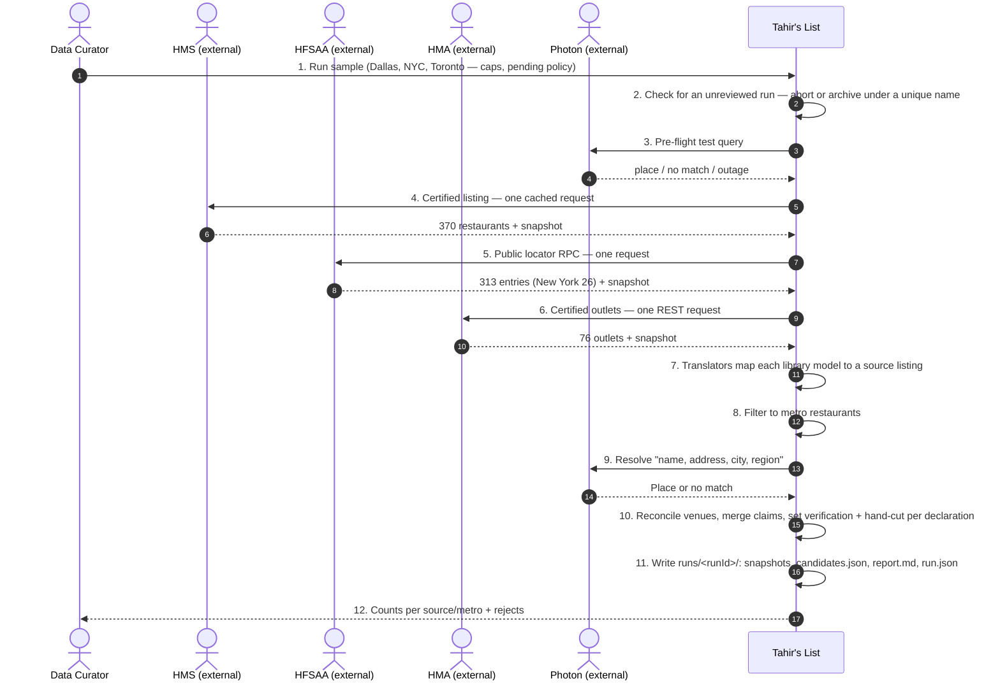
**A1 — several entries** · one source listing per entry.
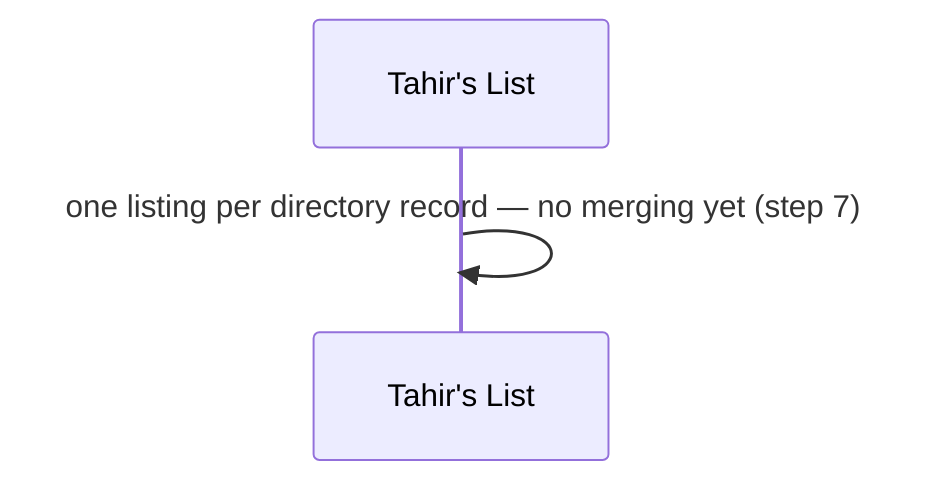
**A2 — HMS unavailable** · fail that source, keep the others.
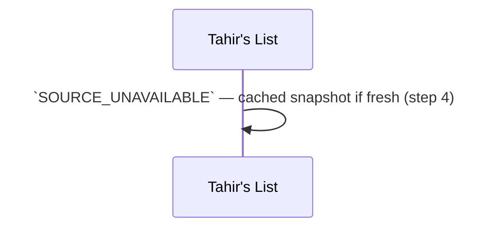
**A3 — below cap** · continue, report the shortfall.
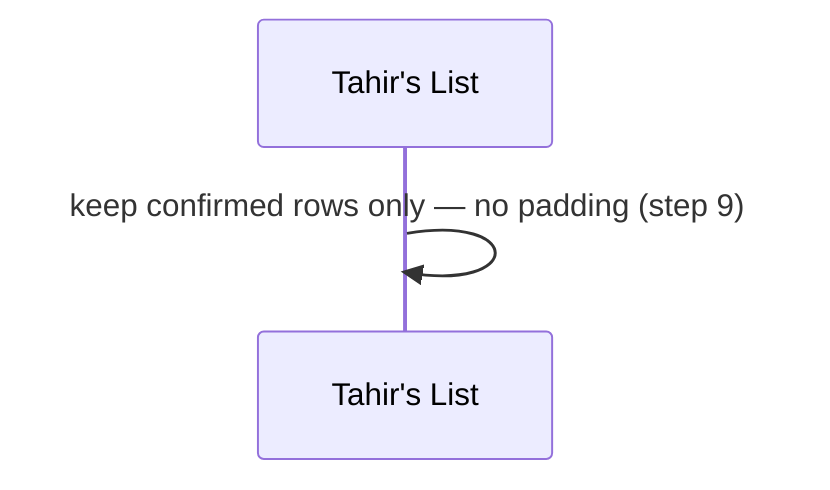
**P1 — unreviewed run exists** · abort or archive, never overwrite.
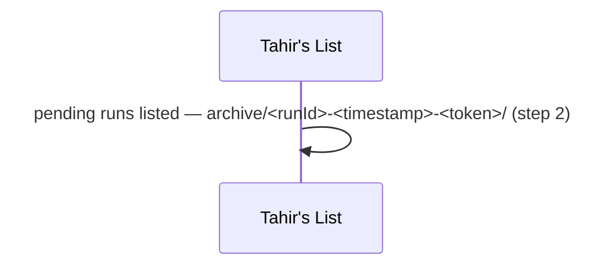
**P2 — Photon down at pre-flight** · abort before any fetch.
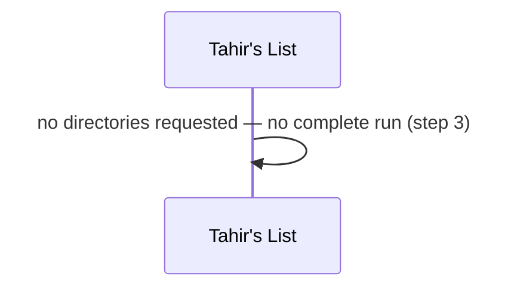
**E1 — source unreachable** · `SOURCE_UNAVAILABLE`, run continues.
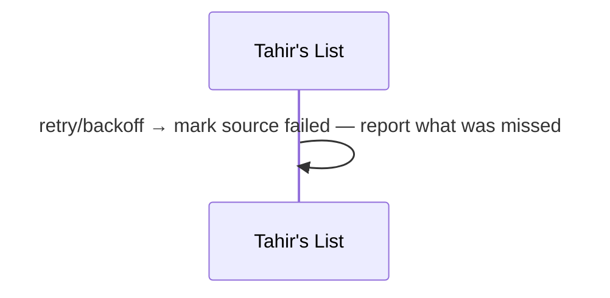
**E2 — Photon down mid-run** · abort; no manifest, so the run is incomplete.
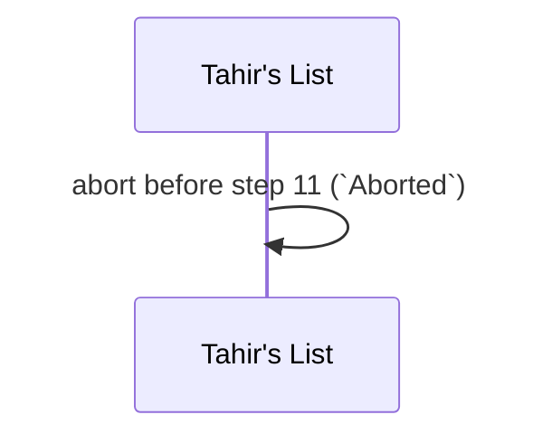
**E3 — source format changed** · quarantine, run continues.
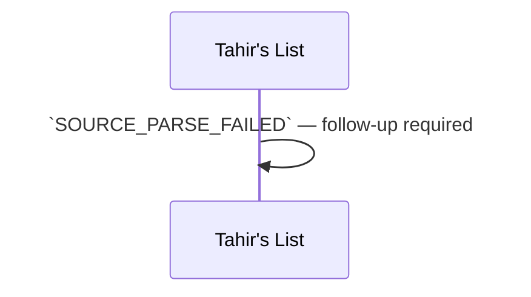
**E4 — zero metro matches** · reported; no load.
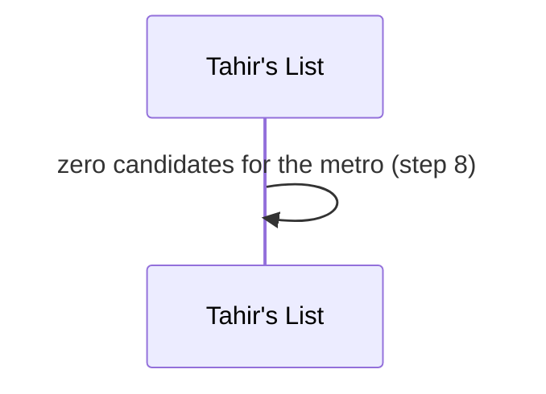
**E5 — bad geocode** · reject, coordinates never taken.
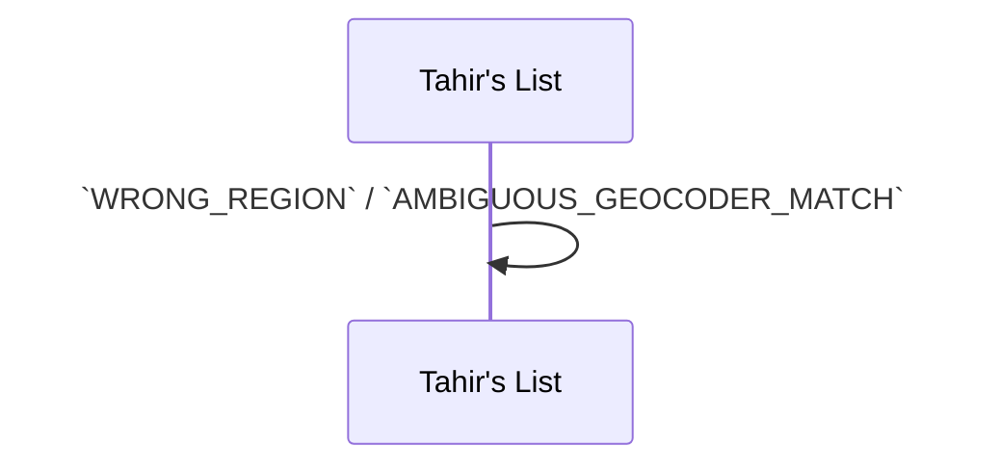
**E6 — HFSAA key rotated** · re-discover once from the public bundle.
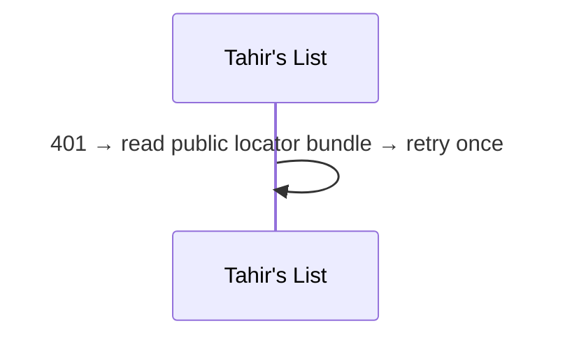
**E7 — HMS city blank** · derive from the address, or leave unknown.
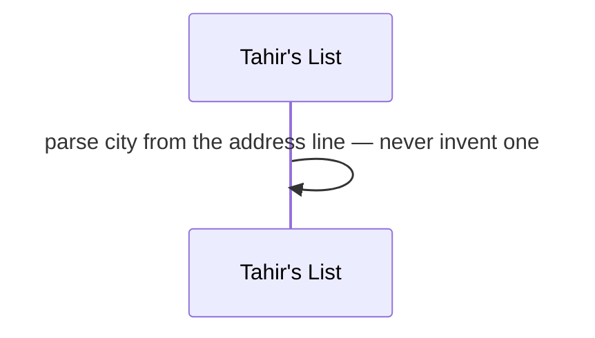
