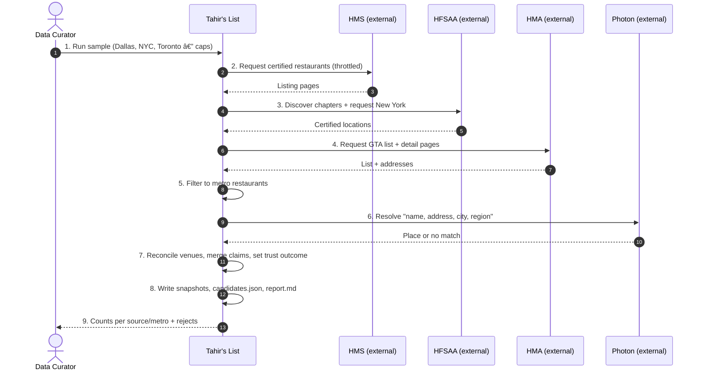
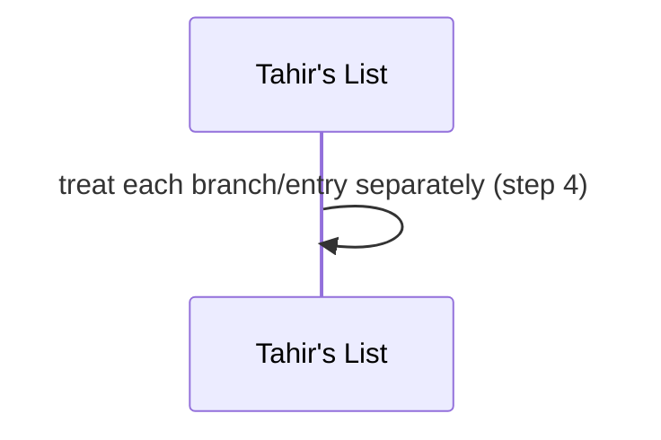
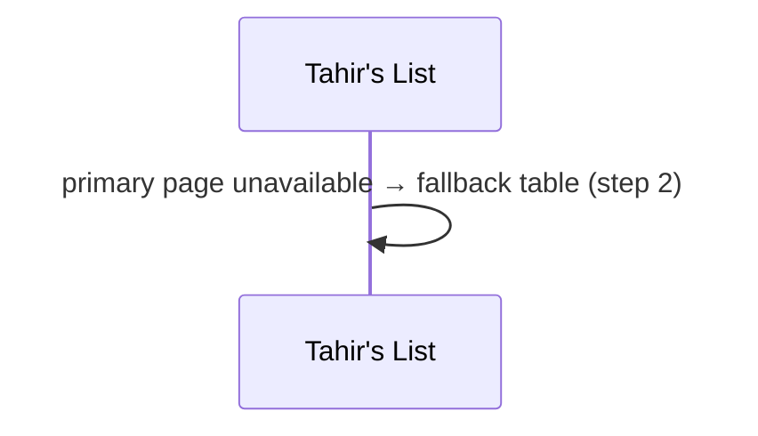
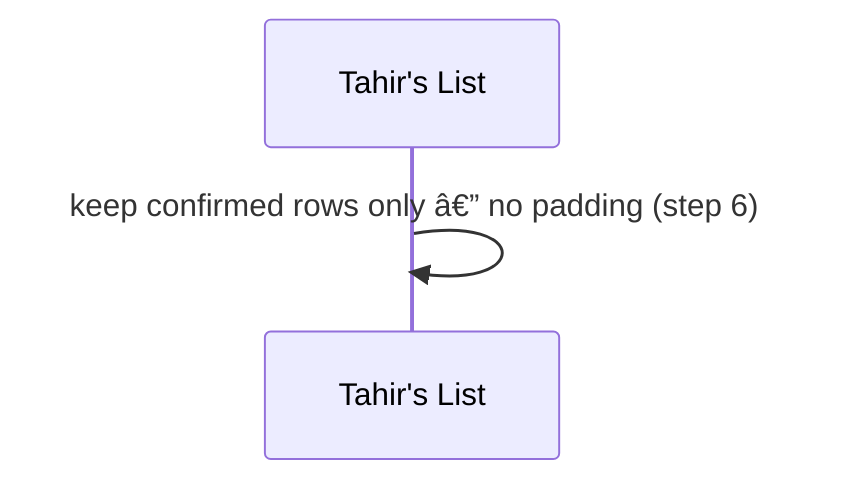
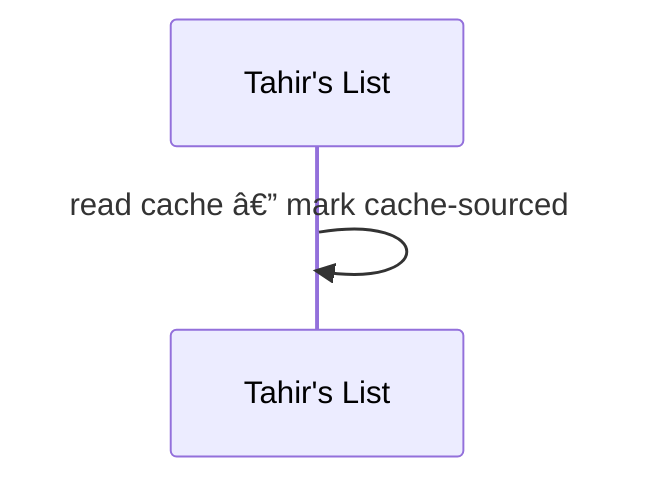
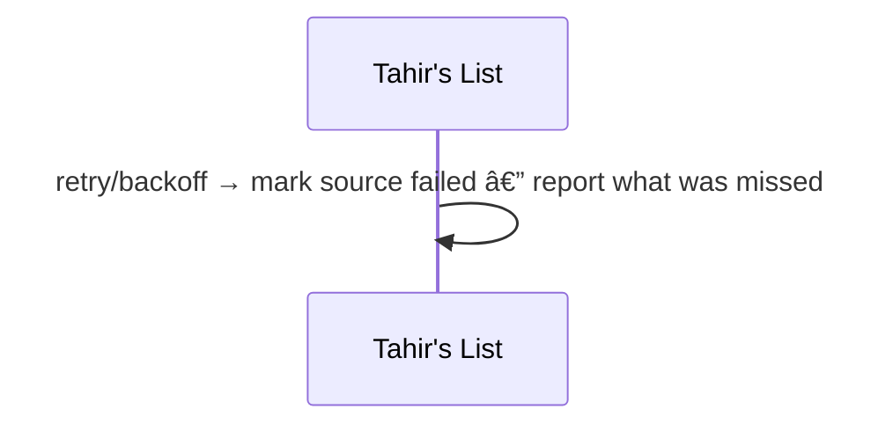
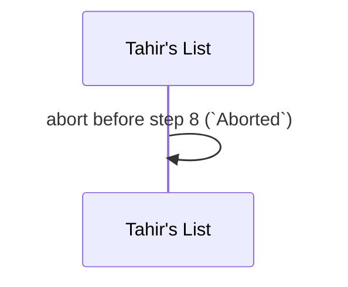
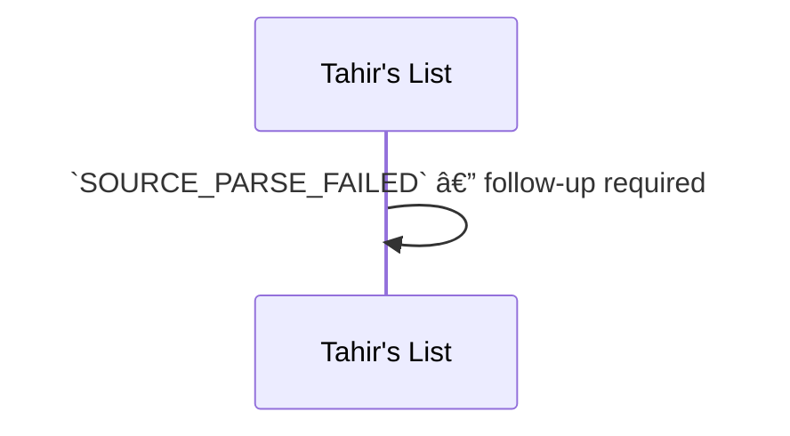
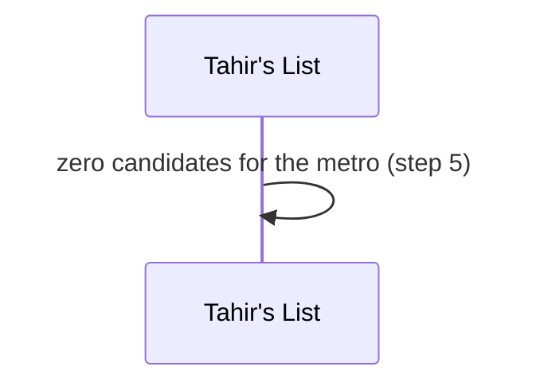
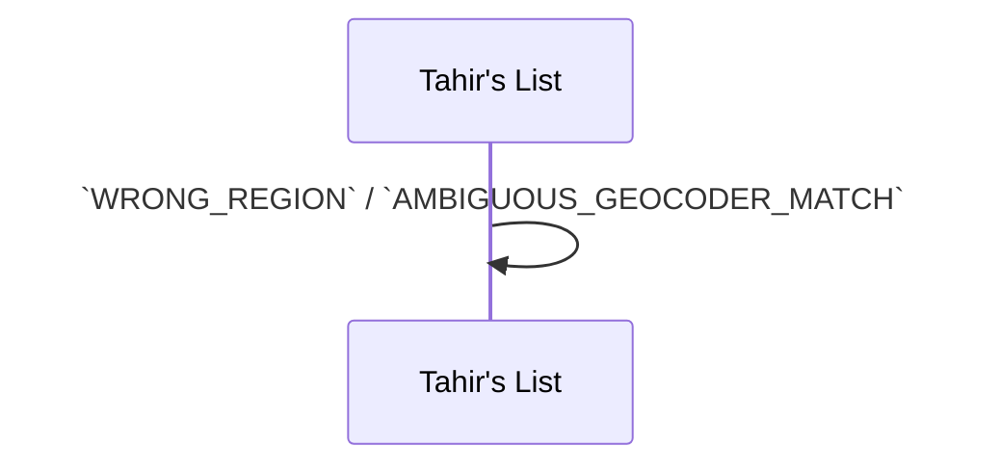

# SC-211 — Phase 4: Black-box — UC-01 Run a sample directory ingestion

> **Purpose:** actor-visible behaviour of the Tier-1 sample run · **Derived from:** 02 UC-01 · **Delta:** new
> **Security:** external trust data enters here; no auth surface; no PII; integrity = no invented locations / no silent drops.

**A1 — several branches** · one source listing per entry.

**A2 — HMS fallback** · ShariahBoard table used and recorded.

**A3 — below cap** · continue, report the shortfall.

**A4 — repeat run** · cached snapshots, no fetch.

**E1 — source unreachable** · `SOURCE_UNAVAILABLE`, run continues.

**E2 — Photon down** · abort; no candidates artifact.

**E3 — source format changed** · quarantine, run continues.

**E4 — zero metro matches** · reported; no load.

**E5 — bad geocode** · reject, coordinates never taken.

