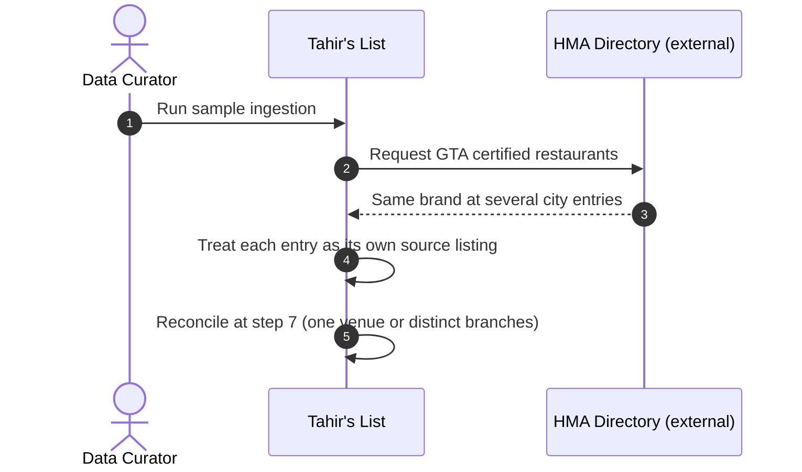
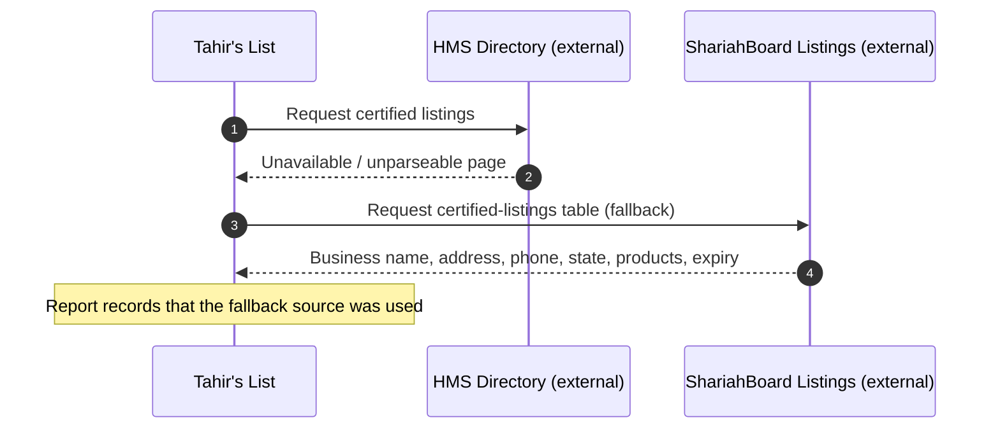

# SC-211 — Phase 4: Black-box sequence — UC-01 Run a sample directory ingestion

> **Security / trust flags:** externally sourced establishments and certification
> claims enter the system through this flow; data integrity (no invented
> locations, no silent drops) is the security-relevant property. No authentication
> surface is exposed; the operator runs a local tool. No PII is ingested.

**Actor:** Data Curator.
**External services (opaque):** HMS Directory, HFSAA Directory, HMA Directory,
Photon Geocoder.

## Main success scenario

```mermaid
sequenceDiagram
  autonumber
  actor DC as Data Curator
  participant TL as Tahir's List
  participant HMS as HMS Directory (external)
  participant HFSAA as HFSAA Directory (external)
  participant HMA as HMA Directory (external)
  participant PH as Photon Geocoder (external)

  DC->>TL: 1. Run sample ingestion (Dallas, NYC, Toronto; caps 15–25)
  TL->>HMS: 2. Request certified restaurant listings (throttled)
  HMS-->>TL: Listing pages (name, address, city/state, phone, products, expiry)
  TL->>HFSAA: 3. Discover chapter links, request New York chapter
  HFSAA-->>TL: Certified locations for the chapter
  TL->>HMA: 4. Request GTA certified restaurants + detail pages
  HMA-->>TL: City-grouped restaurant list + addresses
  TL->>TL: 5. Keep only restaurants inside the selected metro city allowlists
  TL->>PH: 6. Resolve "name, address, city, region"
  PH-->>TL: Candidate place or no match
  TL->>TL: 7. Reconcile same-venue rows (tier priority; merge claims)
  TL->>TL: 8. Write raw snapshots, candidates.json, report.md
  TL-->>DC: 9. Counts per source/metro + rejected rows with reasons
```

## Alternate flows

**A1 — a venue appears under several branches/records (from step 4)**



**A2 — HMS primary page unavailable; documented fallback (from step 2)**



**A3 — fewer rows than the cap survive (from step 6)**

```mermaid
sequenceDiagram
  autonumber
  participant TL as Tahir's List
  participant PH as Photon Geocoder (external)
  TL->>PH: Resolve candidates
  PH-->>TL: Some rows unmatched
  TL->>TL: Keep confirmed rows only (below cap)
  Note over TL: Report states the shortfall honestly; no padding
```

**A4 — repeat run within the cache window**

```mermaid
sequenceDiagram
  autonumber
  actor DC as Data Curator
  participant TL as Tahir's List
  DC->>TL: Re-run the same selection
  TL->>TL: Read snapshots from the local cache
  Note over TL: No external fetch; report marks cached snapshots
```

## Exception flows

**E1 — a source is unreachable or rate-limited after retries (from steps 2–4)**

```mermaid
sequenceDiagram
  autonumber
  participant TL as Tahir's List
  participant SRC as Directory source (external)
  TL->>SRC: Request listings (with backoff/retry)
  SRC-->>TL: Timeout / HTTP error / 429
  TL->>TL: Mark this source SOURCE_UNAVAILABLE
  Note over TL: Run continues with remaining sources; the report names exactly what was not fetched
```

**E2 — Photon unavailable (from step 6)**

```mermaid
sequenceDiagram
  autonumber
  participant TL as Tahir's List
  participant PH as Photon Geocoder (external)
  TL->>PH: Resolve candidates
  PH-->>TL: Unreachable
  TL->>TL: Abort the run (Aborted state)
  Note over TL: No candidates artifact is published as a success; the report records the outage
```

**E3 — a source's page format changed (parse failure, from steps 2–4)**

```mermaid
sequenceDiagram
  autonumber
  participant TL as Tahir's List
  participant SRC as Directory source (external)
  TL->>SRC: Request listings
  SRC-->>TL: Unexpected page shape
  TL->>TL: Quarantine source as SOURCE_PARSE_FAILED
  Note over TL: Run continues; a follow-up story is required by UC-04
```

**E4 — zero rows match a metro (from step 5)**

```mermaid
sequenceDiagram
  autonumber
  participant TL as Tahir's List
  TL->>TL: Filter fetched rows to the metro allowlist
  Note over TL: Zero candidates for that metro → reported; no load can proceed for an empty metro
```

**E5 — ambiguous or wrong-region geocode (from step 6)**

```mermaid
sequenceDiagram
  autonumber
  participant TL as Tahir's List
  participant PH as Photon Geocoder (external)
  TL->>PH: Resolve "name, address, city, region"
  PH-->>TL: Match in a different region / several plausible matches
  TL->>TL: Reject row (WRONG_REGION / AMBIGUOUS_GEOCODER_MATCH)
  Note over TL: Query and rejected match recorded for review; no coordinates taken
```

## Coverage check

| UC-01 step | Black-box message |
|---|---|
| 1 | 1 |
| 2 | 2 |
| 3 | 3 |
| 4 | 4 |
| 5 | 5 |
| 6 | 6 |
| 7 | 7 |
| 8 | 8 |
| 9 | 9 |

All alternates (A1–A4) and exceptions (E1–E5) have a fragment above.
