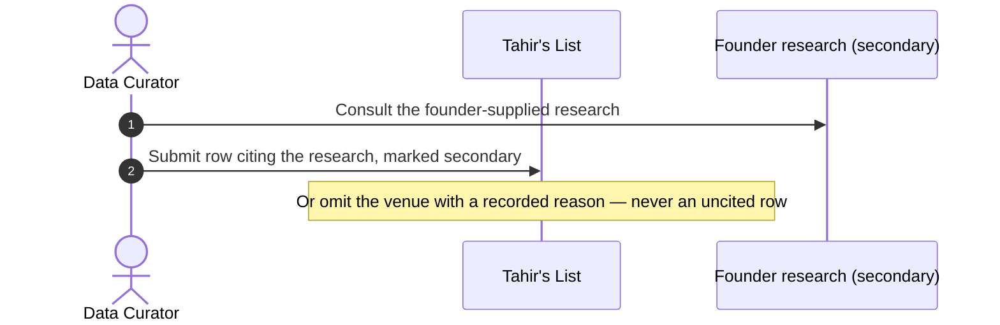
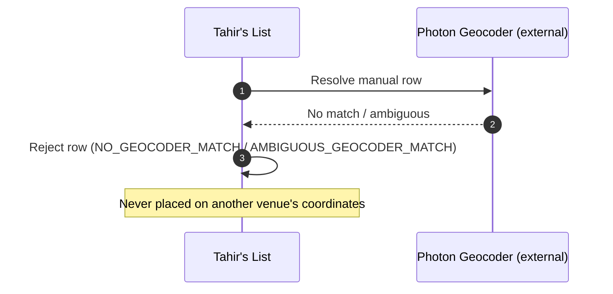

# SC-211 — Phase 4: Black-box sequence — UC-02 Compile a cited manual Tier-3 batch

> **Security / trust flags:** a crowdsourced source (Zabihah) enters only through
> hand curation with per-row citations; no scraping. A Tier-3 observation must
> never produce a hand-cut assertion and must never set `VERIFIED`.
> Terms-of-service compliance is a review concern for Omar.

**Actor:** Data Curator.
**External services (opaque):** Zabihah public listing pages; the
founder-supplied research document (secondary source); Photon Geocoder.

## Main success scenario

```mermaid
sequenceDiagram
  autonumber
  actor DC as Data Curator
  participant TL as Tahir's List
  participant ZAB as Zabihah (external, manual)
  participant PH as Photon Geocoder (external)

  DC->>ZAB: 1. Consult a small set of public listing pages
  ZAB-->>DC: Venue details (name, address, halal flags)
  DC->>TL: 2. Submit curated batch (row = venue + source URL + access date)
  TL->>TL: 3. Validate the batch against the manual-entry schema
  TL->>PH: 4. Resolve "name, address, city, region"
  PH-->>TL: Confirmed place or no match
  TL->>TL: 5. Merge with Tier-1 candidates (Tier-1 wins, verified; manual rows stay unverified)
  TL->>TL: 6. Update candidates.json and report.md
  TL-->>DC: 7. Merged/rejected manual rows with reasons
```

## Alternate flows

**A1 — a venue has a partial address (from step 2)**

```mermaid
sequenceDiagram
  autonumber
  actor DC as Data Curator
  participant TL as Tahir's List
  DC->>TL: Submit row without postal code
  TL->>TL: Accept with NULL structured fields
  Note over TL: Report notes the address gap; no value is guessed
```

**A2 — the public page is unavailable (from step 1)**



## Exception flows

**E1 — invalid manual entry (from step 3)**

```mermaid
sequenceDiagram
  autonumber
  participant TL as Tahir's List
  TL->>TL: Validate entry (citation, required fields)
  TL->>TL: Reject entry (INVALID_MANUAL_ENTRY) with field-level reason
  Note over TL: Remaining entries proceed; the batch is not blocked
```

**E2 — no confirmed geocode (from step 4)**



**E3 — duplicate of a Tier-1 candidate (from step 5)**

```mermaid
sequenceDiagram
  autonumber
  participant TL as Tahir's List
  TL->>TL: Match manual row to an existing Tier-1 candidate
  TL->>TL: Merge (Tier-1 keeps provenance; Tier-3 claim added)
  Note over TL: Report marks the row DUPLICATE_MERGED
```

## Coverage check

Every UC-02 step (1–7) appears as a numbered message; A1–A2 and E1–E3 each have
a fragment.
