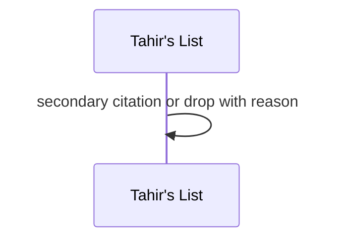
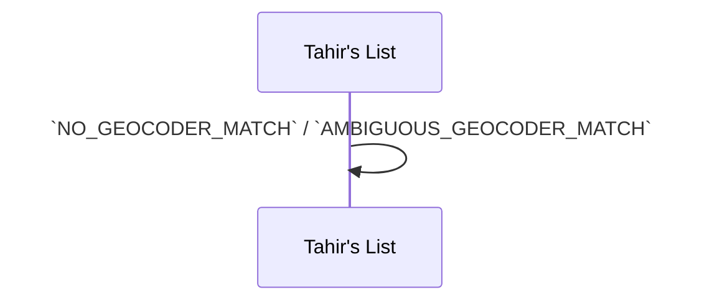

# SC-211 — Phase 4: Black-box — UC-02 Compile a cited manual Tier-3 batch

> **Purpose:** actor-visible behaviour of the hand-curated sample · **Derived from:** 02 UC-02 · **Delta:** new
> **Security:** crowdsourced data enters only via citations; Tier-3 must never set `VERIFIED` or hand-cut; ToS review by Omar.

```mermaid
sequenceDiagram
  autonumber
  actor DC as Data Curator
  participant TL as Tahir's List
  participant ZAB as Zabihah (external)
  participant PH as Photon (external)
  DC->>ZAB: 1. Consult a small set of public listings
  ZAB-->>DC: Venue details
  DC->>TL: 2. Submit curated file (URL + access date per row)
  TL->>TL: 3. Validate manual-entry schema
  TL->>PH: 4. Resolve each row; confirm match
  PH-->>TL: Place or no match
  TL->>TL: 5. Merge (Tier-1 keeps `VERIFIED`; Tier-3 claim added)
  TL->>TL: 6. Update candidates.json + report.md
  TL-->>DC: 7. Merged/rejected rows with reasons
```

**A1 — partial address** · accept with `NULL` fields.

```mermaid
sequenceDiagram
  participant TL as Tahir's List
  TL->>TL: `NULL` structured fields; report the gap
```

**A2 — page unavailable** · cite research as secondary, or omit.



**E1 — invalid entry** · `INVALID_MANUAL_ENTRY`.

```mermaid
sequenceDiagram
  participant TL as Tahir's List
  TL->>TL: reject with field detail; rest proceeds
```

**E2 — no geocode** · reject; never reuse coordinates.



**E3 — duplicate of Tier-1** · merged, marked.

```mermaid
sequenceDiagram
  participant TL as Tahir's List
  TL->>TL: `DUPLICATE_MERGED`; Tier-1 stays the listing
```
