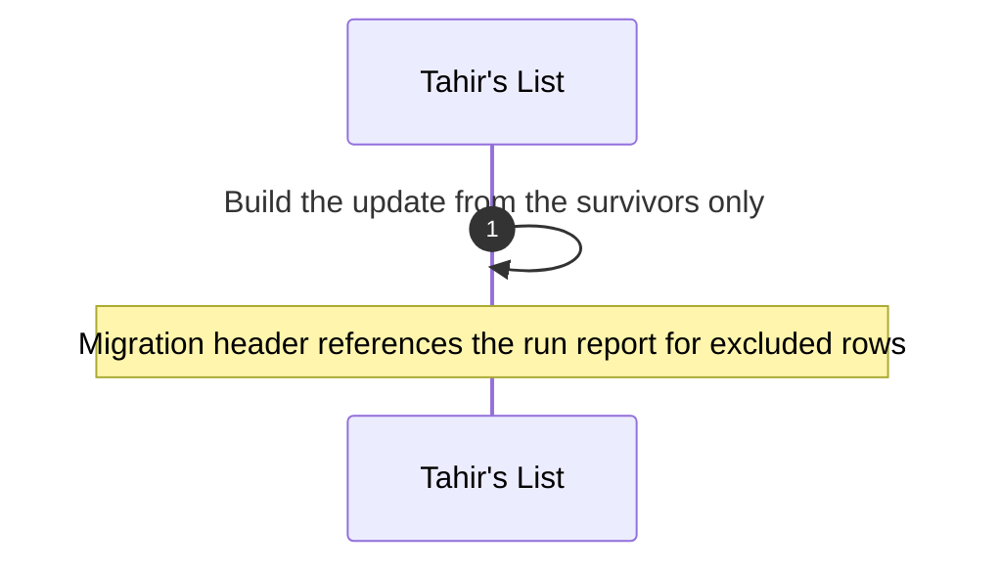
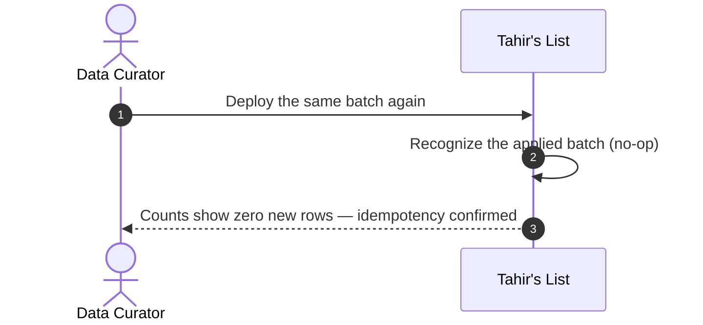

# SC-211 — Phase 4: Black-box sequence — UC-03 Load a reviewed ingestion batch into the catalog

> **Security / trust flags:** this is the only flow that writes to the catalog.
> Tier-1 writes are `VERIFIED` + hand-cut on the certifier's authority (founder
> ruling) and must always be claim-backed; manual Tier-3 writes stay
> `UNVERIFIED`. The generated migration is reviewed before merge
> (supply-chain-of-code control). Idempotency and upgrade-on-match are
> correctness properties, not conveniences.

**Actor:** Data Curator.
**External services:** none. The catalog, migration execution, and search are
inside Tahir's List.

## Main success scenario

```mermaid
sequenceDiagram
  autonumber
  actor DC as Data Curator
  participant TL as Tahir's List

  DC->>TL: 1. Generate catalog update from approved candidates
  TL-->>DC: 2. Generated migration + diff summary (brands, verified/unverified listings, upgrades, claims, projection)
  DC->>TL: 3. Review and merge the generated update
  TL->>TL: 4. Apply pending migrations at startup (single transaction)
  TL-->>DC: 5. Applied counts (inserted / upgraded / skipped)
  DC->>TL: 6. Verify search per metro, Verified display + hand-cut-only filter
  TL-->>DC: 7. Tier-1 rows verified; manual rows unverified; provenance and claims intact
```

## Alternate flows

**A1 — the batch has previously rejected rows (from step 2)**



**A2 — the migration was already applied (from step 4)**



**A3 — a Tier-1 venue matches an existing row (from step 4)**

```mermaid
sequenceDiagram
  autonumber
  participant TL as Tahir's List
  TL->>TL: Match a Tier-1 candidate to an existing listing at the same location
  TL->>TL: Upgrade that listing to VERIFIED + hand-cut, attach the claim
  Note over TL: No duplicate; report records the upgrade (INV-11)
```

## Exception flows

**E1 — constraint violation (from step 4)**

```mermaid
sequenceDiagram
  autonumber
  participant TL as Tahir's List
  TL->>TL: Apply migration (provenance CHECK, claim FK, vocabulary)
  TL-->>TL: Violation
  TL->>TL: Roll back the migration transaction
  Note over TL: No partial catalog write; the app does not start on a half-applied batch; curator fixes and regenerates
```

**E2 — schema migration not yet applied (from step 4)**

```mermaid
sequenceDiagram
  autonumber
  participant TL as Tahir's List
  TL->>TL: Apply migrations in order
  Note over TL: Fails fast on the missing V22; merge V22 first, then the data batch
```

**E3 — a listing is not searchable or shows the wrong trust state after load (from step 6)**

```mermaid
sequenceDiagram
  autonumber
  actor DC as Data Curator
  participant TL as Tahir's List
  DC->>TL: Search the metro
  TL-->>DC: Listing missing, or Tier-1 row not Verified, or manual row wrongly Verified
  Note over TL: Blocking: investigate projection write, verification outcome, or cross-contamination gate; not accepted until fixed
```

## Coverage check

Every UC-03 step (1–7) appears as a numbered message; A1–A3 and E1–E3 each have a
fragment.
