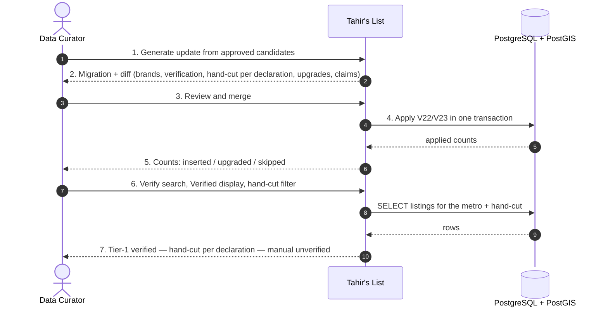
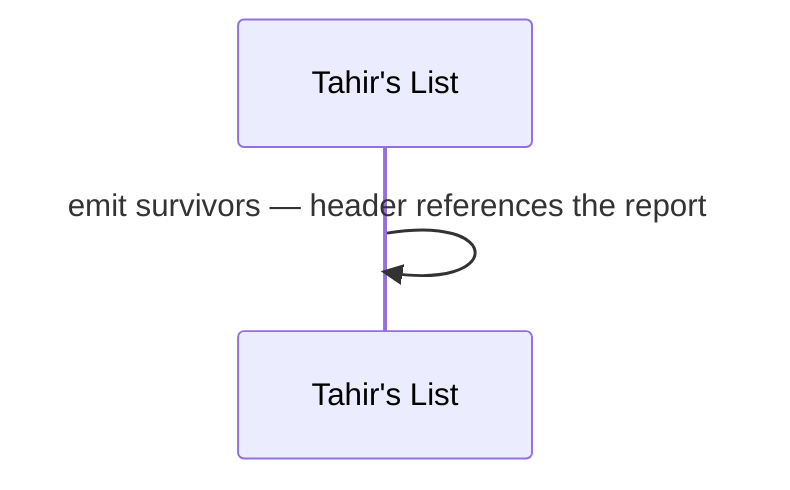
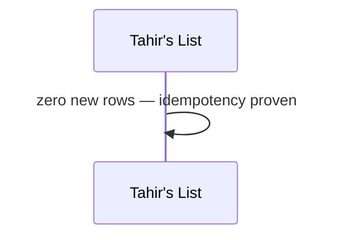
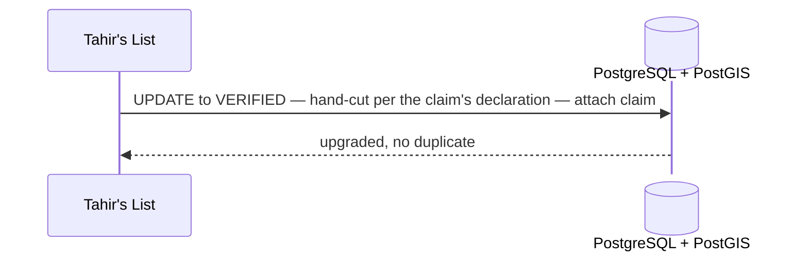
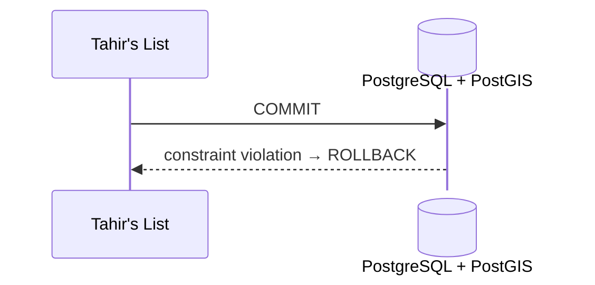
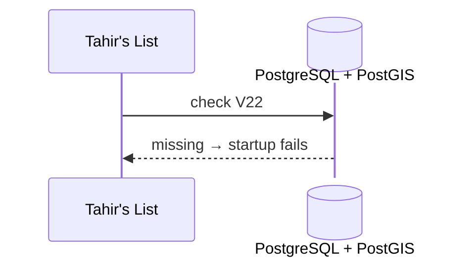
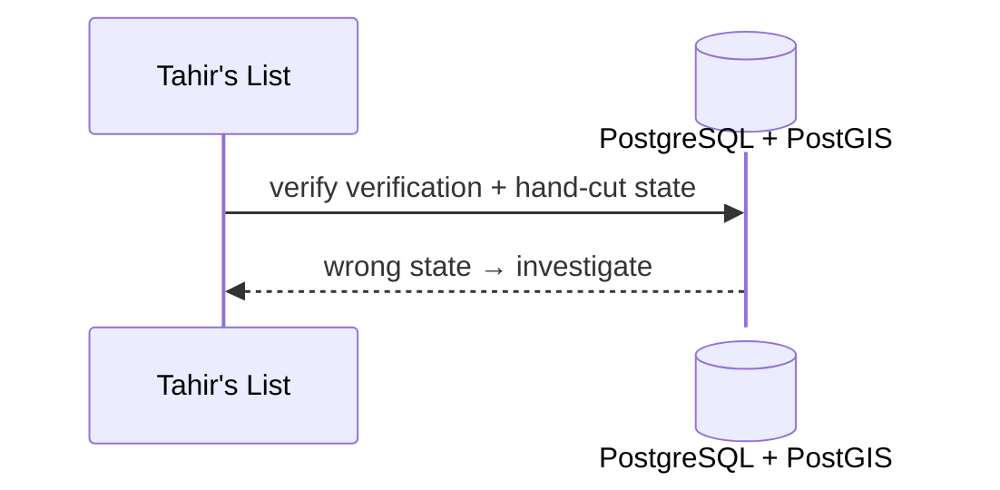

# SC-211 — Phase 4: Black-box — UC-03 Load a reviewed ingestion batch

> **Purpose:** actor-visible behaviour of the catalogue load · **Derived from:** 02 UC-03 · **Delta:** new
> **Security:** the only catalogue write; Tier-1 verified on certifier authority; manual rows unverified; reviewed before merge.

**A1 — rejected rows excluded** · survivors only.

**A2 — re-apply** · idempotent no-op.

**A3 — matched existing row** · upgrade, never duplicate.

**E1 — constraint violation** · rollback, no partial load.

**E2 — schema missing** · fail fast.

**E3 — missing/wrong trust state** · blocking.

