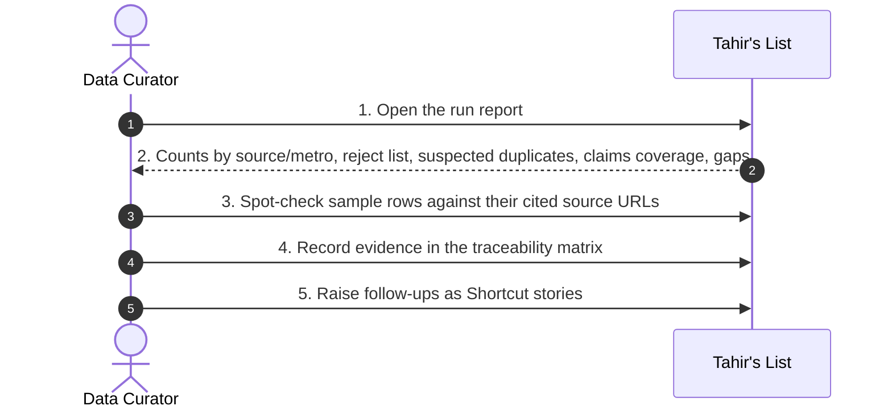
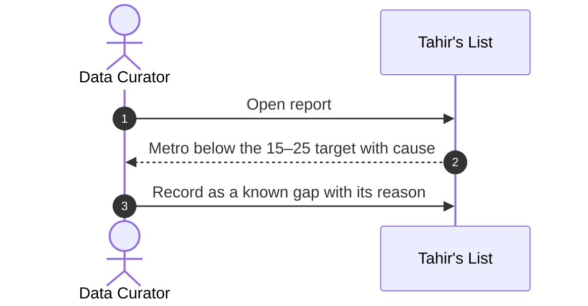

# SC-211 — Phase 4: Black-box sequence — UC-04 Audit an ingestion run and record evidence

> **Security / trust flags:** this flow is the amanah control: it is where the
> team proves that what was ingested is what was claimed, and that nothing was
> silently dropped. It reads artifacts only; it never mutates the catalog.

**Actor:** Data Curator.
**External services:** the cited source URLs (opaque, opened for spot-checks).

## Main success scenario



## Alternate flows

**A1 — a source failed during the run (from step 2)**

```mermaid
sequenceDiagram
  autonumber
  actor DC as Data Curator
  participant TL as Tahir's List
  DC->>TL: Open report
  TL-->>DC: Source marked failed; counts exclude it
  DC->>TL: Record the failure and raise a re-run/fix story
```

**A2 — metro shortfall (from step 2)**



## Exception flows

**E1 — a fetched row is unaccounted for (from step 2)**

```mermaid
sequenceDiagram
  autonumber
  participant TL as Tahir's List
  TL->>TL: Reconcile fetched rows vs candidates + rejects
  TL-->>TL: Row missing from both
  Note over TL: Blocking defect: the run is not accepted; fix accounting before loading
```

**E2 — a spot-check does not match its cited source (from step 3)**

```mermaid
sequenceDiagram
  autonumber
  actor DC as Data Curator
  participant TL as Tahir's List
  participant SRC as Cited source URL (external)
  DC->>SRC: Open the citation
  SRC-->>DC: Details differ from the candidate
  DC->>TL: Quarantine the row and investigate (parser vs merge)
  Note over TL: Blocking defect; the run is re-executed after the fix
```

**E3 — a VERIFIED/hand-cut row lacks a backing claim (from step 2)**

```mermaid
sequenceDiagram
  autonumber
  participant TL as Tahir's List
  TL->>TL: Check every VERIFIED / is_hand_cut = TRUE row for a Tier-1 claim
  TL-->>TL: Missing claim found
  Note over TL: Blocking against INV-3/INV-12; the generator must refuse VERIFIED or TRUE without a claim
```

## Coverage check

Every UC-04 step (1–5) appears as a numbered message; A1–A2 and E1–E3 each have a
fragment.
