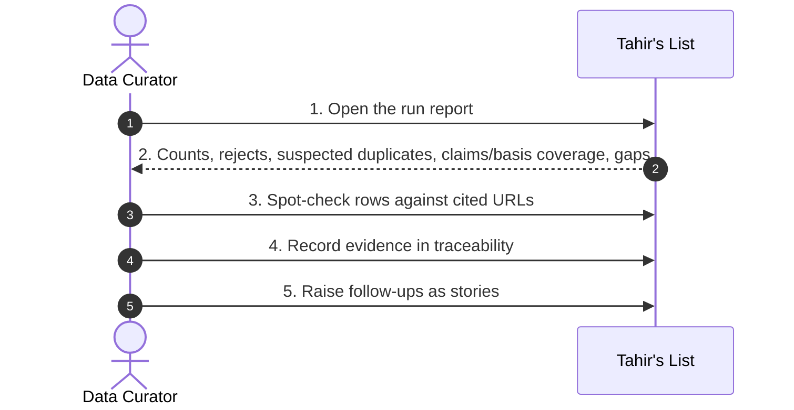
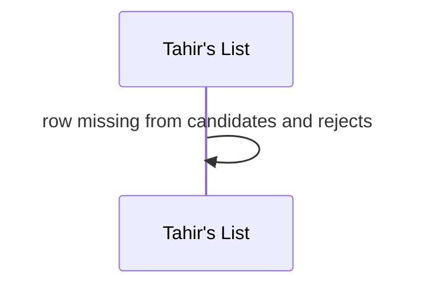
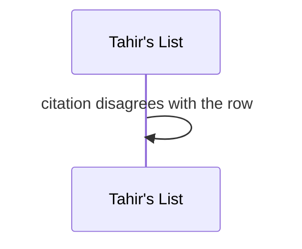
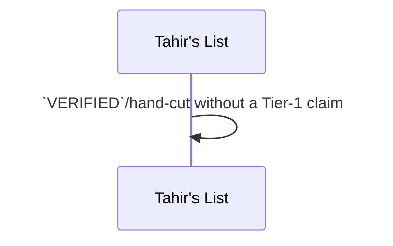

# SC-211 — Phase 4: Black-box — UC-04 Audit an ingestion run

> **Purpose:** actor-visible behaviour of the honest-report audit · **Derived from:** 02 UC-04 · **Delta:** new
> **Security:** amanah control — proves nothing was silently dropped; reads artifacts only.



**A1 — source failed** · record + re-run/fix story.

```mermaid
sequenceDiagram
  participant TL as Tahir's List
  TL->>TL: source marked failed; counts exclude it
```

**A2 — metro shortfall** · known gap with cause.

```mermaid
sequenceDiagram
  participant TL as Tahir's List
  TL->>TL: below target; reason recorded
```

**E1 — unaccounted row** · blocking.



**E2 — spot-check mismatch** · blocking; quarantine + re-run.



**E3 — unbacked trust** · blocking.


