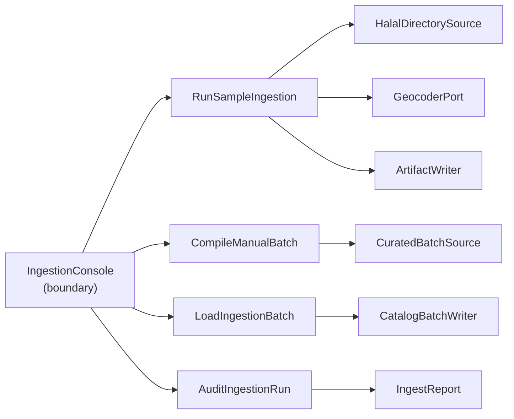
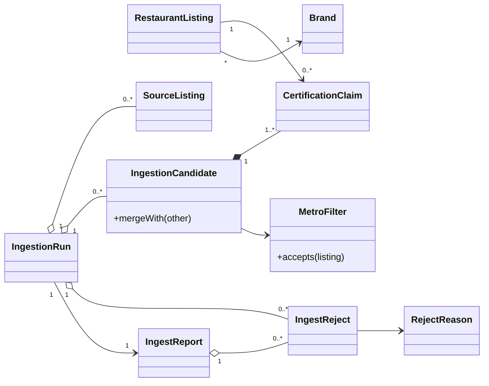
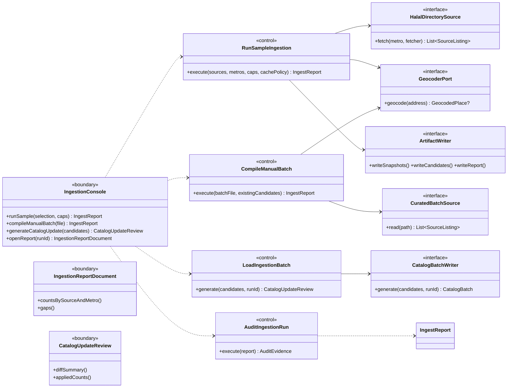

# SC-211 — Phase 5: System class diagram (conceptual)

> **Purpose:** the classes and ports that serve the use cases · **Derived from:** 01–04 · **Delta:** new ingestion controls/ports; existing `GeocoderPort` reused

## Overview

## Domain

## Application and boundary

## Ports and adapter stubs

| Port | Purpose | Adapter stubs |
|---|---|---|
| `HalalDirectorySource` | Fetch one directory's listings | `HmsDirectoryAdapter`, `HfsaaDirectoryAdapter`, `HmaDirectoryAdapter` |
| `CuratedBatchSource` | Read the cited manual file | `CuratedBatchFileAdapter` |
| `GeocoderPort` (existing) | Confirm a venue's coordinates | `PhotonGeocoder` |
| `ArtifactWriter` | Persist snapshots/candidates/report | `FileArtifactWriter` |
| `CatalogBatchWriter` | Emit the reviewed catalogue update | `SqlMigrationBatchWriter` |

## Operation coverage

| UC step | Operation |
|---|---|
| UC-01.1 | `IngestionConsole.runSample` → `RunSampleIngestion.execute` |
| UC-01.2–4 | `HalalDirectorySource.fetch` (one adapter per directory) |
| UC-01.5 | `MetroFilter.accepts` |
| UC-01.6 | `GeocoderPort.geocode` + `MatchConfirmationPolicy.confirm` |
| UC-01.7 | `IngestionCandidate.mergeWith` + `intendedStatus`/`verificationBasis` |
| UC-01.8–9 | `ArtifactWriter.write*`; `IngestReport` |
| UC-02.1–5 | `CompileManualBatch` → `CuratedBatchSource.read` → `GeocoderPort.geocode` → `mergeWith` |
| UC-02.6–7 | `ArtifactWriter.writeCandidates/writeReport` |
| UC-03.1–5 | `LoadIngestionBatch.generate` → `CatalogBatchWriter.generate` → `CatalogUpdateReview` |
| UC-03.6 | existing `ListingSearchQuery` |
| UC-04.1–5 | `IngestionReportDocument.*`; `AuditIngestionRun.execute` |

**Existing collaborators:** `Migrations` (UC-03.4) · `ListingSearchQuery`/`ExposedListingSearchQuery` (UC-03.6) · `RestaurantListingRepository` (reference only).

**Revisions:** 2026-11-07 initial; added existing collaborators; added `VerificationBasis` + `intendedStatus` (founder ruling).
