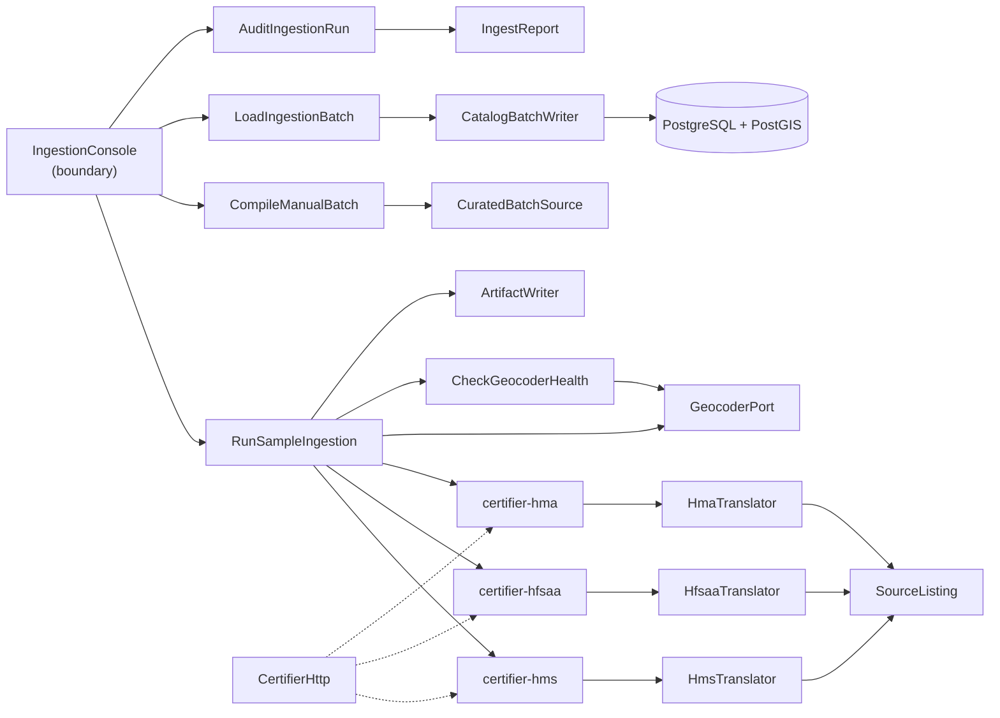
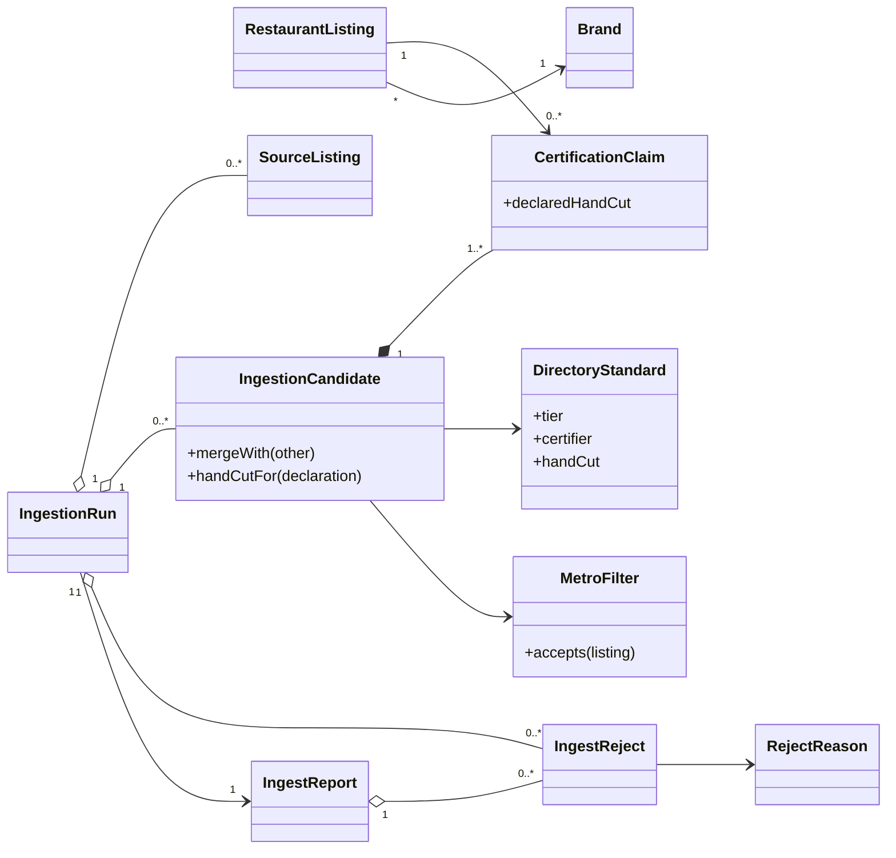
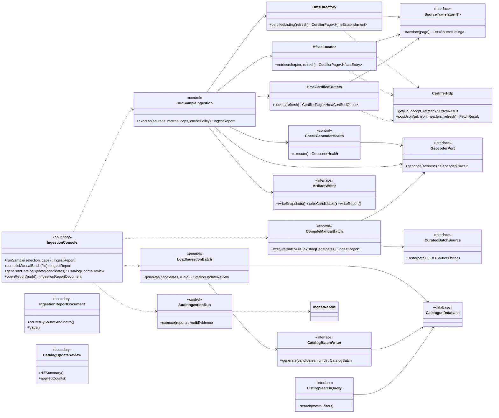

# SC-211 — Phase 5: System class diagram (conceptual)

> **Purpose:** the classes and ports that serve the use cases · **Derived from:** 01–04 · **Delta:** new certifier libraries + translators; existing `GeocoderPort` reused

## Overview

## Domain

## Application, libraries and boundary

## Ports, libraries and adapters

| Type | Purpose | Implementation |
|---|---|---|
| `certifier-hms` | HMS certified listing -> `HmsEstablishment` | `HmsDirectory` + `HmsParser` |
| `certifier-hfsaa` | HFSAA locator -> `HfsaaEntry` | `HfsaaLocator` + `HfsaaParser` |
| `certifier-hma` | HMA outlets -> `HmaCertifiedOutlet` | `HmaCertifiedOutlets` + `HmaParser` |
| `certifier-core` | shared politeness, cache, robots, snapshots | `CertifierHttp`, `CertifierPage`, `HandCutDeclaration` |
| `SourceTranslator<T>` | library model -> `SourceListing` | `HmsTranslator`, `HfsaaTranslator`, `HmaTranslator` |
| `CuratedBatchSource` | read the cited manual file | `CuratedBatchFileAdapter` |
| `GeocoderPort` (existing) | confirm a venue's coordinates | `PhotonGeocoder` |
| `CheckGeocoderHealth` | one pre-flight query before any fetch | application control |
| `ArtifactWriter` | persist snapshots/candidates/report | `FileArtifactWriter` |
| `CatalogBatchWriter` | emit the reviewed catalogue update | `SqlMigrationBatchWriter` |
| `CatalogueDatabase` | owned catalogue store | PostgreSQL + PostGIS |

## Operation coverage

| UC step | Operation |
|---|---|
| UC-01.1 | `IngestionConsole.runSample` → `RunSampleIngestion.execute` |
| UC-01.2 | `CheckGeocoderHealth.execute` (pre-flight; abort on failure) |
| UC-01.3–5 | `HmsDirectory.certifiedListing` · `HfsaaLocator.entries` · `HmaCertifiedOutlets.outlets` |
| UC-01.6 | `HmsTranslator.translate` · `HfsaaTranslator.translate` · `HmaTranslator.translate` |
| UC-01.7 | `MetroFilter.accepts` |
| UC-01.8 | `GeocoderPort.geocode` + `MatchConfirmationPolicy.confirm` |
| UC-01.9 | `IngestionCandidate.mergeWith` + `intendedStatus`/`verificationBasis`/`handCutFor(declaration)` |
| UC-01.10–11 | `ArtifactWriter.write*`; `IngestReport` |
| UC-02.1–5 | `CompileManualBatch` → `CuratedBatchSource.read` → `GeocoderPort.geocode` → `mergeWith` |
| UC-02.6–7 | `ArtifactWriter.writeCandidates/writeReport` |
| UC-03.1–5 | `LoadIngestionBatch.generate` → `CatalogBatchWriter.generate` → `CatalogUpdateReview` |
| UC-03.6 | existing `ListingSearchQuery` → `CatalogueDatabase` |
| UC-04.1–5 | `IngestionReportDocument.*`; `AuditIngestionRun.execute` |

**Existing collaborators:** `Migrations` (UC-03.4) · `ListingSearchQuery`/`ExposedListingSearchQuery` (UC-03.6) · `RestaurantListingRepository` (reference only).

**Revisions:** 2026-11-07 initial · 2026-11-08 verified libraries replace the single `HalalDirectorySource` port; `HandCutDeclaration` replaces the old standard vocabulary (D-12) · 2026-11-08 diagram conventions: external actors left, `CatalogueDatabase` explicit on the right.
