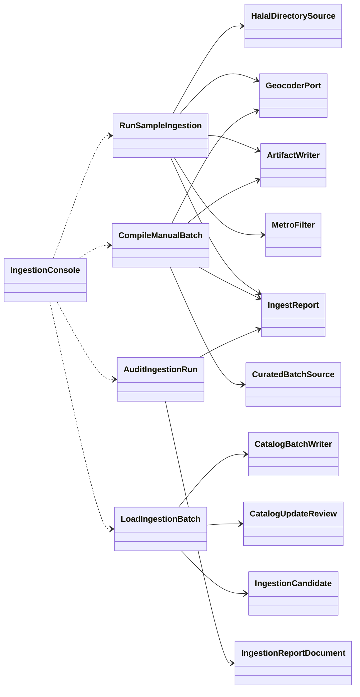
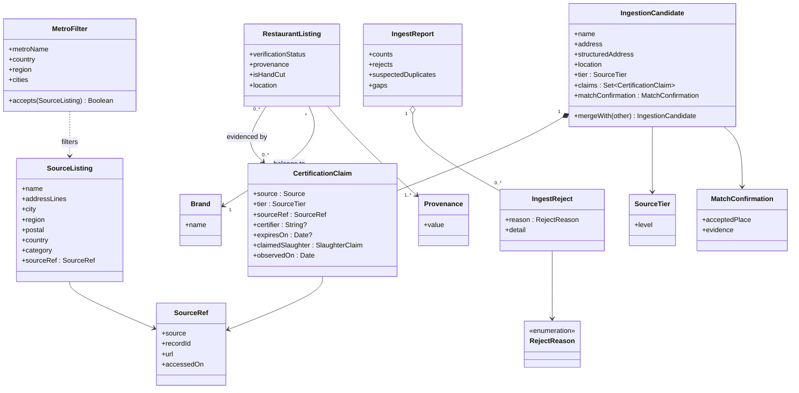

# SC-211 — Phase 5: System class diagram (conceptual)

No tables, columns, frameworks, or JSON shapes here. Every name below is reused
verbatim by the white-box diagrams (`06-whitebox/`).

## 1. Overview

## 2. Domain entities (from Phase 1)

## 3. Application, boundary, and port classes

```mermaid
classDiagram
  class IngestionConsole {
    <<boundary>>
    +runSample(selection : MetroFilter[], caps) IngestReport
    +compileManualBatch(batchFile) IngestReport
    +generateCatalogUpdate(candidates) CatalogUpdateReview
    +openReport(runId) IngestionReportDocument
  }
  class IngestionReportDocument {
    <<boundary>>
    +countsBySourceAndMetro()
    +rejectList()
    +suspectedDuplicates()
    +gaps()
  }
  class CatalogUpdateReview {
    <<boundary>>
    +diffSummary()
    +appliedCounts()
  }
  class RunSampleIngestion {
    <<control>>
    +execute(sources, metros, caps, cachePolicy) IngestReport
  }
  class CompileManualBatch {
    <<control>>
    +execute(batchFile, existingCandidates) IngestReport
  }
  class LoadIngestionBatch {
    <<control>>
    +generate(candidates, runId) CatalogUpdateReview
  }
  class AuditIngestionRun {
    <<control>>
    +execute(report) AuditEvidence
  }
  class HalalDirectorySource {
    <<interface>>
    +source() Source
    +fetch(metro : MetroFilter) List~SourceListing~
  }
  class CuratedBatchSource {
    <<interface>>
    +read(file) List~SourceListing~
  }
  class GeocoderPort {
    <<interface>>
    +geocode(address : String) GeocodedPlace?
  }
  class ArtifactWriter {
    <<interface>>
    +writeSnapshots(runId, snapshots)
    +writeCandidates(runId, candidates)
    +writeReport(runId, report)
  }
  class CatalogBatchWriter {
    <<interface>>
    +generate(candidates, runId) CatalogBatch
  }

  RunSampleIngestion --> HalalDirectorySource
  RunSampleIngestion --> GeocoderPort
  RunSampleIngestion --> ArtifactWriter
  RunSampleIngestion ..> MetroFilter
  RunSampleIngestion ..> IngestReport
  CompileManualBatch --> CuratedBatchSource
  CompileManualBatch --> GeocoderPort
  CompileManualBatch --> ArtifactWriter
  LoadIngestionBatch --> CatalogBatchWriter
  LoadIngestionBatch ..> IngestionCandidate
  AuditIngestionRun ..> IngestReport
  IngestionConsole ..> IngestionReportDocument
  IngestionConsole ..> CatalogUpdateReview
```

## 4. Ports and adapter stubs (named now; technology in Phase 7)

| Port | Purpose | Adapter stub(s) |
|---|---|---|
| `HalalDirectorySource` | Fetch one directory's listings for a metro | `HmsDirectoryAdapter`, `HfsaaDirectoryAdapter`, `HmaDirectoryAdapter` |
| `CuratedBatchSource` | Read a hand-curated, cited batch file | `CuratedBatchFileAdapter` |
| `GeocoderPort` (existing) | Resolve a venue to confirmed coordinates | `PhotonGeocoder` (existing) |
| `ArtifactWriter` | Persist snapshots, candidates, report | `FileArtifactWriter` |
| `CatalogBatchWriter` | Generate the reviewed catalog update | `SqlMigrationBatchWriter` |

Supporting collaborators (not ports): `MatchConfirmationPolicy` (applies the
country/region + name-token rules), `MetroSelection` (parsed from operator
input), `Clock` (timestamps on claims and artifacts).

### 4.1 Existing collaborators used unchanged

| Class | Existing role | Used by |
|---|---|---|
| `Migrations` | Applies pending Flyway migrations at application startup | UC-03 step 4 |
| `ListingSearchQuery` (interface) + `ExposedListingSearchQuery` (adapter) | The existing search read surface | UC-03 step 6 verification |
| `RestaurantListingRepository` | Existing listing persistence port (not written by this feature; the batch loads via SQL migration) | Referenced for consistency only |

## 5. Operation coverage (every use-case step resolves)

| Use case step | Operation |
|---|---|
| UC-01.1 | `IngestionConsole.runSample` → `RunSampleIngestion.execute` |
| UC-01.2–4 | `HalalDirectorySource.fetch` on each directory adapter |
| UC-01.5 | `MetroFilter.accepts` |
| UC-01.6 | `GeocoderPort.geocode` + `MatchConfirmationPolicy.confirm` |
| UC-01.7 | `IngestionCandidate.mergeWith` |
| UC-01.8 | `ArtifactWriter.write*` |
| UC-01.9 | `IngestReport.counts` / `IngestReport.rejects` |
| UC-02.1–2 | `IngestionConsole.compileManualBatch` |
| UC-02.3 | `CuratedBatchSource.read` (validation inside the control) |
| UC-02.4 | `GeocoderPort.geocode` |
| UC-02.5 | `IngestionCandidate.mergeWith` |
| UC-02.6–7 | `ArtifactWriter.writeCandidates/writeReport` |
| UC-03.1–2 | `IngestionConsole.generateCatalogUpdate` → `LoadIngestionBatch.generate` → `CatalogBatchWriter.generate` |
| UC-03.3 | `CatalogUpdateReview.diffSummary` |
| UC-03.4–5 | migration application (existing bootstrap concern) + `CatalogUpdateReview.appliedCounts` |
| UC-03.6 | existing `ListingSearchQuery` (unchanged) |
| UC-04.1–2 | `IngestionConsole.openReport` → `IngestionReportDocument.*` |
| UC-04.3–5 | `AuditIngestionRun.execute` (evidence assembly; human actions are outside the system) |

## 6. Revisions

| Date | Change | Reason |
|---|---|---|
| 2026-11-07 | Initial system class diagram | Phase 5 for SC-211 |
| 2026-11-07 | Added §4.1 existing collaborators (`Migrations`, `ListingSearchQuery`, `RestaurantListingRepository`) | UC-03 white-box needs them; delta recorded before drawing Phase 6 |
