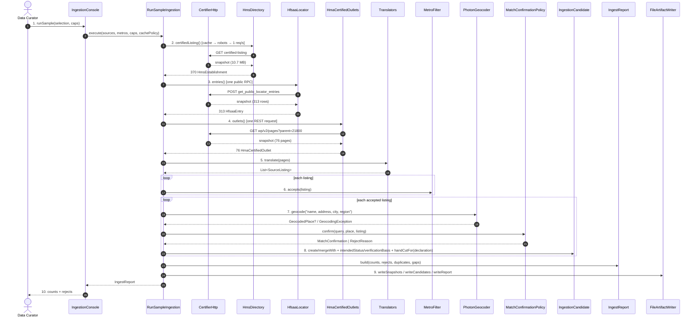

# SC-211 — Phase 6: White-box — UC-01 Run a sample directory ingestion

> **Purpose:** how the run is served, class by class · **Derived from:** 05 + 04/UC-01 · **Delta:** new; no DB transaction (files only)

**Consistency:** `ING-1` — candidates written only after every fetched row is classified; geocoder outage aborts before write. `ING-3` — `VERIFIED` + `CERTIFIER_REGISTRY` iff the winning claim is Tier-1; hand-cut is TRUE only when that claim declares hand-cut, FALSE otherwise (declared not or silent), never from the tier alone. Files are atomic (temp + rename); report is the commit marker.

| Phase-4 flow | Error / outcome |
|---|---|
| A1–A5 | Per-entry listings; cache marked; shortfall in `gaps` |
| E1 | `SourceUnavailableException` → `IngestReject(SOURCE_UNAVAILABLE)`; run continues |
| E2 | `GeocodingException` → `GeocoderUnavailableException`; abort before `writeCandidates` |
| E3 | `SourceParseException` → `IngestReject(SOURCE_PARSE_FAILED)`; source skipped |
| E4 | `MetroFilter.accepts` false for all → zero for that metro |
| E5 | `WRONG_REGION` / `AMBIGUOUS_GEOCODER_MATCH` reject; place never used |
| E6 | HFSAA `401` → `discoverKey()` → retry once; otherwise `SOURCE_BLOCKED` |
| E7 | HMS blank city → `deriveCity`; null if not derivable |

**Authorization:** local operator; no HTTP surface; anonymous throttled fetches with a configured User-Agent; libraries never write to the DB.
