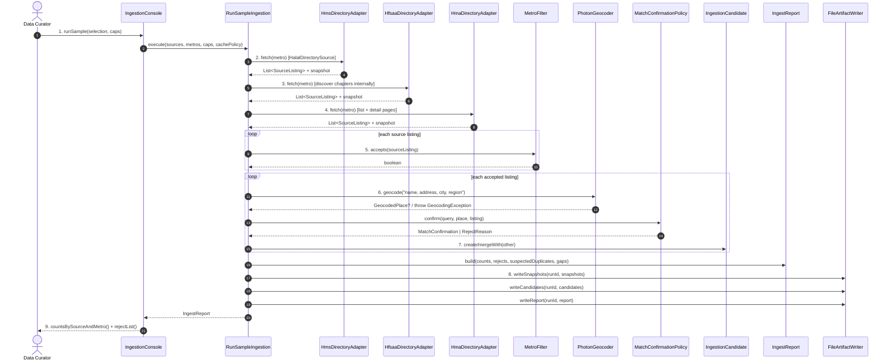

# SC-211 — Phase 6: White-box sequence — UC-01 Run a sample directory ingestion

Participants are exactly the classes/interfaces from `05-class-diagram-system.md`.
No database transaction occurs in this use case; artifacts are written with
write-temp-then-rename per file, and the report is written last so a partial run
cannot masquerade as a complete one.

## Main success scenario

## Transaction and consistency notes

- **No DB transaction.** Files are written atomically (temp + rename).
- `ING-1 (run atomicity):` candidates are written only after every fetched row
  has been classified (candidate or reject). If geocoding aborts (E2), no
  candidates file is written.
- The report is the commit marker: its presence means the run finished.

## Exception mapping

| Phase 4 flow | White-box behavior | Observable outcome |
|---|---|---|
| A1 | One `SourceListing` per branch; `IngestionCandidate.mergeWith` at step 7 | Report shows either one venue with multiple `SourceRef`s or distinct branches |
| A2 | `HmsDirectoryAdapter.fetch` catches the primary-page failure and fetches the ShariahBoard table; records the fallback in the snapshot metadata | Report lists the fallback source |
| A3 | Run continues with fewer confirmed rows; `IngestReport.gaps` records the shortfall | CLI prints shortfall |
| A4 | `PoliteFetcher` (adapter-internal collaborator) returns cached bytes; `SourceListing` marked cache-sourced | Report marks cached snapshots |
| E1 | Adapter throws `SourceUnavailableException` after retries; `RunSampleIngestion` converts it to an `IngestReject(SOURCE_UNAVAILABLE)` for the source and continues | Run completes; exit code 0 with warnings in the report |
| E2 | `GeocodingException` from `PhotonGeocoder` propagates as `GeocoderUnavailableException`; `RunSampleIngestion` aborts before `writeCandidates` | CLI exit code non-zero; report shows `Aborted`; no candidates artifact |
| E3 | Adapter parse error → `SourceParseException`; converted to `IngestReject(SOURCE_PARSE_FAILED)` with a redacted snippet; source skipped | Report lists the quarantine; UC-04 raises a follow-up |
| E4 | `MetroFilter.accepts` returns false for all rows | Report shows zero for that metro; `LoadIngestionBatch` later refuses an empty metro |
| E5 | `MatchConfirmationPolicy.confirm` returns `WRONG_REGION` or `AMBIGUOUS_GEOCODER_MATCH` | `IngestReject` with the query and rejected place; row never becomes a candidate |

## Authorization placement

- The command runs locally with the operator's own credentials; there is no
  HTTP endpoint and no client-supplied identity.
- Directory fetches are anonymous, throttled, and identified by a configured
  User-Agent string; no secrets are required by any Tier-1 directory.
- The adapters never write to the database; authorization to load is exercised
  only in UC-03 through the reviewed migration.
