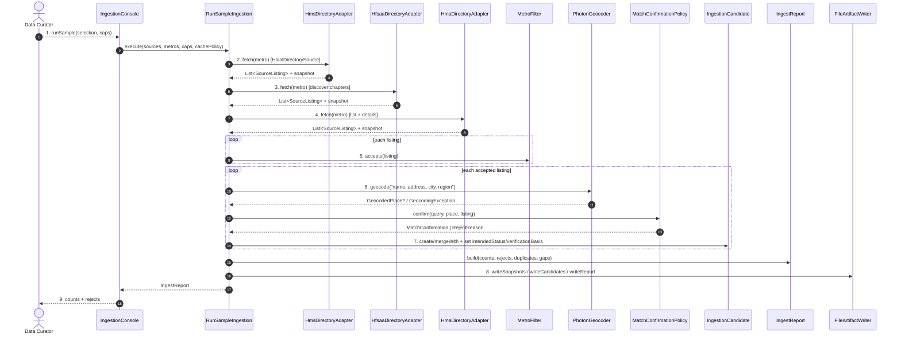

# SC-211 — Phase 6: White-box — UC-01 Run a sample directory ingestion

> **Purpose:** how the run is served, class by class · **Derived from:** 05 + 04/UC-01 · **Delta:** new; no DB transaction (files only)

**Consistency:** `ING-1` — candidates written only after every fetched row is classified; geocoder outage aborts before write. `ING-3` — `VERIFIED` + `CERTIFIER_REGISTRY` iff the winning claim is Tier-1; else `UNVERIFIED`. Files are atomic (temp + rename); report is the commit marker.

| Phase-4 flow | Error / outcome |
|---|---|
| A1–A4 | Per-entry listings; fallback recorded; shortfall in `gaps`; cache marked |
| E1 | `SourceUnavailableException` → `IngestReject(SOURCE_UNAVAILABLE)`; run continues |
| E2 | `GeocodingException` → `GeocoderUnavailableException`; abort before `writeCandidates` |
| E3 | `SourceParseException` → `IngestReject(SOURCE_PARSE_FAILED)`; source skipped |
| E4 | `MetroFilter.accepts` false for all → zero for that metro |
| E5 | `WRONG_REGION` / `AMBIGUOUS_GEOCODER_MATCH` reject; place never used |

**Authorization:** local operator; no HTTP surface; anonymous throttled fetches with a configured User-Agent; adapters never write to the DB.
