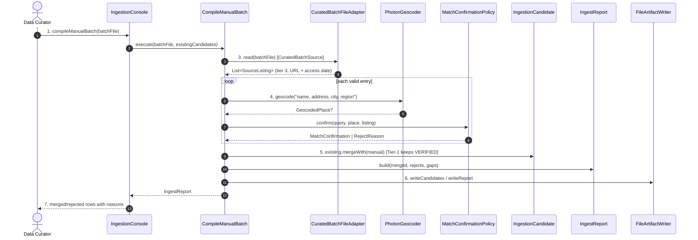

# SC-211 — Phase 6: White-box — UC-02 Compile a cited manual Tier-3 batch

> **Purpose:** how the manual batch is served, class by class · **Derived from:** 05 + 04/UC-02 · **Delta:** new; no DB transaction

**Validation (adapter):** required name, address, city, region, country, URL, accessed-on, tier 3. `ING-4` — manual-only candidates are always `UNVERIFIED` + hand-cut `NULL`; a manual row can never set trust. There is no Zabihah library: the curator reads the listings by hand (D-13), and only the cited file enters the pipeline.

| Phase-4 flow | Error / outcome |
|---|---|
| A1 | `SourceListing(postal = null)`; report notes the gap |
| A2 | `SourceRef(source = RESEARCH_SECONDARY)`; marked in report |
| E1 | `BatchValidationException` → `IngestReject(INVALID_MANUAL_ENTRY)` |
| E2 | `NO_GEOCODER_MATCH` / `AMBIGUOUS_GEOCODER_MATCH` reject |
| E3 | `ING-2` merge detects the venue → `DUPLICATE_MERGED`, claim added |

**Authorization:** local operator; the curated file is committed and PR-reviewed (provenance is code review, not runtime auth).
