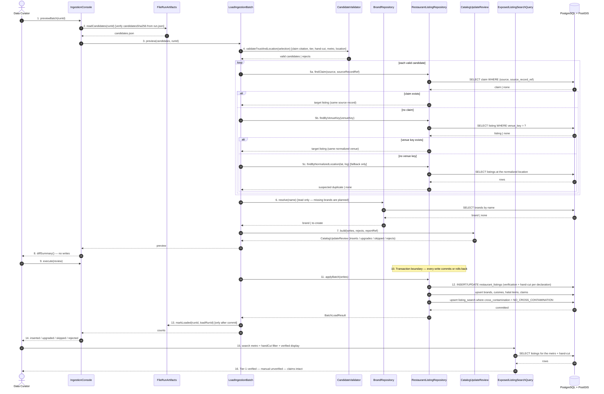

# SC-211 — Phase 6: White-box — UC-03 Load a reviewed ingestion batch

> **Purpose:** how the catalogue load is served, class by class · **Derived from:** 05 + 04/UC-03 · **Delta:** new; one runtime transaction

**Idempotency:** the run's `candidatesSha256` is verified before preview and load. For each candidate the matcher checks, in order: the existing claim `(source, source_record_ref)` → `venue_key` → normalized-location fallback. Only the first two update/attach silently; a location-only match is **held as `SUSPECTED_DUPLICATE` and not written**. Claims are globally unique per `(source, source_record_ref)`, so the same source record cannot attach to two listings even if its coordinates drift. Brands are matched by name; the search mirror upserts by `id`. The whole batch is one transaction: a failure leaves no partial load and no `loaded.json`. Replaying an older/archived batch follows the same order, so it updates the newer listings instead of duplicating them.

**Index gate:** Tier-1 certified rows are written with `cross_contamination = NO_CROSS_CONTAMINATION` (D-16), so they reach `listing_search`. Manual/web rows keep their explicit value (default `UNCERTAIN`).

| Phase-4 flow | Error / outcome |
|---|---|
| A1 | Survivors only; header references the report |
| A2 | Re-run matches existing rows/claims → counts zero; an already-loaded run is refused |
| A3 | `UPDATE` matched row to `VERIFIED`; hand-cut per the claim's declaration; attach claim |
| A4 | Validator rejects an unbacked `VERIFIED`/TRUE hand-cut before execute |
| A5 | Older/archived batch replayed → claim-first match, then `venue_key`; existing listing updated, no duplicate |
| A6 | Location matches but name/address does not → held as `SUSPECTED_DUPLICATE`; no write until resolved |
| E1 | Any persistence failure → the single transaction rolls back; `loaded.json` is not written |
| E2 | Missing V22 → the load refuses before writing |
| E3 | Wrong verification/hand-cut state for the claim's declaration → blocking (AC-7/INV-1/INV-3) |
| E9 | `candidates.json` changed after the run completed → checksum mismatch, load refuses |
| E10 | A claim `(source, record)` already points at a different listing → conflict; the batch aborts rather than duplicating |

**Authorization:** the load runs with the app's configured DB credentials; the batch file and preview are reviewed by the curator (and PR-reviewed when committed); no new endpoint.
