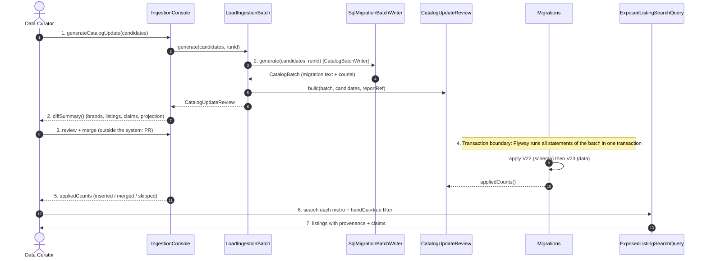

# SC-211 — Phase 6: White-box sequence — UC-03 Load a reviewed ingestion batch into the catalog

Participants are exactly the classes/interfaces from `05-class-diagram-system.md`
(including §4.1 existing collaborators).

## Main success scenario

## Transaction and consistency notes

- **One transaction per migration file.** Flyway applies V23 as a unit: brands,
  listings, claims, and the search projection all commit or all roll back
  (BR-13). A failure means the application does not start on a partial batch.
- **Idempotency (INV-7):** brands use `ON CONFLICT (name) DO NOTHING`; listings
  use the normalized-location conflict target scoped to ingested provenance;
  claims use a unique key (listing, source, source record); the search
  projection uses `ON CONFLICT (id) DO NOTHING`.
- **Schema-before-data:** V22 (provenance vocabulary + claims table + widened
  dedupe index) sorts before V23, so a fresh database and an existing database
  converge.
- **Search visibility:** the projection insert is part of V23 so a loaded listing
  is searchable immediately; the existing cross-contamination index gate is
  satisfied by the seed-consistent default used for research/ingested rows.

## Exception mapping

| Phase 4 flow | White-box behavior | Observable outcome |
|---|---|---|
| A1 | `SqlMigrationBatchWriter.generate` emits only survivors; header references the report | Diff summary shows the excluded count |
| A2 | Flyway sees the version applied → no-op | `appliedCounts` all zero |
| A3 | Insert hits the partial unique index → `ON CONFLICT DO NOTHING` | Row skipped; report already flags the suspected duplicate |
| E1 | `ExposedSQLException` inside the migration transaction → Flyway rolls back the version | Application startup fails; no partial write; deploy aborted |
| E2 | Flyway applies V22 first; V23 never runs alone | Startup fails fast on the missing schema |
| E3 | Listing absent from `ExposedListingSearchQuery` results | Treated as blocking (INV/AC-7); investigate projection vs. index gate |

## Authorization placement

- The migration is applied by the application's own database credentials from
  environment configuration (existing live profile); no client-supplied identity
  participates.
- Merge authorization is code-review authorization on the PR that carries the
  generated migration — reviewing the diff **is** the approval to load.
- There is no new endpoint, so no new runtime authorization surface.
