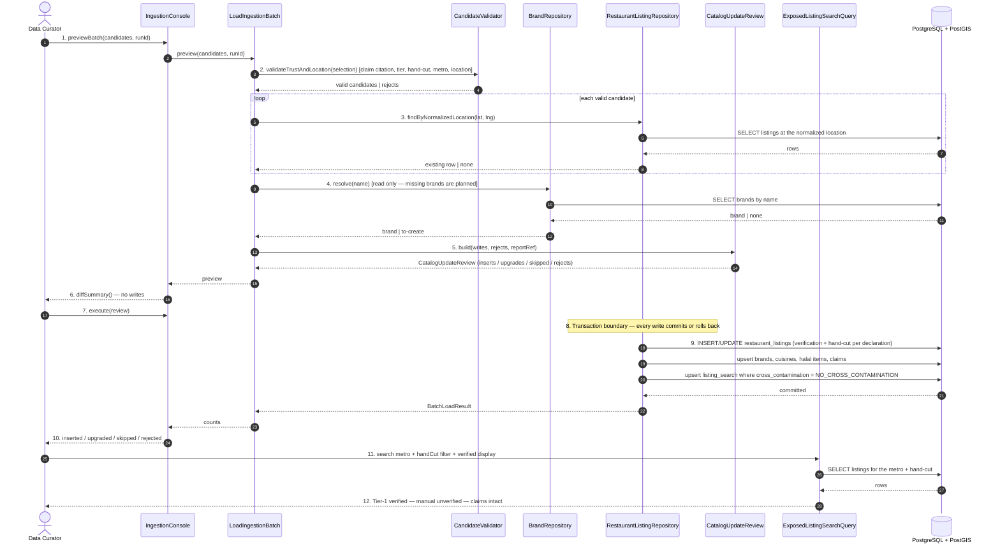

# SC-211 — Phase 6: White-box — UC-03 Load a reviewed ingestion batch

> **Purpose:** how the catalogue load is served, class by class · **Derived from:** 05 + 04/UC-03 · **Delta:** new; one runtime transaction

**Idempotency:** brands matched by name; listings matched by normalized location (`location_lat_6`, `location_lng_6`); matched rows updated, never duplicated; claims unique per (listing, source, record); the search mirror upserts by `id`. The whole batch is one transaction: a failure leaves no partial load.

**Index gate:** Tier-1 certified rows are written with `cross_contamination = NO_CROSS_CONTAMINATION` (D-16), so they reach `listing_search`. Manual/web rows keep their explicit value (default `UNCERTAIN`).

| Phase-4 flow | Error / outcome |
|---|---|
| A1 | Survivors only; header references the report |
| A2 | Re-run matches existing rows/claims → counts zero |
| A3 | `UPDATE` matched row to `VERIFIED`; hand-cut per the claim's declaration; attach claim |
| A4 | Validator rejects an unbacked `VERIFIED`/TRUE hand-cut before execute |
| E1 | Any persistence failure → the single transaction rolls back |
| E2 | Missing V22 → the load refuses before writing |
| E3 | Wrong verification/hand-cut state for the claim's declaration → blocking (AC-7/INV-1/INV-3) |

**Authorization:** the load runs with the app's configured DB credentials; the batch file and preview are reviewed by the curator (and PR-reviewed when committed); no new endpoint.
