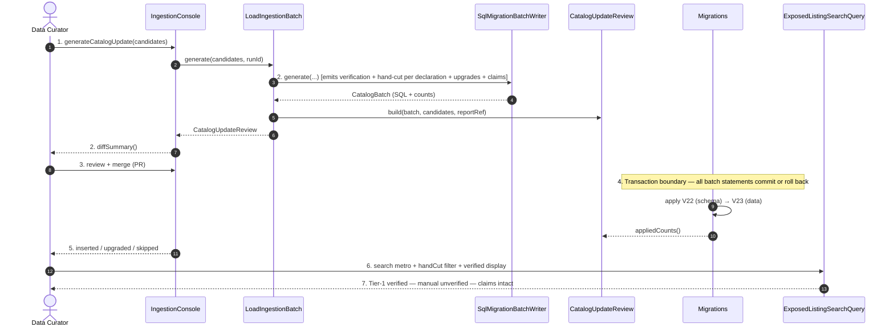

# SC-211 — Phase 6: White-box — UC-03 Load a reviewed ingestion batch

> **Purpose:** how the catalogue load is served, class by class · **Derived from:** 05 + 04/UC-03 · **Delta:** new; one transaction per migration

**Idempotency:** brands `ON CONFLICT (name)`; listings conflict on normalized location (ingested provenance); matched rows upgraded with `UPDATE … WHERE verification_status = 'UNVERIFIED'` (hand-cut set from the claim's declaration); claims unique per (listing, source, record); projection `ON CONFLICT (id)`.

| Phase-4 flow | Error / outcome |
|---|---|
| A1 | Survivors only; header references the report |
| A2 | Applied version → no-op; counts zero |
| A3 | `UPDATE` matched row to `VERIFIED`; hand-cut per the claim's declaration; attach claim |
| E1 | `ExposedSQLException` → Flyway rolls back; startup fails |
| E2 | Missing V22 → fail fast, data never runs alone |
| E3 | Wrong verification/hand-cut state for the claim's declaration → blocking (AC-7/INV-1/INV-3) |

**Authorization:** migration uses the app's configured DB credentials; merge authorization is PR review of the generated diff; no new endpoint.
