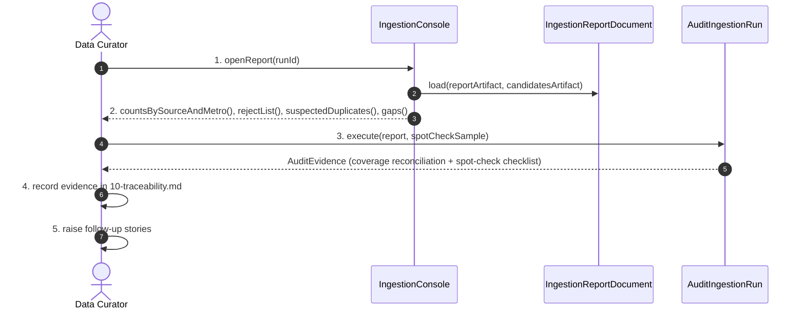

# SC-211 — Phase 6: White-box sequence — UC-04 Audit an ingestion run and record evidence

Participants are exactly the classes/interfaces from `05-class-diagram-system.md`.

## Main success scenario

## Consistency checks performed inside `AuditIngestionRun.execute`

| Check | Rule on failure |
|---|---|
| Fetched-row accounting: every snapshot row appears as a candidate or a reject | Blocking: `UnaccountedRowException` surfaced to the CLI; run not accepted |
| Verification backing: every `VERIFIED` candidate has a Tier-1 claim and a `CERTIFIER_REGISTRY` basis | Blocking: `UnbackedHandCutException` (or `ProvenanceMismatchException`) |
| Hand-cut backing: every `isHandCut = TRUE` candidate has a tier-1 claim | Blocking: `UnbackedHandCutException` |
| Claim citation: every claim has a URL and accessed-on date | Blocking: `UncitedClaimException` |
| Tier/provenance agreement: candidate provenance = its winning tier's stamp | Blocking: `ProvenanceMismatchException` |
| Duplicate suspicion: same normalized location as a pre-existing catalogue row | Non-blocking: listed in the report for human review (the load upgrades it) |

## Transaction notes

- Read-only with respect to the database. The only writes are repository files:
  the traceability matrix and (outside the system) Shortcut stories.

## Exception mapping

| Phase 4 flow | White-box behavior | Observable outcome |
|---|---|---|
| A1 | Report carries a failed-source entry; `AuditEvidence` marks the source as failing | Curator records it; follow-up story |
| A2 | Report carries a metro shortfall with cause | Recorded as a known gap |
| E1 | `UnaccountedRowException` | CLI exits non-zero; batch not accepted |
| E2 | Spot-check checklist item marked failed; row quarantined | Blocking defect; run re-executed |
| E3 | `UnbackedHandCutException` | Blocking; generator must refuse `TRUE` without a claim |

## Authorization placement

- No runtime authorization: the audit consumes local artifacts and produces
  repository evidence. The traceability edit is gated by the same PR review as
  any other change.
