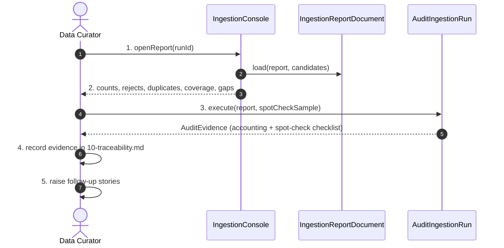

# SC-211 — Phase 6: White-box — UC-04 Audit an ingestion run

> **Purpose:** how the audit checks are served, class by class · **Derived from:** 05 + 04/UC-04 · **Delta:** new; read-only

| Check | On failure |
|---|---|
| Fetched-row accounting | `UnaccountedRowException` (blocking) |
| Verification backing (`VERIFIED` ⇒ Tier-1 claim + basis) | `UnbackedHandCutException` / `ProvenanceMismatchException` |
| Hand-cut backing (`TRUE` ⇒ claim standard HAND; `FALSE` ⇒ MACHINE) | `UnbackedHandCutException` (blocking) |
| Claim citation (URL + date) | `UncitedClaimException` (blocking) |
| Duplicate suspicion vs existing rows | Non-blocking; listed in report |

| Phase-4 flow | Outcome |
|---|---|
| A1/A2 | Failed source / shortfall recorded as gaps |
| E1 | Run not accepted; accounting fixed |
| E2 | Row quarantined; run re-executed |
| E3 | Generator refuses `VERIFIED` without a Tier-1 claim, or `TRUE` without a HAND-standard claim |

**Authorization:** none at runtime; evidence edits are gated by PR review. No DB writes.
