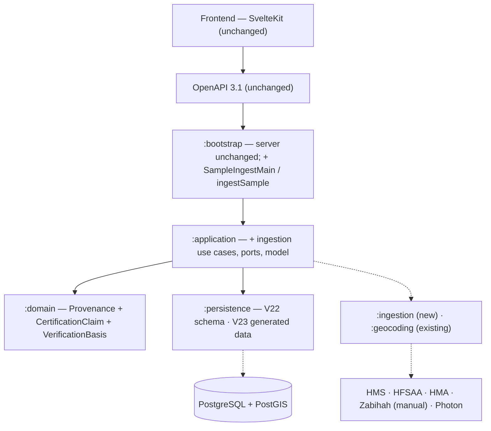

# SC-211 — Phase 7: Complete class diagram (the ultimate design)

> **Purpose:** the implementation design — layers, names, migrations, deltas · **Derived from:** 05–06 · **Delta:** new `:ingestion`; modified `:domain`, `:application`, `:persistence`, `:bootstrap`

## Layer map

## Module map

| Module | Status | Contents |
|---|---|---|
| `:domain` | modified | `Provenance` (+4 strings); new `CertificationClaim`, `SourceTier`, `SourceRef`, `SlaughterClaim`, `VerificationBasis`; `VerificationStatus`/`VerificationCommittee` KDoc |
| `:application` | modified | `com.tahirslist.application.ingestion`: 4 use cases, 5 ports, model, errors |
| `:ingestion` | **new** | `com.tahirslist.ingestion.{hms,hfsaa,hma,manual,http,artifact,catalog}` |
| `:persistence` | modified | V22, V23 (generated), `ExternalCertificationClaims`, migration tests |
| `:bootstrap` | modified | `SampleIngestMain` + `ingestSample` JavaExec task |
| `:web-api` · `:geocoding` · frontend | unchanged | No API/frontend change; `PhotonGeocoder` reused |

## Final class names

| Class | Module | Status |
|---|---|---|
| `Provenance`, `VerificationBasis`, `CertificationClaim`, `SourceTier`, `SourceRef`, `SlaughterClaim` | domain | new/modified |
| `RunSampleIngestion`, `CompileManualBatch`, `LoadIngestionBatch`, `AuditIngestionRun` | application | new |
| `HalalDirectorySource`, `CuratedBatchSource`, `PageFetcher`, `ArtifactWriter`, `CatalogBatchWriter` | application | new |
| `SourceListing`, `MetroTarget`, `MatchConfirmationPolicy`, `IngestionCandidate`, `IngestReject`, `RejectReason`, `IngestReport`, `CatalogBatch`, `CatalogUpdateReview`, `AuditEvidence` | application | new |
| `HmsDirectoryAdapter`, `HfsaaDirectoryAdapter`, `HmaDirectoryAdapter`, `CuratedBatchFileAdapter`, `PoliteFetcher`, `FileArtifactWriter`, `SqlMigrationBatchWriter` | ingestion | new |
| `SampleIngestMain` | bootstrap | new |
| `IngestionConsole` (CLI boundary), `IngestionReportDocument`, `CatalogUpdateReview` | application/bootstrap boundary | new |
| `Migrations`, `ListingSearchQuery`, `ExposedListingSearchQuery`, `RestaurantListingRepository`, `PhotonGeocoder` | existing | unchanged |

## Persistence delta

| Element | Status | Detail |
|---|---|---|
| `V22__sc_211_ingestion_schema.sql` | new | provenance CHECK (+4 values); `external_certification_claims` table (id, listing_id FK, source, source_tier, source_record_ref, source_url, certifier, expires_on, claimed_slaughter CHECK, first/last_seen, created_at; unique (listing_id, source, source_record_ref)); index on listing_id; drop `uq_restaurant_listings_seed_location`, create `uq_restaurant_listings_research_location` on `(location_lat_6, location_lng_6) WHERE provenance IS NOT NULL` |
| `V23__sc_211_ingest_sample.sql` | new, generated | brands upsert → listings insert with trust outcome → matched-row `UPDATE` to `VERIFIED` + hand-cut → claims → `listing_search` insert/update |
| `Tables.kt` | modified | add `ExternalCertificationClaims` catalogue object |
| Verification CHECK | unchanged | V15 already admits `VERIFIED` |

## API and frontend delta

| Layer | Status | Detail |
|---|---|---|
| OpenAPI | unchanged | No routes/DTOs; sample data flows through existing `GET /v1/listings` |
| Frontend | unchanged | No routes, components, stores, or client functions |
| Contract in the middle | n/a | Backend-only; search API is acceptance evidence, not a new contract |

## Config, scripts, tests

| Item | Status | Detail |
|---|---|---|
| CLI flags | new | `--metros --caps --sources --cache-dir --out-dir` |
| `INGEST_USER_AGENT` · `INGEST_RATE_LIMIT_MS` · `INGEST_CACHE_TTL_MINUTES` | new | Polite fetch defaults (1000 ms); no secrets |
| `scripts/ingest-sample.sh` | new | Containerized `:bootstrap:ingestSample` |
| `scripts/generate_ingest_migration.py` | new | Containerized candidates → V23 |
| `scripts/backend-test.sh` | unchanged | Picks up the new module automatically |
| Tests | new | Domain: `ProvenanceTest`, `CertificationClaimTest` · persistence: `IngestionSchemaMigrationTest`, `IngestSampleMigrationTest` · adapters: `HmsDirectoryAdapterTest`, `HfsaaDirectoryAdapterTest`, `HmaDirectoryAdapterTest`, `PoliteFetcherTest`, `CuratedBatchFileAdapterTest` · application: `MatchConfirmationPolicyTest`, `RunSampleIngestionTest`, `CompileManualBatchTest`, `LoadIngestionBatchTest`, `AuditIngestionRunTest` |
| Key test names | new | `loadsTierOneAsVerifiedWithClaims`, `loadsManualAsUnverified`, `upgradesMatchedSeedRow`, `isIdempotent`, `doesNotDuplicateSeedRows`, `refusesVerifiedWithoutClaim`, `marksTierOneCandidatesVerified`, `neverVerifiesManualOnlyRows`, `flagsUnaccountedRow` |

## Architecture and risks

**ARCHITECTURE.md §1.2:** changes — `VERIFIED` gains the `CERTIFIER_REGISTRY` route; `CertificationClaim`/`VerificationBasis` added; committee flow unchanged. Implementation PR adds the Part 1 row.

| Risk | Mitigation |
|---|---|
| Source HTML changes | Fixture tests + `SOURCE_PARSE_FAILED` quarantine |
| HMS JS-rendered | ShariahBoard fallback, tested |
| Dedupe merges coincident venues | Suspected duplicates reported (D-4) |
| Badge copy says "committee" for registry rows | D-8 follow-up story |
| Certifier expiry/revocation | Expiry stored; no auto-demotion (D-10) |
| ToS / attribution | Public registries, throttled, UA; Omar review; ODbL display open (Q-4) |
