# SC-211 — Phase 7: Complete class diagram (the ultimate design)

This is the design the code will be written from. **Naming here is final.**
Legend: 🆕 new · ✏️ modified · (unchanged).

## 1. Module map

| Module | Status | Contents |
|---|---|---|
| `:domain` | ✏️ modified | `Provenance` vocabulary extension; new `CertificationClaim` entity + `SourceTier`/`SourceRef`/`SlaughterClaim`/`VerificationBasis` value objects; `VerificationStatus` and `VerificationCommittee` KDoc amended to record the second legal route to `VERIFIED` (registry verification) |
| `:application` | ✏️ modified | New package `com.tahirslist.application.ingestion`: use cases, ports, ports' DTOs, errors |
| `:persistence` | ✏️ modified | `V22__sc_211_ingestion_schema.sql`, generated `V23__sc_211_ingest_sample.sql`, `Tables.kt` + `ExternalCertificationClaims`, migration tests |
| `:ingestion` 🆕 | 🆕 new | Adapters: three directory sources, curated-batch file adapter, polite fetcher, artifact writer, SQL batch writer (registered as `project(":ingestion").projectDir = file("adapters/ingestion")`) |
| `:bootstrap` | ✏️ modified | `SampleIngestMain` composition root + `ingestSample` Gradle JavaExec task; nothing server-side changes |
| `:web-api` | (unchanged) | No new endpoints |
| `:geocoding` | (unchanged) | `PhotonGeocoder` reused as the `GeocoderPort` adapter |
| Frontend (SvelteKit) | (unchanged) | No routes, components, stores, or client functions |

## 2. Final class diagram

```mermaid
classDiagram
  %% domain
  class Provenance {
    +value : String
    +HMS_CERTIFIED_DIRECTORY_PHOTON_GEOCODE
    +HFSAA_CERTIFIED_DIRECTORY_PHOTON_GEOCODE
    +HMA_CERTIFIED_DIRECTORY_PHOTON_GEOCODE
    +ZABIHAH_MANUAL_BATCH_PHOTON_GEOCODE
  }
  class SourceTier {
    +level : Int
    +CERTIFIER_REGISTRY
    +CURATED
  }
  class SourceRef {
    +source : String
    +recordId : String
    +url : String
    +accessedOn : LocalDate
  }
  class SlaughterClaim {
    <<enumeration>>
    HAND
    UNSPECIFIED
  }
  class CertificationClaim {
    +source : String
    +tier : SourceTier
    +sourceRef : SourceRef
    +certifier : String?
    +expiresOn : LocalDate?
    +claimedSlaughter : SlaughterClaim
    +observedOn : LocalDate
  }
  class VerificationBasis {
    <<enumeration>>
    COMMITTEE_REVIEW
    CERTIFIER_REGISTRY
  }
  class VerificationStatus {
    <<enumeration>>
    UNVERIFIED
    VERIFIED
  }

  %% application
  class HalalDirectorySource {
    <<interface>>
    +source() String
    +tier() SourceTier
    +fetch(metro : MetroTarget, fetcher : PageFetcher) List~SourceListing~
  }
  class CuratedBatchSource {
    <<interface>>
    +read(path : Path) List~SourceListing~
  }
  class PageFetcher {
    <<interface>>
    +get(url : String) FetchedPage
  }
  class ArtifactWriter {
    <<interface>>
    +writeSnapshots(outDir, snapshots)
    +writeCandidates(outDir, candidates)
    +writeReport(outDir, report)
  }
  class CatalogBatchWriter {
    <<interface>>
    +generate(candidates, runId) CatalogBatch
  }
  class SourceListing {
    +name
    +addressLines
    +city
    +region
    +postal
    +country
    +category
    +sourceRef : SourceRef
  }
  class MetroTarget {
    +name
    +country
    +region
    +cities
    +cap
    +accepts(SourceListing) Boolean
    +matchesRegion(GeocodedPlace) Boolean
  }
  class MatchConfirmationPolicy {
    +confirm(query, place, listing) MatchConfirmation?
  }
  class MatchConfirmation {
    +place
    +evidence
  }
  class IngestionCandidate {
    +name
    +address
    +city
    +province
    +postal
    +country
    +location : LatLng
    +cuisine : Cuisine?
    +tier : SourceTier
    +provenance : Provenance
    +claims : List~CertificationClaim~
    +intendedStatus : VerificationStatus
    +verificationBasis : VerificationBasis
    +mergeWith(other) IngestionCandidate
    +isHandCut() Boolean?
  }
  class IngestReject {
    +reason : RejectReason
    +sourceRef : SourceRef
    +detail
  }
  class RejectReason {
    <<enumeration>>
    NO_GEOCODER_MATCH
    AMBIGUOUS_GEOCODER_MATCH
    WRONG_REGION
    NOT_A_RESTAURANT
    MISSING_ADDRESS
    DUPLICATE_MERGED
    INVALID_MANUAL_ENTRY
    SOURCE_UNAVAILABLE
    SOURCE_PARSE_FAILED
  }
  class IngestReport {
    +runId
    +selection
    +counts
    +rejects
    +suspectedDuplicates
    +gaps
  }
  class RunSampleIngestion {
    +execute(selection, sources, caps, cachePolicy) IngestReport
  }
  class CompileManualBatch {
    +execute(batchPath, runDir) IngestReport
  }
  class LoadIngestionBatch {
    +generate(candidatesPath, runId) CatalogUpdateReview
  }
  class AuditIngestionRun {
    +execute(runDir) AuditEvidence
  }
  class CatalogBatch {
    +sql : String
    +counts
  }
  class CatalogUpdateReview {
    +diffSummary()
    +appliedCounts()
  }
  class AuditEvidence {
    +accounting
    +spotChecks
    +findings
  }

  %% adapters (new module)
  class HmsDirectoryAdapter
  class HfsaaDirectoryAdapter
  class HmaDirectoryAdapter
  class CuratedBatchFileAdapter
  class PoliteFetcher
  class FileArtifactWriter
  class SqlMigrationBatchWriter
  class SampleIngestMain

  %% existing
  class GeocoderPort {
    <<interface>>
    +geocode(address) GeocodedPlace?
  }
  class PhotonGeocoder
  class Migrations
  class ExposedListingSearchQuery

  HalalDirectorySource <|.. HmsDirectoryAdapter
  HalalDirectorySource <|.. HfsaaDirectoryAdapter
  HalalDirectorySource <|.. HmaDirectoryAdapter
  CuratedBatchSource <|.. CuratedBatchFileAdapter
  PageFetcher <|.. PoliteFetcher
  ArtifactWriter <|.. FileArtifactWriter
  CatalogBatchWriter <|.. SqlMigrationBatchWriter
  GeocoderPort <|.. PhotonGeocoder

  RunSampleIngestion --> HalalDirectorySource
  RunSampleIngestion --> GeocoderPort
  RunSampleIngestion --> MatchConfirmationPolicy
  RunSampleIngestion --> MetroTarget
  RunSampleIngestion --> ArtifactWriter
  RunSampleIngestion ..> IngestReport
  CompileManualBatch --> CuratedBatchSource
  CompileManualBatch --> GeocoderPort
  CompileManualBatch --> ArtifactWriter
  LoadIngestionBatch --> CatalogBatchWriter
  LoadIngestionBatch ..> CatalogBatch
  AuditIngestionRun ..> IngestReport
  SampleIngestMain ..> RunSampleIngestion
  SampleIngestMain ..> CompileManualBatch
  SampleIngestMain ..> LoadIngestionBatch
  SampleIngestMain ..> AuditIngestionRun
  IngestionCandidate *-- CertificationClaim
  IngestionCandidate --> Provenance
  IngestionCandidate --> SourceTier
  IngestReport *-- IngestReject
  IngestReject --> RejectReason
```

## 3. Concrete package/class placement (final names)

### 3.1 `:domain` (`com.tahirslist.domain.restaurant`)
- ✏️ `Provenance` — add four constants + vocabulary entries (D-6 strings):
  - `hms-certified-directory / photon-geocode`
  - `hfsaa-certified-directory / photon-geocode`
  - `hma-certified-directory / photon-geocode`
  - `zabihah-manual-batch / photon-geocode`
- 🆕 `CertificationClaim`, `SourceTier`, `SourceRef`, `SlaughterClaim`, `VerificationBasis`.
- ✏️ `VerificationStatus` KDoc: `VERIFIED` is now reachable via two routes — committee approval (existing) and recognized Tier-1 registry ingestion (this feature); `DEFAULT` remains `UNVERIFIED`.
- ✏️ `VerificationCommittee` KDoc: the committee is the only route for **owner-submitted** certificates; registry verification is a separate, claim-backed route.

### 3.2 `:application` (`com.tahirslist.application.ingestion`)
- Ports: `HalalDirectorySource`, `CuratedBatchSource`, `PageFetcher`, `ArtifactWriter`, `CatalogBatchWriter` (🆕; `GeocoderPort` unchanged).
- Use cases: `RunSampleIngestion`, `CompileManualBatch`, `LoadIngestionBatch`, `AuditIngestionRun`.
- Model/DTOs: `SourceListing`, `MetroTarget`, `MatchConfirmationPolicy`, `MatchConfirmation`, `IngestionCandidate`, `IngestReject`, `RejectReason`, `IngestReport`, `CatalogBatch`, `CatalogUpdateReview`, `AuditEvidence`.
- Errors: `SourceUnavailableException`, `SourceParseException`, `GeocoderUnavailableException`, `BatchValidationException`, `UnaccountedRowException`, `UnbackedHandCutException`, `UncitedClaimException`, `ProvenanceMismatchException`.

### 3.3 `:ingestion` (new; `com.tahirslist.ingestion`)
- `hms/HmsDirectoryAdapter` — parses `hmsusa.org/certified-listing`, fallback `shariahboard.org/certified-listings`; extracts name, address, city, state/region, phone, product categories, expiry.
- `hfsaa/HfsaaDirectoryAdapter` — discovers chapter URLs from `/chapters`, parses the New York chapter listings.
- `hma/HmaDirectoryAdapter` — parses the city-grouped list, follows detail pages for sampled rows.
- `manual/CuratedBatchFileAdapter` — reads and schema-validates the curated JSON.
- `http/PoliteFetcher` — Ktor CIO client; configurable delay (default 1000 ms), identifying User-Agent, retry/backoff, on-disk snapshot cache.
- `artifact/FileArtifactWriter` — atomic writes of `snapshots/`, `candidates.json`, `report.md`.
- `catalog/SqlMigrationBatchWriter` — emits the V23 SQL from candidates (parameter-escaped like `generate_seed_migration.py`, deterministic ordering).
- HTML parsing uses **Jsoup** behind Kotlin facade(s); the current API is verified through `kotlin-lib-mcp` before coding (AGENTS.md rule).

### 3.4 `:bootstrap`
- 🆕 `com.tahirslist.bootstrap.ingest.SampleIngestMain` — parses CLI args, composes adapters + use cases (no Koin/server boot), delegates to the requested subcommand, prints the exit code.
- 🆕 Gradle task `ingestSample` (JavaExec) in `bootstrap/build.gradle.kts`, main class above, classpath from `:bootstrap` + `:ingestion`.
- (unchanged) `Application.module` — no runtime runner is added (D-7 keeps runtime scheduling out of scope).

### 3.5 `:persistence`
- 🆕 `V22__sc_211_ingestion_schema.sql`:
  1. replace `ck_restaurant_listings_provenance` with the extended closed vocabulary;
  2. `CREATE TABLE external_certification_claims` (id, listing_id FK, source, source_tier, source_record_ref, source_url, certifier, expires_on, claimed_slaughter with CHECK, first_seen_on, last_seen_on, created_at; unique (listing_id, source, source_record_ref); index on listing_id);
  3. drop `uq_restaurant_listings_seed_location`, create `uq_restaurant_listings_research_location` on `(location_lat_6, location_lng_6) WHERE provenance IS NOT NULL` (D-4).
  No verification-status constraint change is needed: V15 already admits `VERIFIED`.
- 🆕 `V23__sc_211_ingest_sample.sql` — **generated**, never hand-edited: brands upsert → listings insert with the intended verification outcome (`VERIFIED` + `is_hand_cut = TRUE` + per-source provenance for Tier-1; `UNVERIFIED` + `NULL` for manual rows; structured address, `cross_contamination = NO_CROSS_CONTAMINATION` seed-consistent default, `ON CONFLICT` on the partial index) → upgrades of matched existing rows (`UPDATE … SET verification_status = 'VERIFIED', is_hand_cut = TRUE WHERE verification_status = 'UNVERIFIED'`, preserving original provenance) → claims insert (`ON CONFLICT` on the unique key) → `listing_search` projection insert/update.
- ✏️ `Tables.kt` — add `ExternalCertificationClaims` catalogue object (no `SchemaUtils` use).
- 🆕 tests in `:persistence`: `IngestionSchemaMigrationTest`, `IngestSampleMigrationTest`.

## 4. Persistence delta (by name)

| Migration | Type | Content |
|---|---|---|
| `V22__sc_211_ingestion_schema.sql` | schema | provenance CHECK extension, `external_certification_claims`, dedupe-index widening |
| `V23__sc_211_ingest_sample.sql` | data (generated) | brands, listings, claims, search projection |

Current maximum before this feature: `V21`. No existing migration is edited.

## 5. API / OpenAPI delta

**None.** No routes, DTOs, or OpenAPI changes. The sample data appears through
the existing `GET /v1/listings` search contract.

## 6. Frontend delta

**None.** No SvelteKit routes, components, stores, load functions, or typed
client changes.

## 7. Contract in the middle

Not applicable: backend-only feature; there is no frontend work item to cut.
The observable contract is the existing search API's response for the three
metros (used as acceptance evidence, not as a new contract).

## 8. Config and environment

| Key | Where | Purpose | Required on dev before deploy |
|---|---|---|---|
| CLI flags: `--metros`, `--caps`, `--sources`, `--cache-dir`, `--out-dir` | `SampleIngestMain` | Run selection | No (local tool) |
| `INGEST_USER_AGENT` | `PoliteFetcher` | Identifying UA with contact string | No (sensible default) |
| `INGEST_RATE_LIMIT_MS` | `PoliteFetcher` | Politeness delay (default 1000) | No |
| `INGEST_CACHE_TTL_MINUTES` | `PoliteFetcher` | Snapshot reuse window | No |

No secrets are introduced. No feature flag is introduced: the data is inert
until the migration is merged and applied.

## 9. Tooling and scripts

| Script | Status | Purpose |
|---|---|---|
| `scripts/ingest-sample.sh` | 🆕 | Containerized (`eclipse-temurin:21-jdk` + cached Gradle volume) run of `:bootstrap:ingestSample`, repo mounted, output directory mapped |
| `scripts/generate_ingest_migration.py` | 🆕 | Containerized (`python:3.12-slim`) candidates → V23 SQL generator (mirrors `generate_seed_migration.py`) |
| `scripts/backend-test.sh` | (unchanged) | New module's tests are picked up by Gradle automatically |

## 10. Test inventory (names are final; written first per TDD)

| Test | Layer | Proves |
|---|---|---|
| `ProvenanceTest.acceptsIngestionVocabularies` / `rejectsUnknownVocabulary` | domain | INV-2 |
| `CertificationClaimTest.requiresCitation` / `rejectsTierThreeHandAssertion` | domain | INV-3, INV-5 |
| `IngestionSchemaMigrationTest.addsClaimsTable` / `widensProvenanceCheck` / `widensDedupeIndex` | persistence | D-4/V22 |
| `IngestSampleMigrationTest.loadsTierOneAsVerifiedWithClaims` / `loadsManualAsUnverified` / `upgradesMatchedSeedRow` / `isIdempotent` / `doesNotDuplicateSeedRows` | persistence | AC-4..AC-6, INV-1/3/7/11 |
| `HmsDirectoryAdapterTest.parsesCertifiedRestaurants` / `fallsBackToShariahBoard` | adapter | AC-1, E-2 |
| `HfsaaDirectoryAdapterTest.discoversChapterLinks` / `parsesNewYorkChapter` | adapter | AC-1, E-1 |
| `HmaDirectoryAdapterTest.parsesCityGroupedList` / `fetchesDetailAddress` | adapter | AC-1 |
| `PoliteFetcherTest.throttlesAndCaches` / `retriesThenThrows` | adapter | BR-6, E-7 |
| `CuratedBatchFileAdapterTest.validatesCitationAndFields` | adapter | BR-7/8, E1 |
| `MatchConfirmationPolicyTest.acceptsSameRegionNameOverlap` / `rejectsWrongRegion` / `rejectsAmbiguous` | application | AC-2, INV-4 |
| `RunSampleIngestionTest.filtersToMetroAndCap` / `mergesTierPriority` / `marksTierOneCandidatesVerified` / `accountsForEveryRow` / `abortsBeforeCandidatesOnGeocoderOutage` | application | AC-2/3, INV-1/6/9/10 |
| `CompileManualBatchTest.mergesDuplicateOfTierOne` / `rejectsInvalidEntry` / `neverVerifiesManualOnlyRows` | application | AC-5, E1/E3 |
| `LoadIngestionBatchTest.generatesIdempotentBatch` / `refusesVerifiedWithoutClaim` / `emitsUpgradeForMatchedRow` | application | AC-4/6, INV-3/11 |
| `AuditIngestionRunTest.flagsUnaccountedRow` / `flagsVerifiedWithoutClaim` | application | AC-8, INV-3/10 |

## 11. ARCHITECTURE.md update (proposed, in the implementation PR)

Add to Part 1 §1.0 a row:

> **External directory ingestion (SC-211):** a separate `:ingestion` adapter
> module fetches Tier-1 certifier registries (HMS/HFSAA/HMA) and an operator-
> curated Tier-3 sample, geocodes through the existing Photon `GeocoderPort`
> with mandatory match-confirmation, and produces reviewed artifacts. Catalogue
> writes happen only through a generated, idempotent Flyway batch. External
> certification observations are stored as `CertificationClaim` rows. **Founder
> ruling (2026-11-07):** a recognized Tier-1 certifier's registry entry is
> authoritative — the ingested/upgraded listing is `VERIFIED` and hand-cut,
> backed by the claim (`CERTIFIER_REGISTRY` verification basis); owner-submitted
> certificates continue through committee review (`COMMITTEE_REVIEW`). Tier-3
> manual rows stay unverified and never assert hand-cut.

## 12. Risks

| Risk | Mitigation |
|---|---|
| Source HTML changes without notice | Fixture-based tests + `SOURCE_PARSE_FAILED` quarantine + report; follow-up stories per breakage |
| HMS page is JS-rendered | Documented ShariahBoard fallback, tested as a first-class path |
| Widened dedupe index silently merges distinct venues at identical 6-dp coordinates | Suspected duplicates reported for human review; acceptable at sample scale (D-4) |
| **Registry-verified rows display the same badge/tooltip copy as committee-verified rows, which says "reviewed by our committee"** | Blocking product follow-up (D-8): verified-badge attribution must name the certifier (e.g. "Certified by HMS") — new story, not silently accepted |
| **Certifier expires/revokes a certificate after ingestion** | Expiry stored on the claim; revocation handling remains the open product flag (U-14 area) — no auto-demotion in this feature (INV-8) |
| Manual batch's citations go stale | Access dates recorded; audit spot-checks (UC-04) |
| Photon rate limits during the sample | ~60–100 throttled lookups total; cache prevents repeat lookups |
| Terms-of-service concern for directory fetching | Public certifier registries, throttled, identified UA, attribution planned; Omar review gate; Zabihah excluded from automation |
