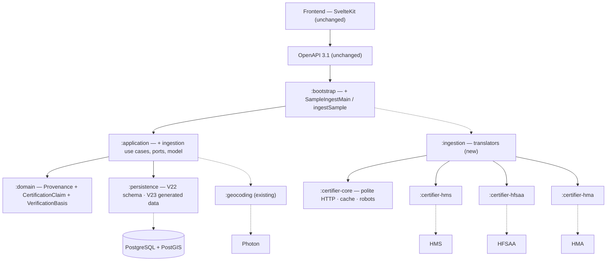

# SC-211 — Phase 7: Complete class diagram (the ultimate design)

> **Purpose:** the implementation design — layers, names, verified API surface, migrations · **Derived from:** 05–06 + live probe 2026-11-08 · **Delta:** new certifier libraries + `:ingestion`; modified `:domain`, `:application`, `:persistence`, `:bootstrap`

## Layer map

## Module map

| Module | Status | Contents |
|---|---|---|
| `:domain` | modified | `Provenance` (+4 strings); new `CertificationClaim` (+`declaredHandCut`), `VerificationBasis`; `VerificationStatus`/`VerificationCommittee` KDoc |
| `:application` | modified | `com.tahirslist.application.ingestion`: 4 use cases, ports, model, errors |
| `:certifier-core` | **new** | `CertifierHttp`, `FetchPolicy`, `HttpTransport`/`KtorHttpTransport`, `SnapshotStore`/`FileSnapshotStore`, `RobotsPolicy`, `SourceSnapshot`, `CertifierPage`, `CertifierProfile`, `HandCutDeclaration` |
| `:certifier-hms` | **new** | `HmsDirectory`, `HmsParser`, `HmsEstablishment`, `HmsCategory`, `HmsCertificationStatus`, `HmsAddress`, `HmsLocation`, `HmsProfile` |
| `:certifier-hfsaa` | **new** | `HfsaaLocator`, `HfsaaParser`, `HfsaaEntry`, `HfsaaEntryType`, `HfsaaProject`, `HfsaaProfile` |
| `:certifier-hma` | **new** | `HmaCertifiedOutlets`, `HmaParser`, `HmaCertifiedOutlet`, `HmaAddress`, `HmaProfile` |
| `:ingestion` | **new** | `SourceListing`, `SourceRef`, `SourceTier`, `DirectoryStandard`, `SourceTranslator`, `HmsTranslator`, `HfsaaTranslator`, `HmaTranslator`, `LiveProbe` |
| `:persistence` | modified | V22, V23 (generated), `ExternalCertificationClaims`, migration tests |
| `:bootstrap` | modified | `SampleIngestMain` + `ingestSample` JavaExec task |
| `:web-api` · `:geocoding` · frontend | unchanged | No API/frontend change; `PhotonGeocoder` reused |

## Verified API surface (live probe, 2026-11-08)

| Field | HMS | HFSAA | HMA |
|---|---|---|---|
| Records | **370 restaurants** (687 all categories) | **313** (248 restaurants) | **76** outlets |
| Source id | `data-id` | UUID | WordPress page id |
| Certificate id | — | **`R-…` / `M-…`** | — |
| Certification status | `Certified` | `certified` | statement on 63/76 |
| Expiry | **324 rows** | — | — |
| Coordinates | **324/370** | **312/313** | **none published** |
| Address | line, city, county, state, country | line, city, state, ZIP | line, city, province, postal |
| City | 360/370 (10 blank) | 313 | 76 |
| Phone | map records | 313 | most outlets |
| Website | — | some | some |
| Hours / cuisine | — | some | — |
| Google place id | — | some | — |
| Chapters / regions | US states | 10 chapters | Canadian provinces |
| Access | 1 GET, 10.7 MB | 1 POST RPC | 1 GET, 3.1 MB |

**Possible:** 15–25 rows per metro (Dallas 43, NYC 58, Toronto 28 before dedupe); claim-backed `VERIFIED`; certificate IDs for HFSAA; expiry for HMS; geocoding for HMA and the 46 HMS rows without coordinates.
**Not possible:** HMA coordinates; HMS certificate IDs; HFSAA expiry; any bulk Zabihah access (D-13).

## Persistence delta

| Element | Status | Detail |
|---|---|---|
| `V22__sc_211_ingestion_schema.sql` | new | provenance CHECK (+4 values); `external_certification_claims` table (id, listing_id FK, source, source_tier, source_record_ref, source_url, certifier, expires_on, `declared_hand_cut BOOLEAN NULL`, first/last_seen, created_at; unique (listing_id, source, source_record_ref)); index on listing_id; drop `uq_restaurant_listings_seed_location`, create `uq_restaurant_listings_research_location` on `(location_lat_6, location_lng_6) WHERE provenance IS NOT NULL` |
| `V23__sc_211_ingest_sample.sql` | new, generated | brands upsert → listings insert with verification + hand-cut outcome → matched-row `UPDATE` to `VERIFIED` with hand-cut from the claim's declaration → claims → `listing_search` insert/update |
| `Tables.kt` | modified | add `ExternalCertificationClaims` catalogue object |
| Verification CHECK | unchanged | V15 already admits `VERIFIED` |

## API and frontend delta

| Layer | Status | Detail |
|---|---|---|
| OpenAPI | unchanged | No routes/DTOs; sample data flows through existing `GET /v1/listings` |
| Frontend | unchanged | No routes, components, stores, or client functions |
| Contract in the middle | n/a | Backend-only; search API is acceptance evidence, not a new contract |

## Config, scripts, tests

| Item | Status | Detail |
|---|---|---|
| CLI flags | new | `--metros --caps --sources --cache-dir --out-dir` |
| `FetchPolicy` defaults | new | UA `TahirsListBot/0.1`, 1 req/s/host, 3 attempts, 10 requests/run, 24 h cache, robots on |
| `scripts/ingest-sample.sh` | new | Containerized `:bootstrap:ingestSample` |
| `scripts/certifier-live.sh` | **new** | Containerized `:ingestion:liveProbe` (ad-hoc live check) |
| `scripts/generate_ingest_migration.py` | new | Containerized candidates → V23 |
| `scripts/backend-test.sh` | unchanged | Picks up the new modules automatically |
| Tests (57, all green) | new | Core: `CertifierHttpTest` (15), `RobotsPolicyTest` (7) · HMS: `HmsParserTest` (8), `HmsDirectoryTest` (3) · HFSAA: `HfsaaParserTest` (6), `HfsaaLocatorTest` (4) · HMA: `HmaParserTest` (5), `HmaCertifiedOutletsTest` (3) · ingestion: 6 translator tests |
| Key test names | new | `loadsTierOneAsVerifiedWithClaims`, `loadsManualAsUnverified`, `handCutFollowsDeclaredStandard`, `nonHandCutDeclarationYieldsFalse`, `upgradesMatchedSeedRow`, `isIdempotent`, `doesNotDuplicateSeedRows`, `refusesVerifiedWithoutClaim`, `marksTierOneCandidatesVerified`, `neverVerifiesManualOnlyRows`, `flagsUnaccountedRow`, `re-discovers a rotated publishable key once and retries`, `follows X-WP-TotalPages` |

## Architecture and risks

**ARCHITECTURE.md §1.2:** changes — `VERIFIED` gains the `CERTIFIER_REGISTRY` route; `CertificationClaim`/`VerificationBasis` added; verification follows tier, hand-cut follows the certifier's own declaration; committee flow unchanged. Implementation PR adds the Part 1 row.

| Risk | Mitigation |
|---|---|
| Source markup/JSON changes | Recorded-fixture tests + `SOURCE_PARSE_FAILED` quarantine |
| HFSAA publishable key rotates | Key re-discovery from the public bundle, retry once (tested) |
| HMS city blank on 10 rows | `deriveCity` from the address; null if not derivable (tested) |
| Dedupe merges coincident venues | Suspected duplicates reported (D-4) |
| Badge copy says "committee" for registry rows | D-8 follow-up story |
| Certifier expiry/revocation | Expiry stored; no auto-demotion (D-10) |
| Future Tier-1 certifier does not require hand-cut | Hand-cut derives from its own declaration (FALSE/NULL), never from tier (D-11) |
| ToS / attribution | Public registries, throttled, UA; Omar review; ODbL display open (Q-4) |
