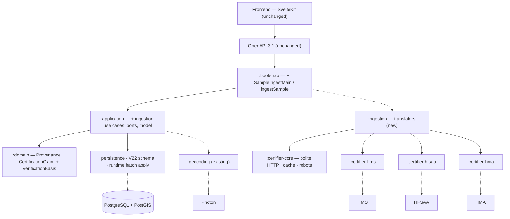

# SC-211 — Phase 7: Complete class diagram (the ultimate design)

> **Purpose:** the implementation design — layers, names, verified API surface, migrations · **Derived from:** 05–06 + live probe 2026-11-08 · **Delta:** new certifier libraries + `:ingestion`; modified `:domain`, `:application`, `:persistence`, `:bootstrap`

## Implementation status (2026-11-08)

| Increment | State |
|---|---|
| Design package (D-11…D-18) | merged — #72 |
| Certifier libraries, translators, pre-flight, artifact guard, `VenueIdentity` | merged — #75 |
| Domain claims + V22 schema | merged — #79 |
| Runtime load: claim/venue/location matching, `applyBatch`, `LoadIngestionBatch` | implemented, tested |
| Pipeline: feeds, metro filter, match confirmation, `RunSampleIngestion`, `CompileManualBatch` | implemented, tested |
| CLIs and scripts: `:bootstrap:ingestSample`, `:bootstrap:loadIngestBatch` | implemented |

## Layer map

## Module map

| Module | Status | Contents |
|---|---|---|
| `:domain` | modified | `Provenance` (+4 strings); new `CertificationClaim` (+`declaredHandCut`, persisted as `hand_cut_declaration`), `VerificationBasis`; `VerificationStatus`/`VerificationCommittee` KDoc |
| `:application` | modified | `com.tahirslist.application.ingestion`: `IngestionCandidate`, `IngestReject`, `CandidateBatch`/`CandidateBatchJson`, `CandidateValidator`, `LoadIngestionBatch.preview/execute`, `ListingWrite`/`CatalogUpdateReview`/`BatchLoadResult`, `BrandRepository`, `ClaimConflictException`; `RestaurantListingRepository` matching + `applyBatch`; `com.tahirslist.application.geo.CheckGeocoderHealth` (pre-flight) |
| `:certifier-core` | **new** | `CertifierHttp`, `FetchPolicy` (HTTPS + per-certifier host allow-list, capped redirects, response-size cap), `HttpTransport`/`KtorHttpTransport`, `SnapshotStore`/`FileSnapshotStore`, `RobotsPolicy`, `SourceSnapshot`, `CertifierPage`, `CertifierProfile`, `HandCutDeclaration` |
| `:certifier-hms` | **new** | `HmsDirectory`, `HmsParser`, `HmsEstablishment`, `HmsCategory`, `HmsCertificationStatus`, `HmsAddress`, `HmsLocation`, `HmsProfile` |
| `:certifier-hfsaa` | **new** | `HfsaaLocator`, `HfsaaParser`, `HfsaaEntry`, `HfsaaEntryType`, `HfsaaProject`, `HfsaaProfile` |
| `:certifier-hma` | **new** | `HmaCertifiedOutlets`, `HmaParser`, `HmaCertifiedOutlet`, `HmaAddress`, `HmaProfile` |
| `:ingestion` | **new** | `SourceListing`, `SourceRef`, `SourceTier`, `DirectoryStandard`, `SourceTranslator`, `HmsTranslator`, `HfsaaTranslator`, `HmaTranslator`, `LiveProbe`, `FileRunArtifacts` (per-run dirs, pending guard, checksums, `resolutions.json`), `ArtifactStore`, `VenueIdentity` (deterministic venue key); pipeline: `DirectoryFeed`/`HmsFeed`/`HfsaaFeed`/`HmaFeed`, `MetroDefinition`/`MetroCatalog`/`MetroFilter` (centre + radius from `metros.json`, no place-name lists), `MatchConfirmationPolicy`, `CandidateFactory`, `IngestReport`, `RunSampleIngestion`, `CuratedBatchSource`/`JsonCuratedBatchSource`, `CompileManualBatch` |
| `:persistence` | modified | V22; `ExternalCertificationClaims`; `ExposedBrandRepository`; `ExposedRestaurantListingRepository.applyBatch` (one transaction, shared with Add Listing) + claim/venue/location matching |
| `:bootstrap` | modified | `SampleIngestMain` + `:bootstrap:ingestSample`; `LoadIngestBatchMain` + `:bootstrap:loadIngestBatch`; `scripts/ingest-sample.sh`, `scripts/load-ingest-batch.sh` |
| `:web-api` · `:geocoding` · frontend | unchanged | No API/frontend change; `PhotonGeocoder` reused |

## Verified API surface (live probe, 2026-11-08)

| Field | HMS | HFSAA | HMA |
|---|---|---|---|
| Records | **370 restaurants** (687 all categories) | **313** (248 restaurants) | **76** outlets |
| Source id | `data-id` | UUID | WordPress page id |
| Certificate id | — | **`R-…` / `M-…`** | — |
| Certification status | `Certified` | `certified` | statement on 63/76 |
| Expiry | **324 rows** | — | — |
| Coordinates | **324/370** | **312/313** | **none published** |
| Address | line, city, county, state, country | line, city, state, ZIP | line, city, province, postal |
| City | 360/370 (10 blank) | 313 | 76 |
| Phone | map records | 313 | most outlets |
| Website | — | some | some |
| Hours / cuisine | — | some | — |
| Google place id | - | some | - |
| Cross-contamination | **not published** | **not published** | **not published** |
| Hand-cut declaration | profile (research, not a field) | profile | profile |
| Brand | derive from name | derive from name | derive from name |
| Chapters / regions | US states | 10 chapters | Canadian provinces |
| Access | 1 GET, 10.7 MB | 1 POST RPC | 1 GET, 3.1 MB |

**Possible:** 15-25 rows per metro (Dallas 43, NYC 58, Toronto 28 before dedupe); claim-backed `VERIFIED`; certificate IDs for HFSAA; expiry for HMS; geocoding for HMA and the 46 HMS rows without coordinates; a cited snapshot (`requestedUrl` + final `url` + SHA-256) for every claim.
**Not possible:** HMA coordinates; HMS certificate IDs; HFSAA expiry; any cross-contamination evidence from the directories (Tier-1 index qualification is a policy decision, D-16); directory brand ids (resolve by name); any bulk Zabihah access (D-13).

## Persistence delta

| Element | Status | Detail |
|---|---|---|
| `V22__sc_211_ingestion_schema.sql` | new | provenance CHECK (+4 values); `external_certification_claims` table (id, listing_id FK, source, source_tier, source_record_ref, source_url, certifier, expires_on, `hand_cut_declaration VARCHAR(32) NOT NULL` with CHECK `(HAND_CUT, NOT_HAND_CUT, UNSPECIFIED)`, first/last_seen, created_at; **unique `(source, source_record_ref)` globally**; source/URL CHECKs; listing FK `ON DELETE RESTRICT` so the audit trail and idempotency key survive); index on listing_id; `restaurant_listings.venue_key CHAR(64) NULL` with a partial unique index on `venue_key` where it is not null; drop `uq_restaurant_listings_seed_location` and create `uq_restaurant_listings_research_location` on `(location_lat_6, location_lng_6) WHERE provenance IS NOT NULL` (PostgreSQL infers it for V7's narrower `ON CONFLICT` predicate, so seed re-runs stay no-ops) |
| `RestaurantListingRepository.applyBatch` | new | One transaction for a batch: brands, listings (insert/update), cuisines, halal items, claims, search mirror. Matching order: claim `(source, record)` → `venue_key` → location fallback (held, not written). Shared by Add Listing and ingestion |
| `VenueIdentity` | new | SHA-256 over normalized name + address + city + region + country; coordinates excluded; conservative (no fuzzy `Rd`/`Road` merge) |
| `BrandRepository` | new | `resolve` (preview) + `resolveOrCreate` (execute) by name |
| `V23__sc_211_ingest_sample.sql` | **retired** | No generated data migration: `LoadIngestionBatch` writes through `RestaurantListingRepository.applyBatch` in one transaction (D-15) |
| `Tables.kt` | modified | add `ExternalCertificationClaims` catalogue object |
| Verification CHECK | unchanged | V15 already admits `VERIFIED` |

## API and frontend delta

| Layer | Status | Detail |
|---|---|---|
| OpenAPI | unchanged | No routes/DTOs; sample data flows through existing `GET /v1/listings` |
| Frontend | unchanged | No routes, components, stores, or client functions |
| Contract in the middle | n/a | Backend-only; search API is acceptance evidence, not a new contract |

## Config, scripts, tests

| Item | Status | Detail |
|---|---|---|
| CLI flags | new | run: `--metros --metros-file --caps --sources --cache-dir --out-dir --run-id --on-pending=abort|archive|ignore --refresh` · load: `--run-id --out-dir --resolutions --execute --load-run-id --interactive --no-interactive` |
| Metro catalogue | new | `metros.json` (classpath) or `--metros-file`: each metro is a centre + radius only. Membership is the circle; a row's own coordinates are a cheap prefilter and a row without coordinates is geocoded once to decide. No city lists exist anywhere. Adding a metro is a data change |
| Decision sheet | new | `runs/<runId>/resolutions.json` is generated at preview (one entry per finding, with evidence) and filled interactively or by an agent; `resolutionsSha256` is recorded in `loaded.json` |
| Decision vocabulary | new | claim: `same-venue` (merge, keeping the named listing), `attach-to` (re-point the claim), `bad-citation` (drop the claim); held duplicate: `same-venue` (write into the named listing), `distinct` (insert). Every decided entry needs a reason |
| `Application` decisions | new | `Finding` (claim conflict, suspected duplicate), `Resolutions`/`ResolutionsJson`, `ListingMerge`, `ClaimReattachment`, `StaleResolutionException`, `InvalidResolutionException` |
| Trust projection (V23) | new | `verification_basis` records where trust came from. After claims are written or moved, the adapter recomputes status/hand-cut/provenance/index qualification from the claim set: a Tier-1 claim wins, and a certifier's current declaration decides hand-cut (withdrawal included). Only `CERTIFIER_REGISTRY` trust can be recomputed; a committee verification (basis NULL) is never touched |
| One point, two venues (V23) | new | The research-location index is a plain lookup; only the seed corpus keeps a unique index. A curator's `distinct` decision can therefore insert a second business at a food-court point |
| `FetchPolicy` defaults | new | UA `TahirsListBot/0.1`, HTTPS-only + per-certifier host allow-list, 1 req/s/host, 3 attempts, 10 wire requests/run, 24 h cache, robots on (fail-closed), max 3 redirects (each re-checked), 16 MB response cap |
| `scripts/ingest-sample.sh` | new | Containerized `:bootstrap:ingestSample` |
| `scripts/certifier-live.sh` | **new** | Containerized `:ingestion:liveProbe` (ad-hoc live check) |
| `scripts/load-ingest-batch.sh` | new | Containerized `:bootstrap:loadIngestBatch` (preview then execute) |
| `scripts/generate_ingest_migration.py` | **retired** | No generated data migration (D-15) |
| `scripts/backend-test.sh` | unchanged | Picks up the new modules automatically |
| Pre-flight (D-14) | new | `CheckGeocoderHealth` runs one Photon query before any directory request; `Unavailable` aborts the run with no artifacts |
| Run artifacts (D-17) | new | `<out>/runs/<runId>/` with `snapshots/`, `candidates.json`, `report.md`, `run.json` (commit marker); `archive/<runId>-<timestamp>-<token>/` for pending runs; `loaded.json` / `abandoned.json` markers |
| Tests | new | Core: `CertifierHttpTest` (28), `RobotsPolicyTest` (7), `HandCutDeclarationTest` (3), `FileSnapshotStoreTest` (4) · HMS: `HmsParserTest` (8), `HmsDirectoryTest` (3) · HFSAA: `HfsaaParserTest` (6), `HfsaaLocatorTest` (6) · HMA: `HmaParserTest` (5), `HmaCertifiedOutletsTest` (3) · ingestion: translator/derivation (8), `FileRunArtifactsTest` (14), `VenueIdentityTest` (8), pipeline (`MetroFilterTest`, `MatchConfirmationPolicyTest`, `CandidateFactoryTest`, `RunSampleIngestionTest`, `CompileManualBatchTest`) · application: `CheckGeocoderHealthTest` (4), `IngestionModelTest`, `LoadIngestionBatchTest` · persistence: `ExposedIngestionBatchTest`, `ExposedBrandRepositoryTest`, `IngestionSchemaMigrationTest` · bootstrap: `IngestOptionsTest` |
| Key test names | new | `loadsTierOneAsVerifiedWithClaims`, `loadsManualAsUnverified`, `handCutFollowsDeclaredStandard`, `nonHandCutDeclarationYieldsFalse`, `silentDeclarationYieldsFalse`, `manualRowStaysNull`, `upgradesMatchedSeedRow`, `isIdempotent`, `doesNotDuplicateSeedRows`, `refusesVerifiedWithoutClaim`, `usesSharedWritePath`, `certifiedRowsAreIndexQualified`, `refuses to reuse a run id, so it cannot overwrite a run`, `archives pending runs under unique names before starting a new one`, `detects candidates.json changed after the run completed`, `flagsUnaccountedRow`, `re-discovers a rotated publishable key once and retries`, `does not re-discover a key after a 403`, `follows X-WP-TotalPages`, `refuses a host outside the certifier allow-list`, `refuses a redirect to a host outside the allow-list`, `counts each redirect hop against the request budget`, `rejects a response over the size cap`, `fails closed when robots.txt denies access`, `treats a tampered body as a cache miss`, `passes when the probe resolves`, `fails when the provider throws` |

## Architecture and risks

**ARCHITECTURE.md §1.2:** changes — `VERIFIED` gains the `CERTIFIER_REGISTRY` route; `CertificationClaim`/`VerificationBasis` added; verification follows tier, hand-cut follows the certifier's own declaration; committee flow unchanged. Implementation PR adds the Part 1 row.

| Risk | Mitigation |
|---|---|
| Photon down at run start | One test query runs first; `Unavailable` aborts before any directory fetch, so no wasted download and no partial artifacts |
| Hostile/broken directory response | HTTPS-only + per-certifier host allow-list, capped redirects re-checked per hop, 16 MB response cap, fail-closed robots, cache digest verification |
| Source markup/JSON changes | Recorded-fixture tests + `SOURCE_PARSE_FAILED` quarantine |
| HFSAA publishable key rotates | Key re-discovery from the public bundle, retry once (tested) |
| HMS city blank on 10 rows | `deriveCity` from the address; null if not derivable (tested) |
| Dedupe merges coincident venues | Exact `venue_key` merges; location-only matches are held as suspected duplicates (D-4/D-18) |
| Web/ingestion logic drift | Ingestion uses the same aggregate and `RestaurantListingRepository.applyBatch` as Add Listing (D-15); no generated SQL, no Python renderer |
| Ingested rows excluded from search | Tier-1 certification implies `NO_CROSS_CONTAMINATION` (D-16); manual/web rows stay explicit/`UNCERTAIN` |
| Batch fails partway | One transaction covers brands, listings, children, claims and mirror; any failure rolls back |
| A run overwrites an unreviewed batch | Per-run directories + pending guard; default abort, optional archive with unique names; checksum verified at load |
| A location-only match is treated as the same venue | It is held as a `SUSPECTED_DUPLICATE` finding: nothing is written until a curator records `same-venue` or `distinct`; exact `venue_key` matches update in place |
| A curator decision applied to a changed catalogue | Decisions name the listings they saw; a decision whose finding no longer exists (or names another listing) is refused as stale and the batch is not applied |
| An ingestion upgrade lowers a verified venue's trust | Trust is recomputed from the claim set after every write: a Tier-1 claim wins; a Tier-3 row matching a Tier-1 venue keeps it `VERIFIED`. Only certifier-derived trust (basis `CERTIFIER_REGISTRY`) is recomputed, so a committee verification is never demoted |
| A certifier withdraws hand-cut | Hand-cut is re-derived from the certifier's current declaration on every refresh (`HAND_CUT` → TRUE, declared-not or silent → FALSE), so a stale TRUE cannot persist |
| A merge into a lower-tier keeper loses the verified venue | The merge moves the claims first and recomputes the keeper from the union, restoring `VERIFIED`, hand-cut, provenance and the search-mirror row |
| A merge destroys evidence | `same-venue` moves claims, cuisines, halal items, favourites and reviews to the keeper in the same transaction, then deletes the duplicate; nothing merges without a recorded decision |
| Coordinates drift for the same venue | `venue_key` excludes coordinates; the same normalized name/address maps to the existing listing |
| Badge copy says "committee" for registry rows | D-8 follow-up story |
| Certifier expiry/revocation | Expiry stored; no auto-demotion (D-10) |
| Future Tier-1 certifier does not require hand-cut | Hand-cut derives from its own declaration (FALSE for declared not or silent), never from tier (D-11) |
| ToS / attribution | Public registries, throttled, UA; Omar review; ODbL display open (Q-4) |
