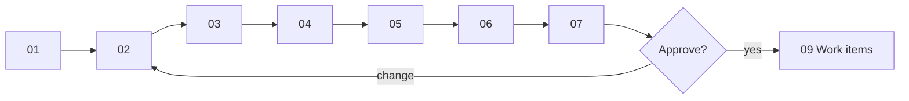

# Design walkthrough — SC-211 Sample ingestion pipeline

> **Purpose:** the founder review surface · **Derived from:** 01–07 + verified libraries · **Delta:** new feature
> Design commit: this branch · Date: 2026-11-08 · **Status: awaiting decision**

| Date | Change | Phases re-run |
|---|---|---|
| 2026-11-07 | Initial walkthrough | — |
| 2026-11-07 | Founder amendment: registries confer verification; hand-cut follows the certifier's declaration | 0–2, 4–8 |
| 2026-11-07 | Format-only retrofit to the ratified diagram-first standard | none (content unchanged) |
| 2026-11-08 | Access spike closed; three certifier libraries implemented, 66 new tests green, live probe passed (D-12, D-13) | 0–8 |
| 2026-11-08 | Correction: a silent certifier declaration yields FALSE, not NULL; NULL only where there is no certifier claim | 0–2, 6–8 |
| 2026-11-08 | Diagram retrofit: actors on the left, owned data store shown explicitly (ratified conventions from #74) | 3–6 |
| 2026-11-08 | D-14: one Photon pre-flight query before any directory fetch; failure aborts with no artifacts | 0–2, 4–7 |



## 1. Story and domain model
**Shows:** claim-backed registry verification, run/report, claims, hand-cut declaration.
**Locks in:** `VERIFIED` has two routes; tier drives verification, the certifier's declaration drives hand-cut (TRUE only on declared hand-cut, FALSE otherwise); manual rows never verify.
**Need:** approve D-3; confirm D-9, D-10, D-11, D-12.

## 2. Use cases
**Shows:** UC-01 Tier-1 sample · UC-02 cited manual batch · UC-03 reviewed load · UC-04 audit.
**Locks in:** library fetch/translate/report is separate from the reviewed, transactional load; Zabihah has no library.
**Need:** ratify D-1; decide D-2; confirm D-9, D-13.

## 3. Use case diagram
**Shows:** four new UCs, the Data Curator, and the three library modules as external dependencies.
**Locks in:** no new end-user flow; no change to existing associations.
**Need:** approve; confirm D-1.

## 4. Black-box sequences
**Shows:** what the curator sees — a pre-flight check, one request per library, partial runs, key rotation, aborts, idempotent re-load.
**Locks in:** Photon is proven reachable before any directory fetch; Tier-1 shows Verified; manual rows do not; failures are explicit; no invented locations.
**Need:** approve.

## 5. System class diagram
**Shows:** entities, one control per UC, boundaries, the three libraries, `CertifierHttp`, translators.
**Locks in:** each certifier owns its model; a translator is the only crossing point; geocoding stays on the existing port.
**Need:** approve; confirm D-12.

## 6. White-box sequences
**Shows:** the serving path; pre-flight → cache → robots → 1 req/s; real live counts; one transaction for V23.
**Locks in:** geocoder availability is checked before any fetch; dedupe/upgrade semantics; hand-cut never derived from tier; fail-fast migration; blocking audit checks.
**Need:** approve; confirm D-4.

## 7. Complete class diagram (the design being approved)
**Shows:** module map, exact class names, verified field matrix, V22/V23, no API/frontend delta, 66 new tests.
**Locks in:** module boundaries, migration contents, provenance strings, test names.
**Need:** approve, including D-5, D-6, D-8, D-11, D-12.

## 8. Verified access
**Shows:** live probe 2026-11-08 — HMS 370 restaurants (324 with coordinates, 324 with expiry); HFSAA 313 (312 with coordinates, all certificate IDs); HMA 76 (no coordinates, 63 statements).
**Locks in:** Dallas 43, NYC 58, Toronto 28 before dedupe; 3 requests cover the sample; Zabihah is licensed-only.
**Need:** acknowledge the limits — HMA needs geocoding; HMS has no certificate id; HFSAA has no expiry.

## Decision items

| # | Question | Recommendation | Decision |
|---|---|---|---|
| D-1 | Ratify Data Curator (DC) as a new internal actor | Yes | pending |
| D-2 | Keep SC-211 in epic 111 or a new ingestion epic | Keep in 111 | pending |
| D-3 | Claim entity + `CERTIFIER_REGISTRY` verification basis | Yes | pending |
| D-4 | Widen dedupe index to `WHERE provenance IS NOT NULL` | Yes | pending |
| D-5 | Artifacts under `docs/research/ingest-sample-2026-11/` | Yes | pending |
| D-6 | The four provenance strings | Approve | pending |
| D-7 | Out of scope: scheduler, claims UI, auto-Zabihah, ODbL display | Confirm | pending |
| D-8 | Verified-badge attribution copy as a follow-up story | Yes | pending |
| D-9 | Upgrade matched existing rows to `VERIFIED`; hand-cut per their claim's declaration | Yes | pending |
| D-10 | Expiry stored; no auto-demotion; revocation stays open | Yes | pending |
| D-11 | Per-directory hand-cut declaration drives hand-cut (TRUE only on declared hand-cut; FALSE for declared not or silent); tier drives only verification | Yes | pending |
| D-12 | One independent library per certifier (own model) + explicit translators, in-repo | Yes | pending |
| D-13 | Zabihah bulk access is licensed-only; manual cited batch until licensed | Yes | pending |
| D-14 | One Photon pre-flight query runs before any directory fetch; failure aborts with no artifacts | Yes | pending |

## Approval

> **Design approval requested.** Reply `approved`, or name the diagram and the change.

```
Approved by: <pending> · Date: · Design commit:
Decision items: D-1 … D-14 resolved as tabled
```

Re-approval: libraries implemented and live-verified, 2026-11-08.
