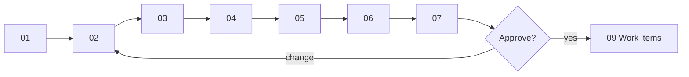

# Design walkthrough — SC-211 Sample ingestion pipeline

> **Purpose:** the founder review surface · **Derived from:** 01–07 · **Delta:** new feature
Design commit: this branch · Date: 2026-11-07 · **Status: awaiting decision**

| Date | Change | Phases re-run |
|---|---|---|
| 2026-11-07 | Initial walkthrough | — |
| 2026-11-07 | Founder amendment: Tier-1 registries confer verification; hand-cut derives from the declared standard | 0–2, 4–8 |
| 2026-11-07 | Format-only retrofit to the ratified diagram-first standard | none (content unchanged) |



## 1. Story and domain model
**Shows:** the pipeline's vocabulary — claim-backed registry verification, run/report, claims.
**Locks in:** `VERIFIED` has two routes; verification follows tier, hand-cut follows the certifier's declared standard; manual rows never verify.
**Need:** approve D-3; confirm D-9, D-10, D-11.

## 2. Use cases
**Shows:** UC-01 Tier-1 sample · UC-02 cited manual batch · UC-03 reviewed load · UC-04 audit.
**Locks in:** fetch/geocode/report is separate from the reviewed, transactional load.
**Need:** ratify D-1; decide D-2; confirm D-9.

## 3. Use case diagram
**Shows:** the four new UCs, the new Data Curator, five external dependencies, over the agreed model.
**Locks in:** no new end-user flow; no change to existing associations.
**Need:** approve; confirm D-1.

## 4. Black-box sequences
**Shows:** what the curator sees per flow — partial runs, aborts, rejects, idempotent re-load.
**Locks in:** Tier-1 shows Verified; manual rows do not; failures are explicit.
**Need:** approve.

## 5. System class diagram
**Shows:** entities, one control per UC, boundaries, ports + adapter stubs.
**Locks in:** a new directory is an adapter; geocoding stays on the existing port.
**Need:** approve; confirm no additional sources now.

## 6. White-box sequences
**Shows:** the serving path; one transaction for V23; verification-by-tier and hand-cut-by-standard; error classes.
**Locks in:** dedupe/upgrade semantics; hand-cut never derived from tier; fail-fast migration; blocking audit checks.
**Need:** approve; confirm D-4.

## 7. Complete class diagram (the design being approved)
**Shows:** layer map, module/class names, V22/V23, no API/frontend delta, tests.
**Locks in:** module boundaries, migration contents, provenance strings, test names.
**Need:** approve, including D-5, D-6, D-8, D-11.

## Decision items

| # | Question | Recommendation | Decision |
|---|---|---|---|
| D-1 | Ratify Data Curator (DC) as a new internal actor | Yes | pending |
| D-2 | Keep SC-211 in epic 111 or a new ingestion epic | Keep in 111 | pending |
| D-3 | Claim entity + `CERTIFIER_REGISTRY` verification basis | Yes | pending |
| D-4 | Widen dedupe index to `WHERE provenance IS NOT NULL` | Yes | pending |
| D-5 | Artifacts under `docs/research/ingest-sample-2026-11/` | Yes | pending |
| D-6 | The four provenance strings | Approve | pending |
| D-7 | Out of scope: scheduler, claims UI, auto-Zabihah, ODbL display | Confirm | pending |
| D-8 | Verified-badge attribution copy as a follow-up story | Yes | pending |
| D-9 | Upgrade matched existing rows to `VERIFIED`; hand-cut per their claim's standard | Yes | pending |
| D-10 | Expiry stored; no auto-demotion; revocation stays open | Yes | pending |
| D-11 | Per-directory declared standard (tier + HAND/MACHINE/UNSPECIFIED) drives hand-cut; tier drives only verification | Yes | pending |

## Approval

> **Design approval requested.** Reply `approved`, or name the diagram and the change.

```
Approved by: <pending> · Date: · Design commit:
Decision items: D-1 … D-11 resolved as tabled
```

Re-approval: format-only retrofit, technical content unchanged, be3630e.
