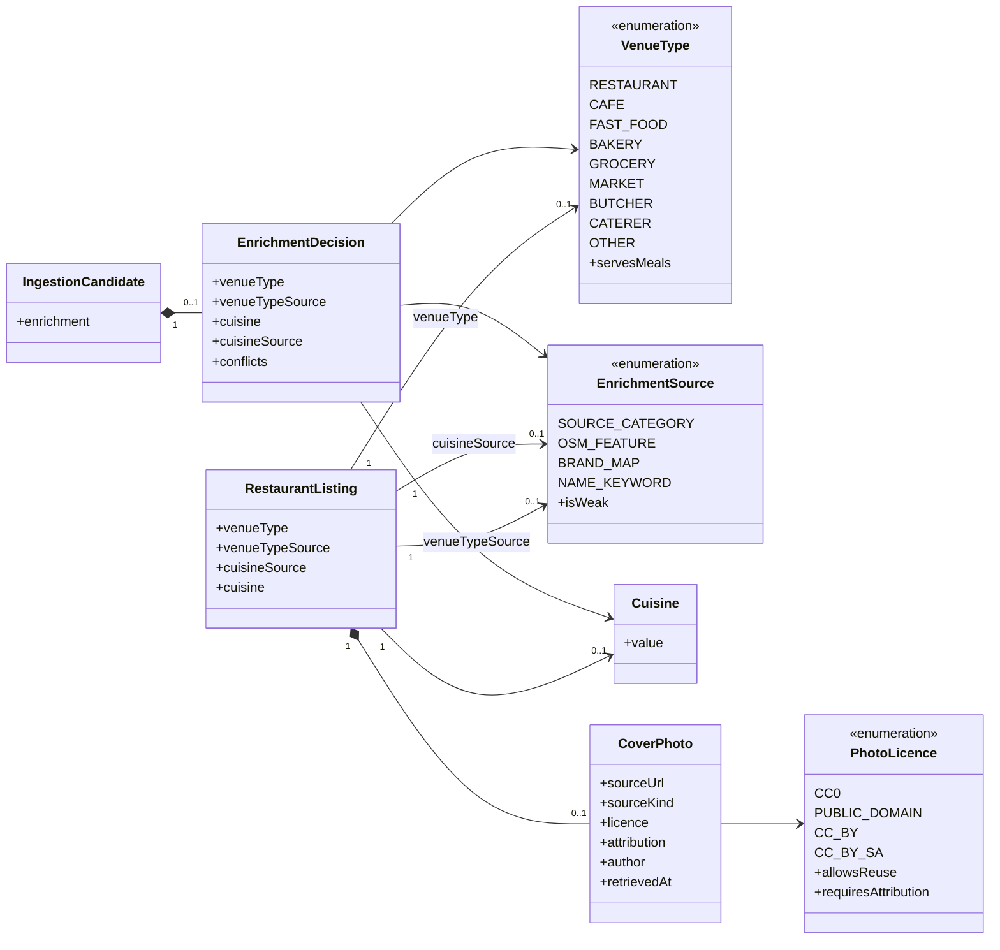

# SC-231 — Phase 1: Domain model

> **Purpose:** the domain vocabulary the use cases rely on · **Derived from:** 00 · **Delta:** extends `RestaurantListing` (venue type + cover photo); new `VenueType`, `EnrichmentSource`, `CoverPhoto`, `PhotoLicence`; `Cuisine` unchanged

**ARCHITECTURE.md §1.2 impact: changes** — `Restaurant` gains *what kind of place it is* and *one credited cover photo*; the restaurant search indexes only meal-serving types (D-6). Verification, hand-cut and the committee flow are untouched.

## Entities

| Entity | Role | Lifecycle |
|---|---|---|
| RestaurantListing (existing) | Catalogue root; gains type, type-evidence, cuisine-evidence and one cover photo | Unchanged trust lifecycle; enrichment fills nulls only |
| VenueType (new) | Closed vocabulary for *what kind of place this is*; `null` means "not decided" | Immutable value |
| EnrichmentSource (new) | Which evidence class decided a value; `NAME_KEYWORD` is marked weak | Immutable value |
| EnrichmentDecision (new) | One row's enrichment outcome + conflicts, carried by the candidate and rendered in the report | Computed once per candidate; deterministic |
| Cuisine (existing) | Free-form validated string (lowercase, ≤64) | Unchanged |
| CoverPhoto (new) | One listing's cover photo: where it came from, its licence, and who to credit | Attached once; replaced only with `--replace` |
| PhotoLicence (new) | The reuse terms we accept | Immutable value |
| IngestionCandidate (existing) | Gains `enrichment`; no other change | Unchanged |

## Invariants

| # | Invariant | Becomes test |
|---|---|---|
| INV-1 | `venueType` is a member of the closed vocabulary or `null`; `null` means the evidence did not decide, never "unknown restaurant" | `VenueClassifierTest.undecidedStaysNull` |
| INV-2 | A source category that is not a restaurant can never produce `RESTAURANT`, whatever the name says | `VenueClassifierTest.retailStoreNeverBecomesRestaurant` |
| INV-3 | Stronger evidence never loses to weaker: source category → OSM feature → name keyword | `VenueClassifierTest.categoryBeatsOsmBeatsName` |
| INV-4 | `cuisine` is set only when evidence exists; two conflicting cuisine families leave it `null` and record the conflict | `VenueClassifierTest.conflictingCuisinesStayNull` |
| INV-5 | `cuisine` is set only for meal-serving types (`RESTAURANT`, `CAFE`, `FAST_FOOD`); a butcher/grocery/distributor never carries one | `VenueClassifierTest.nonServingTypeHasNoCuisine` |
| INV-6 | Every non-null derived value carries the `EnrichmentSource` that produced it | `EnrichmentDecisionTest.everyValueHasASource` |
| INV-7 | Enrichment fills `null` only: an owner- or curator-set value is never overwritten, and re-running the same batch is a no-op | `LoadIngestionBatchTest.enrichmentFillsNullsOnly` · `isIdempotent` |
| INV-8 | Classification is deterministic and side-effect free: same inputs → same decision, no network, no clock, no randomness | `VenueClassifierTest.isDeterministic` |
| INV-9 | A listing carries at most one cover photo | `CoverPhotoTest.onePerListing` |
| INV-10 | A photo is stored only with an accepted licence and the attribution that licence requires; no licence → no photo | `AttachCoverPhotoTest.refusesUnknownLicence` |
| INV-11 | A missing photo stays missing and is reported as a gap; no placeholder, no generated image | `AttachCoverPhotoTest.missingStaysMissing` |
| INV-12 | A listing whose type does not serve meals is not written to the restaurant search index (D-6) | `LoadIngestionBatchTest.nonServingTypesAreNotIndexed` |
| INV-13 | Enrichment never changes verification status, verification basis, hand-cut or cross-contamination | `LoadIngestionBatchTest.enrichmentLeavesTrustAlone` |
| INV-14 | What the report says a row was decided to be is what the catalogue stores | `LoadIngestionBatchTest.reportMatchesCatalogue` |

## States

| From | Event | To | Guard |
|---|---|---|---|
| Matched | Evidence decides the type | Classified | A decisive source category, OSM tag or name word |
| Matched | No evidence decides | Undecided | `venueType = null`, listed in the report |
| Classified | Cuisine evidence, single family | CuisineAssigned | Type serves meals |
| Classified | Two cuisine families | CuisineConflict | Cuisine `null`, conflict recorded |
| Undecided / Classified / CuisineAssigned / CuisineConflict | Reviewed load applied | Loaded | Existing value is `null` (INV-7) |
| Loaded | Non-serving type | NotIndexed | D-6 |
| Loaded | Serving type | Indexed | — |
| Loaded | No photo candidate | NoPhoto | Gap reported |
| Loaded | Licensed candidate found | PhotoPending | Licence accepted, attribution captured |
| PhotoPending | Fetch + decode + variants stored | Photographed | All variants written |
| PhotoPending | Fetch or decode fails | NoPhoto | Failure reported, existing photo kept |
| Photographed | Re-run with another candidate | Photographed | Only with `--replace` |
| Any enrichment state | Owner or curator edits the value | Curated | Enrichment never overwrites this again |

## Glossary

| Term | Meaning |
|---|---|
| Venue type | Closed-vocabulary *what this is*: restaurant, cafe, fast food, bakery, grocery, market, butcher, caterer, other, or undecided |
| Serving type | `RESTAURANT`, `CAFE`, `FAST_FOOD` — the types that may carry a cuisine and appear in restaurant search |
| Evidence source | Which input decided a value: the source's category, the OSM feature tag, a curated brand map, or a name keyword |
| Weak evidence | Name-keyword cuisine: deterministic but a heuristic, surfaced in the review queue |
| Review queue | The report section listing weak and conflicting decisions for a curator |
| Cover photo | The one photo shown for a listing — its bytes live in the image store; its credit lives in the catalogue |
| Accepted licence | `CC0`, public domain, `CC-BY`, `CC-BY-SA`; anything else is refused |
| Enrichment run | A post-load pass over existing listings that attaches photos (phase 2); classification runs inside the ingestion run (phase 1) |
| Gap | Something enrichment could not decide or find, reported rather than guessed |
