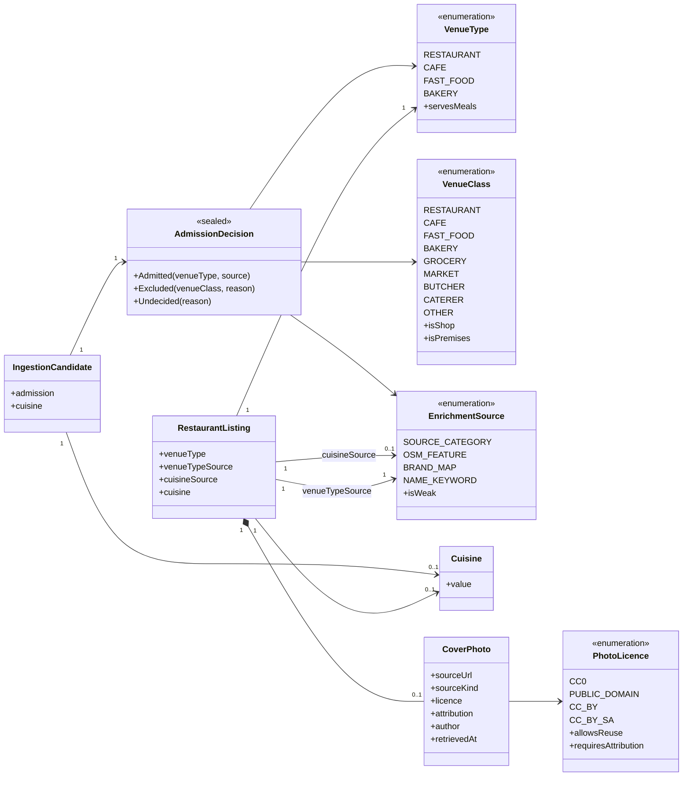

# SC-231 — Phase 1: Domain model

> **Purpose:** the domain vocabulary the use cases rely on · **Derived from:** 00 · **Delta:** new `VenueClass` (what the evidence says), `VenueType` (what we publish), `AdmissionDecision`, `EnrichmentSource`, `CoverPhoto`, `PhotoLicence`; `RestaurantListing` gains type + evidence + one cover photo

**ARCHITECTURE.md §1.2 impact: changes** — the catalogue holds **restaurants only** (L-1); a `Restaurant` gains *what kind of restaurant it is* and *one credited cover photo*. Non-restaurants never reach the catalogue. Verification, hand-cut and the committee flow are untouched.

## Two vocabularies, deliberately

| Vocabulary | Question it answers | Stored? |
|---|---|---|
| `VenueClass` | *What does the evidence say this is?* — including butcher, grocery, distributor | **No.** It is an input to the admission decision and appears in the report |
| `VenueType` | *What kind of restaurant is this?* — `RESTAURANT`, `CAFE`, `FAST_FOOD`, `BAKERY` (L-3) | **Yes**, on every stored listing |

Why two: L-1 says the catalogue holds restaurants only, so the stored type must
describe a restaurant. But to *exclude* a butcher we must first recognise it, and
that recognition is not a property of any stored row. Collapsing them into one
enum would either store "BUTCHER" on rows that must not exist, or force the
classifier to return null for something it recognised perfectly well.

## Entities

| Entity | Role | Lifecycle |
|---|---|---|
| RestaurantListing (existing) | Catalogue root; gains its kind, the evidence for it, and one cover photo | Only restaurants exist here (L-1) |
| VenueType (new) | The published restaurant kinds | Immutable value |
| VenueClass (new) | The recogniser's answer, including non-restaurant classes | Immutable, not persisted |
| AdmissionDecision (new) | `Admitted` / `Excluded` / `Undecided` — the gate's verdict, carried by the candidate and rendered in the report | Computed once per candidate |
| EnrichmentSource (new) | Which evidence class decided a value; `NAME_KEYWORD` is weak | Immutable value |
| Cuisine (existing) | Free-form validated string (lowercase, ≤64) | Unchanged |
| CoverPhoto (new) | One listing's cover photo: where it came from, its licence, who to credit | Attached once; replaced only with `--replace` |
| PhotoLicence (new) | The reuse terms we accept | Immutable value |
| IngestionCandidate (existing) | Gains `admission` and `cuisine` | Unchanged trust fields |

## Invariants

| # | Invariant | Becomes test |
|---|---|---|
| INV-1 | A stored listing is a restaurant: only `Admitted` candidates are written (L-1) | `LoadIngestionBatchTest.nonRestaurantsAreNeverWritten` |
| INV-2 | A shop marker with no premises marker excludes the row, even when the source category says *Restaurants* (the three real rows in today's catalogue) | `AdmissionPolicyTest.restaurantCategoryLosesToShopName` |
| INV-3 | A premises marker ("kitchen", "grill", "bakery") rescues a shop-looking name (`Madina Market (Kitchen)`, `Mannan Bakery and Grill`) and a pure bakery is admitted as `BAKERY` (L-3) | `AdmissionPolicyTest.premisesWordRescuesShopName` · `bakeryIsAdmitted` |
| INV-4 | Evidence order: hard exclusion → source category → OSM feature → name; a weaker source never overrides a stronger one | `AdmissionPolicyTest.evidenceOrder` |
| INV-5 | No decisive evidence means `Undecided`: not loaded, reported for a curator | `AdmissionPolicyTest.undecidedIsHeld` |
| INV-6 | `venueType` on a stored listing is one of the published kinds and always carries its `EnrichmentSource` | `VenueTypeTest.everyTypeHasASource` |
| INV-7 | `cuisine` is set only when evidence exists; two conflicting families leave it `null` and record the conflict | `CuisineAssignerTest.conflictStaysNull` |
| INV-8 | `cuisine` is set only for meal-serving types; a cafe, fast food or bakery may carry one (a butcher or grocery never reaches the catalogue) | `CuisineAssignerTest.nonServingTypeHasNoCuisine` |
| INV-9 | Enrichment fills `null` only: an owner- or curator-set value is never overwritten and a re-run is a no-op | `LoadIngestionBatchTest.enrichmentFillsNullsOnly` · `isIdempotent` |
| INV-10 | Classification is deterministic and side-effect free: same inputs → same decision, no network, no clock, no randomness | `AdmissionPolicyTest.isDeterministic` |
| INV-11 | A listing carries at most one cover photo | `CoverPhotoTest.onePerListing` |
| INV-12 | A photo is stored only with an accepted licence and the attribution that licence requires; no licence → no photo | `AttachCoverPhotoTest.refusesUnknownLicence` |
| INV-13 | A missing photo stays missing and is reported as a gap; no placeholder, no generated image | `AttachCoverPhotoTest.missingStaysMissing` |
| INV-14 | Enrichment never changes verification status, verification basis, hand-cut or cross-contamination | `LoadIngestionBatchTest.enrichmentLeavesTrustAlone` |
| INV-15 | What the report says a row was decided to be is what the catalogue stores, and every exclusion appears in the report | `LoadIngestionBatchTest.reportMatchesCatalogue` |

## States

| From | Event | To | Guard |
|---|---|---|---|
| Matched | Hard exclusion evidence | Excluded | Shop marker without premises marker, or a non-restaurant category, or a shop OSM tag |
| Matched | Category/OSM/name says restaurant | Admitted | Type narrowed to cafe/fast food where the evidence says so |
| Matched | Nothing decides | Undecided | Held, reported, never loaded |
| Admitted | Cuisine evidence, one family | CuisineAssigned | Type serves meals |
| Admitted | Two cuisine families | CuisineConflict | Cuisine `null`, conflict recorded |
| Excluded / Undecided / Admitted | Reviewed load applied | Loaded / Rejected | Only `Admitted` reaches `Loaded` |
| Loaded | No photo candidate | NoPhoto | Gap reported |
| Loaded | Licensed candidate found | PhotoPending | Licence accepted, attribution captured |
| PhotoPending | Fetch + decode + variants stored | Photographed | All variants written |
| PhotoPending | Fetch or decode fails | NoPhoto | Failure reported, existing photo kept |
| Photographed | Re-run with another candidate | Photographed | Only with `--replace` |
| Any admitted state | Owner or curator edits the value | Curated | Enrichment never overwrites this again |

## Glossary

| Term | Meaning |
|---|---|
| Venue class | What the evidence says a place is, including the classes we refuse (butcher, grocery, market, distributor) |
| Venue type | What kind of restaurant a stored listing is: restaurant, cafe, fast food, bakery (L-3) |
| Shop marker | A name or tag that says *retail*: butcher, meat shop, poultry, grocery, supermarket, sweets, wholesale. **Bakery is not one of these** (L-3) |
| Premises marker | A name word that says *eat here*: restaurant, grill, kitchen, cafe, diner, pizzeria, bbq, bakery |
| Admission | The gate's verdict on one row: admitted, excluded, or undecided |
| Exclusion | A recognised non-restaurant removed from the batch and counted in the report — never silently dropped |
| Undecided | No evidence that the row is a restaurant; held for a curator rather than guessed into the catalogue |
| Evidence source | Which input decided a value: the source's category, the OSM feature tag, a curated brand map, or a name keyword |
| Weak evidence | Name-keyword cuisine: deterministic but a heuristic, surfaced in the review queue |
| Cover photo | The one photo shown for a listing — bytes in the image store, credit in the catalogue |
| Accepted licence | `CC0`, public domain, `CC-BY`, `CC-BY-SA`; anything else is refused |
| Enrichment run | A post-load pass over existing listings that attaches photos; classification runs inside the ingestion run |
