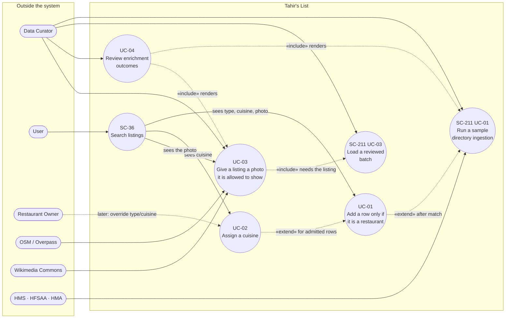

# SC-231 — Phase 3: Use case diagram

> **Purpose:** who can do what, and which use cases are new · **Derived from:** 02 · **Delta:** UC-01…UC-04 new; SC-211's run/load extend

## System boundary and actors

## Reading the diagram

| Element | Why it is drawn that way |
|---|---|
| `UC-01` **extends** SC-211 UC-01 | Admission is a step added inside an existing run, not a new run. It decides *whether* the row may be a candidate at all (L-1) |
| `UC-02` **extends** UC-01 | Cuisine is only asked for once a row is admitted, and only for meal-serving types |
| `UC-03` **includes** SC-211 UC-03 | A photo needs a listing id, so it can only run after a load |
| `UC-04` **includes** UC-01 and UC-03 | The report renders both passes; one report format, two producers |
| `Search listings` **depends on** UC-01…UC-03 | The user sees the enrichment; they never trigger it, and everything they see is a restaurant |
| `Restaurant Owner` is dashed | Overriding type/cuisine is a later story (out of scope); the arrow records that enrichment must not block it |
| External actors sit left | OSM and Commons are read-only actors, not owned stores; the directory sources are the existing SC-211 actors |

## New vs existing

| Use case | Status | Notes |
|---|---|---|
| SC-211 UC-01 Run a sample directory ingestion | existing, extended | gains the admission gate, classification and the enrichment section of the report |
| SC-211 UC-03 Load a reviewed batch | existing, extended | writes venue type, evidence classes, cuisine; **only admitted rows are written** |
| UC-01 Add a row only if it is a restaurant | **new** | phase 1; the gate that enforces L-1 |
| UC-02 Assign a cuisine | **new** | phase 1 |
| UC-03 Give a listing a photo it is allowed to show | **new** | phase 2, post-load; owner > free-licensed > Places cache |
| UC-04 Review enrichment outcomes | **new** | spans both passes |
| SC-36 Search listings | existing, unchanged surface | reads whatever the load wrote — and everything the load writes is a restaurant |

## Personas affected

| Persona | Change |
|---|---|
| DC · Data Curator | two new operations (run classification inside ingestion; run the photo pass) and a review queue to read |
| U · User | sees a type, a cuisine and a credited photo on cards and detail |
| RO/VRO · Owner | nothing yet; the eventual override path must not be broken |
| VC · Verification Committee | nothing — enrichment cannot alter trust state |
