# SC-231 — Phase 4: Black-box — UC-01 Add a row only if it is a restaurant

> **Purpose:** actor-visible behaviour of the admission gate · **Derived from:** 02 UC-01 · **Delta:** new step inside the SC-211 run
> **Security:** the gate decides what enters a public directory. A wrong *admission* publishes a shop as a restaurant; a wrong *exclusion* silently loses a real one. Both are reported, and the decision always names its evidence.

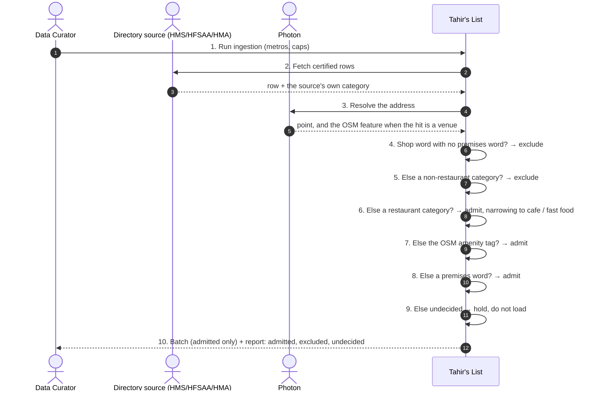
**A1 — a butcher under a restaurant category** · the real rows in today's catalogue.
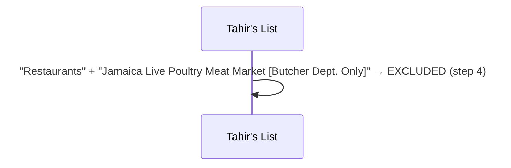
**A2 — a market with a kitchen** · premises word rescues it.
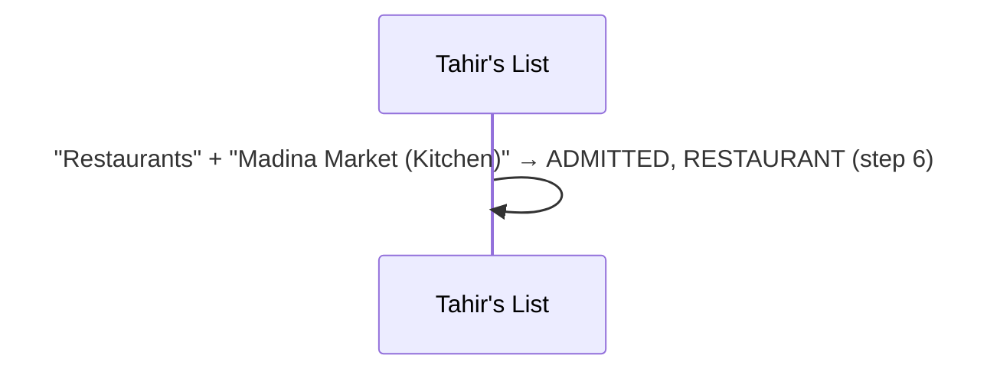
**A3 — a bakery with a grill** · shop word plus premises word.
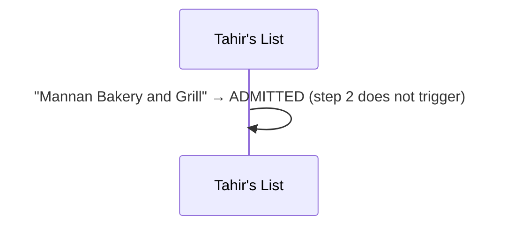
**A4 — a pure bakery** · a bakery is a restaurant (L-3).
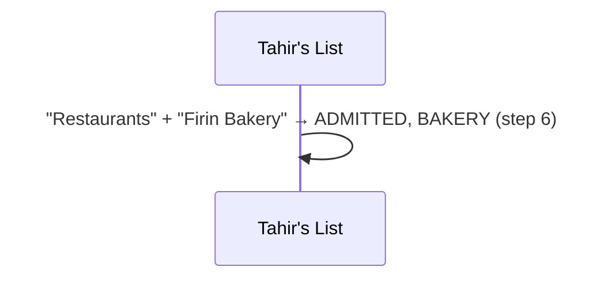
**A5 — a retail store named like a butcher** · both agree.
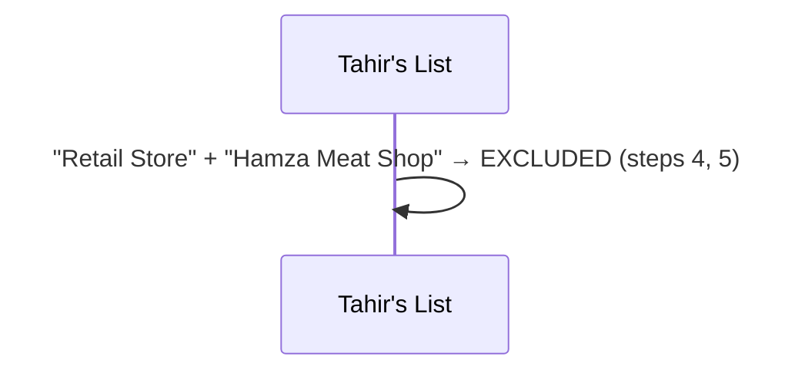
**A6 — a slaughter house, distributor or processor** · excluded by category.
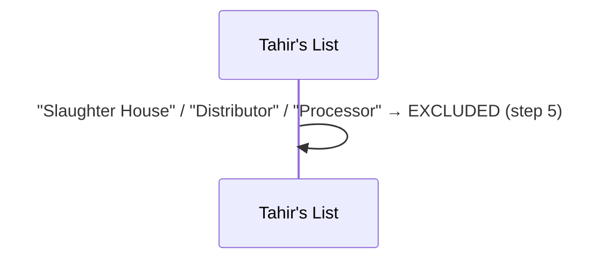
**A7 — a plain restaurant** · admitted, type narrowed when the name says cafe.
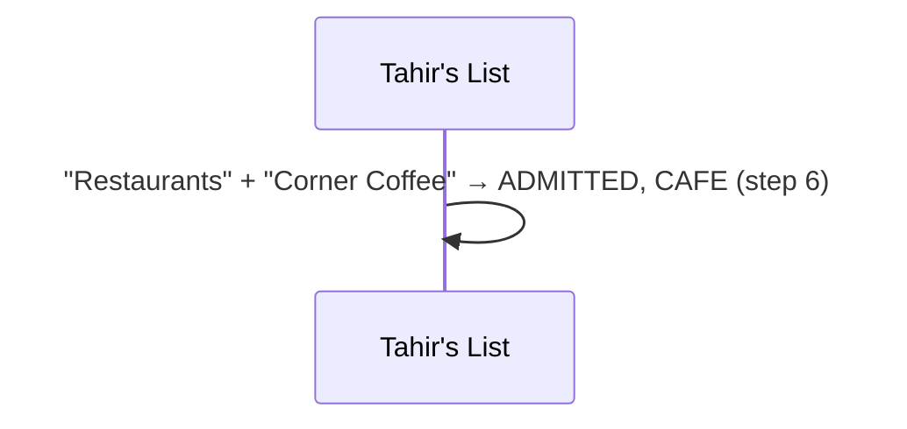
**E1 — nothing decides** · held, never guessed.
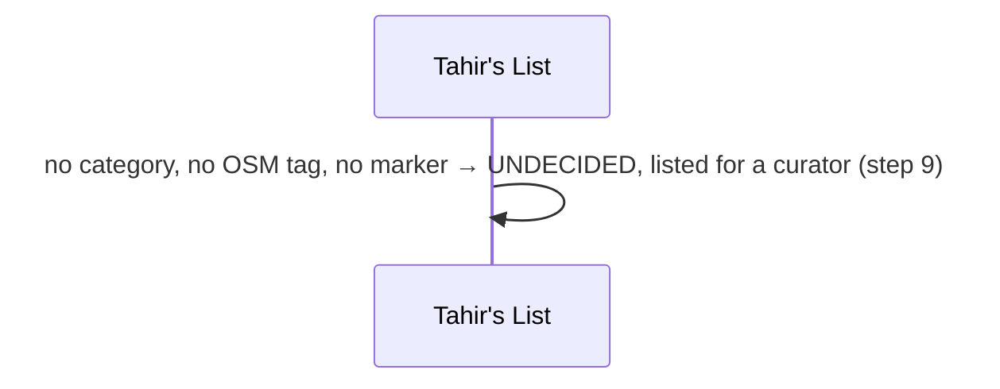
**E2 — both marker families** · premises wins, both words recorded.
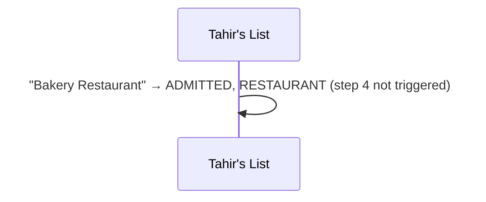
**P1 — OSM tag unavailable** · category + name only.
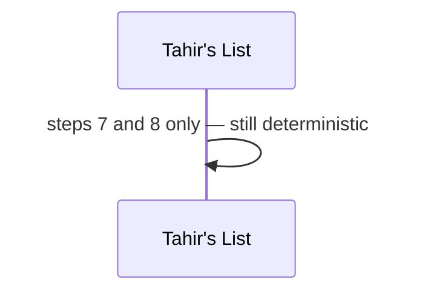
**P2 — the source changes its categories** · visible as a shift in the excluded share.
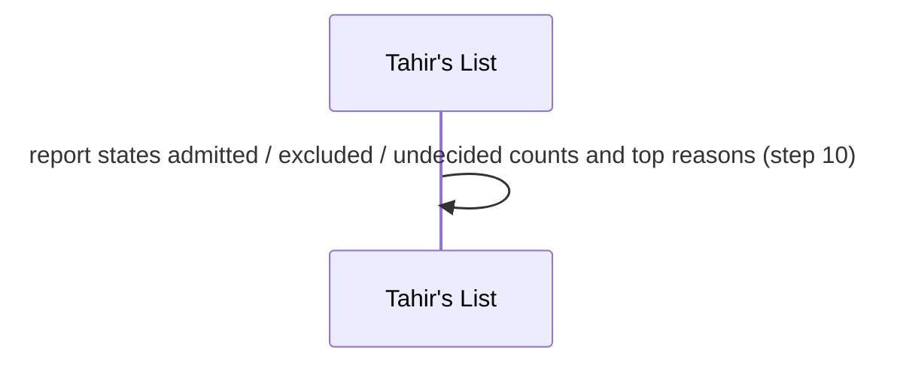
