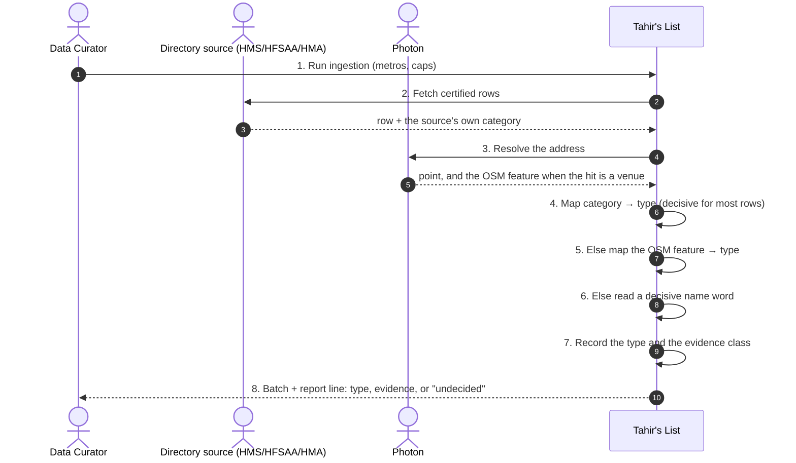
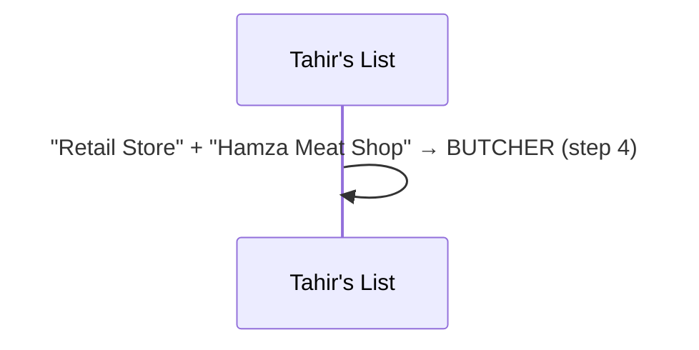
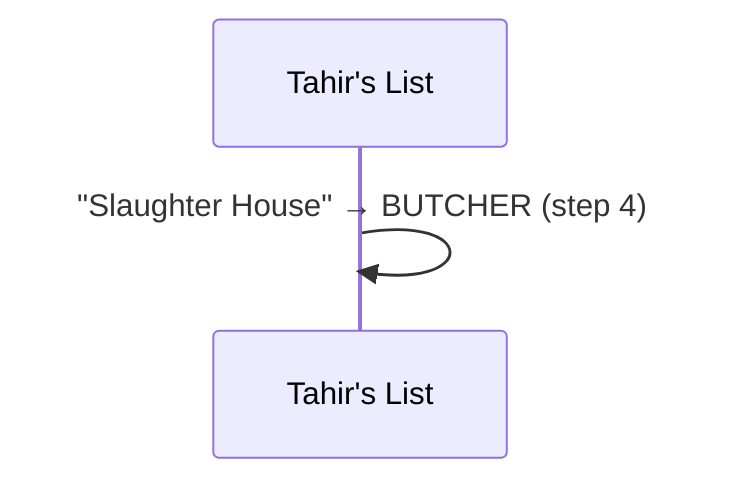
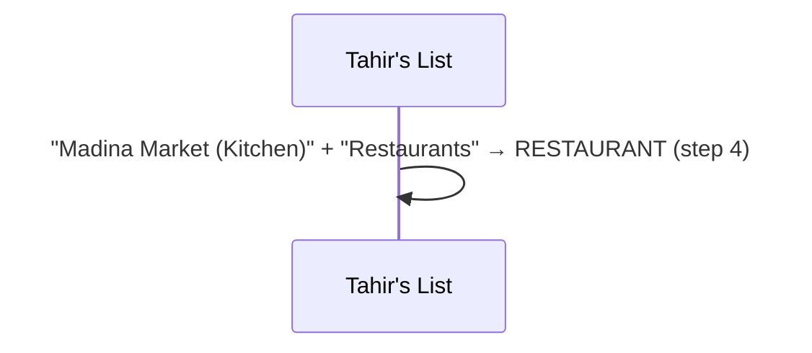
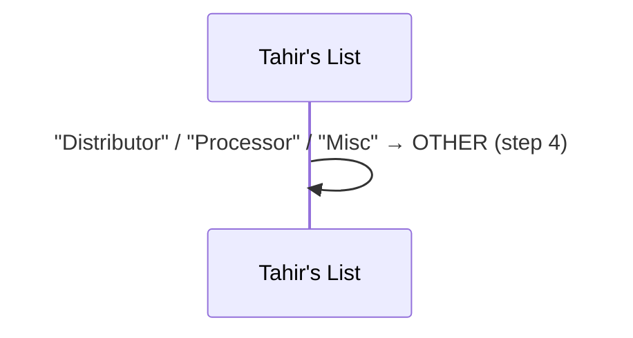
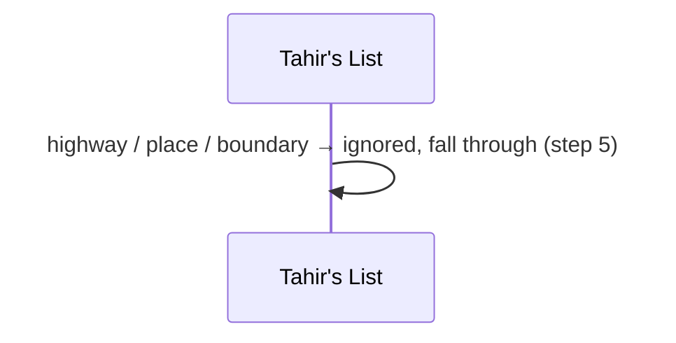
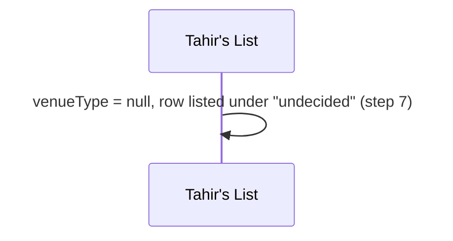
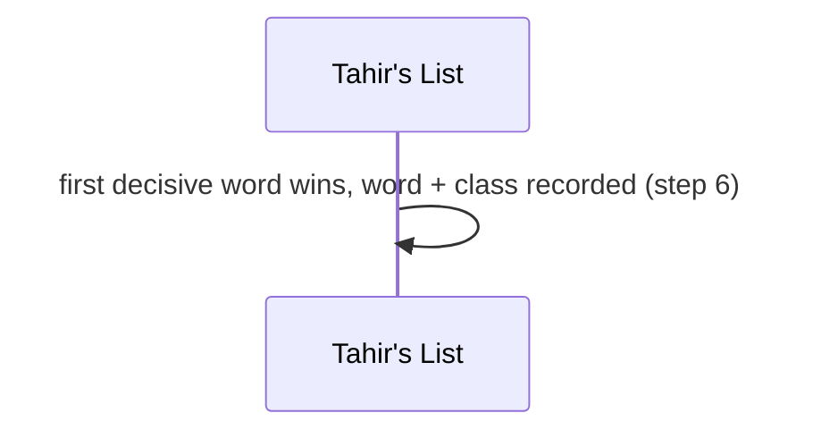
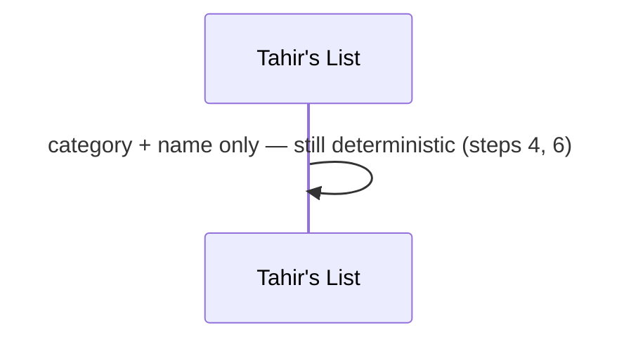

# SC-231 — Phase 4: Black-box — UC-01 Classify a row's venue type

> **Purpose:** actor-visible behaviour of classifying a row · **Derived from:** 02 UC-01 · **Delta:** new step inside the SC-211 run
> **Security:** no new trust input; classification reads text a certifier already published. A wrong type must never change verification or hand-cut. No auth surface, no PII.

**A1 — a retail store named like a butcher** · name narrows the non-restaurant category.

**A2 — a slaughter house** · never a restaurant.

**A3 — name contradicts category** · the category is stronger.

**A4 — a distributor or processor** · decided, but not a place to eat.

**A5 — the OSM hit is not a venue** · a road or boundary says nothing.

**E1 — no evidence decides** · honest null.

**E2 — two name words disagree** · fixed order, reported.

**P1 — OSM tag unavailable** · SC-227 not merged, or no match detail.

