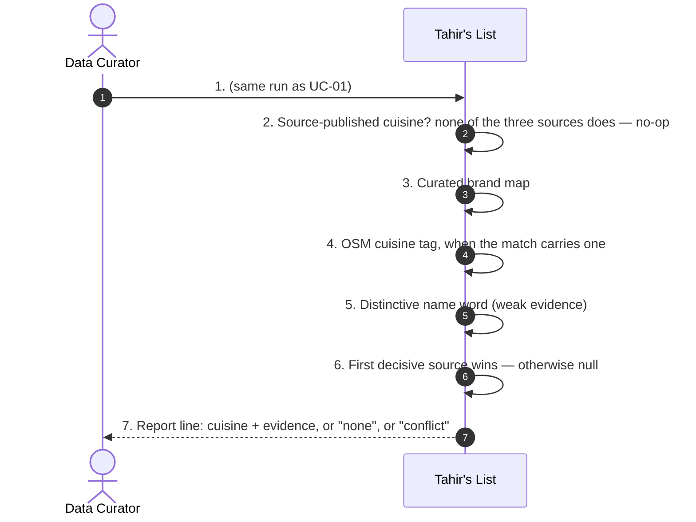
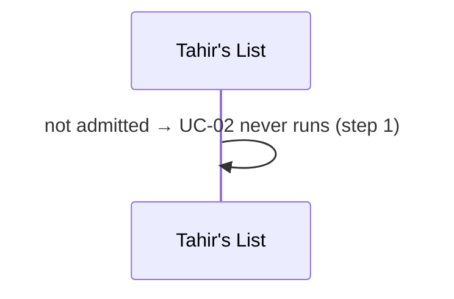
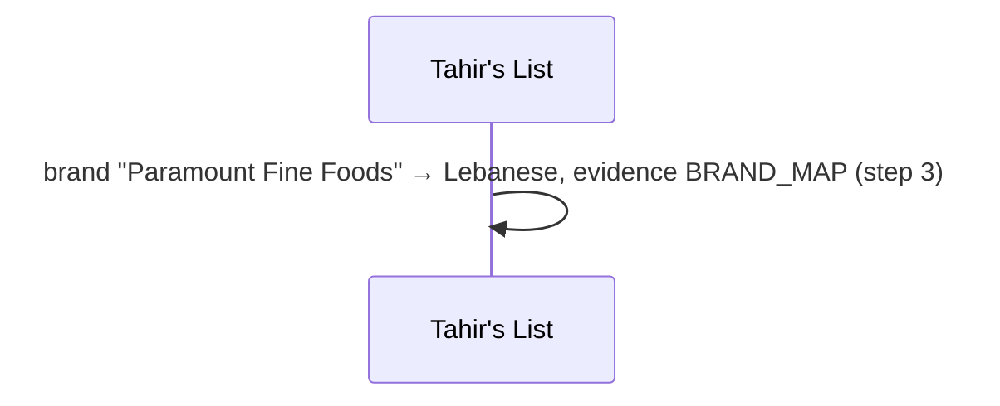
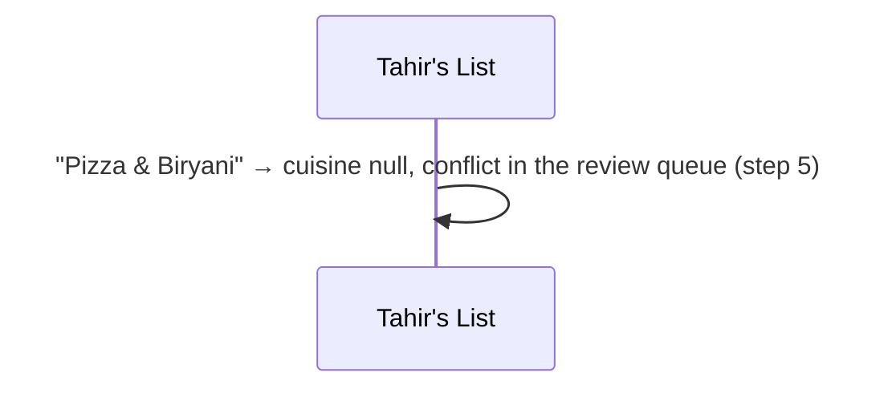
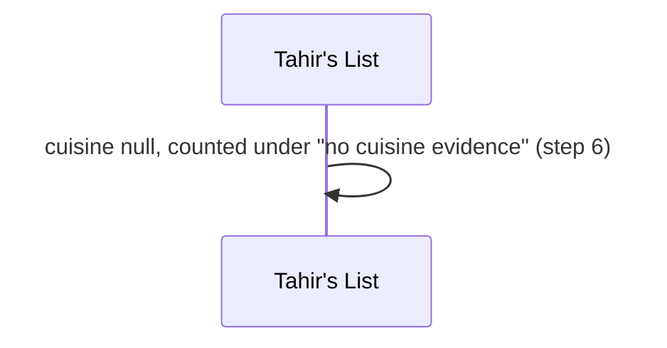
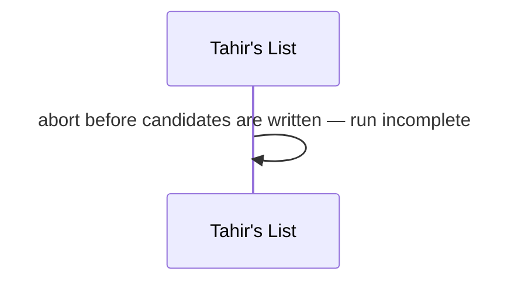
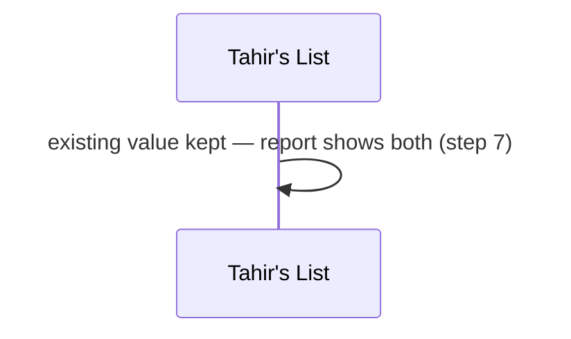

# SC-231 — Phase 4: Black-box — UC-02 Assign a cuisine

> **Purpose:** actor-visible behaviour of assigning a cuisine · **Derived from:** 02 UC-02 · **Delta:** new step after admission
> **Security:** no new input; the risk is *fabricated* data, so every value carries evidence and conflicting evidence means null.

**A1 — the row is a butcher or grocery** · cuisine is not asked.

**A2 — a chain on the brand map** · strong-ish evidence, not the source's own claim.

**A3 — two families in the name** · conflict, not a coin flip.

**E1 — nothing says anything** · null.

**E2 — curated tables malformed** · fail loudly, do not half-classify.

**P1 — the row already has a cuisine (owner/curator)** · untouched.

