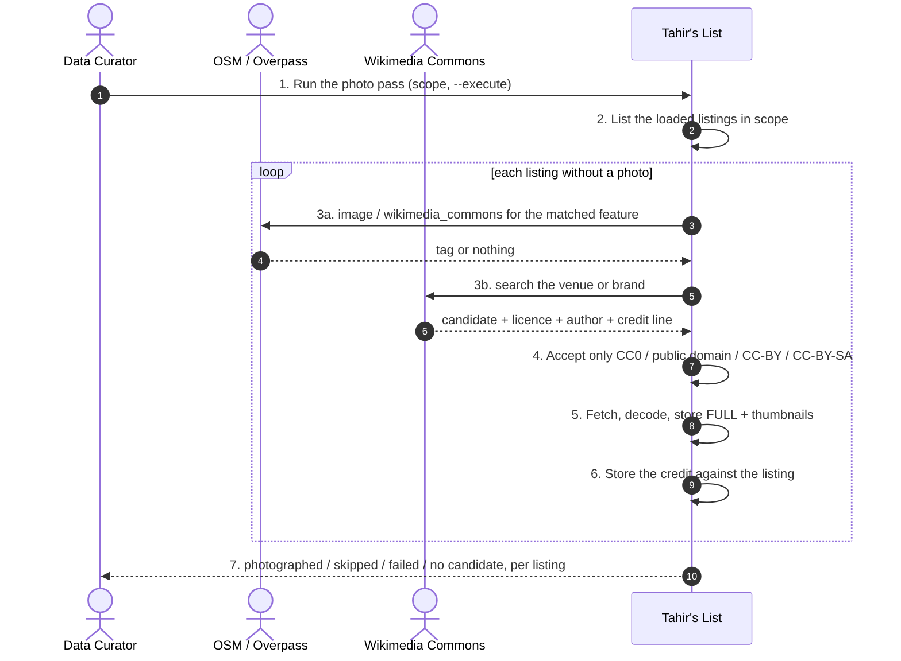
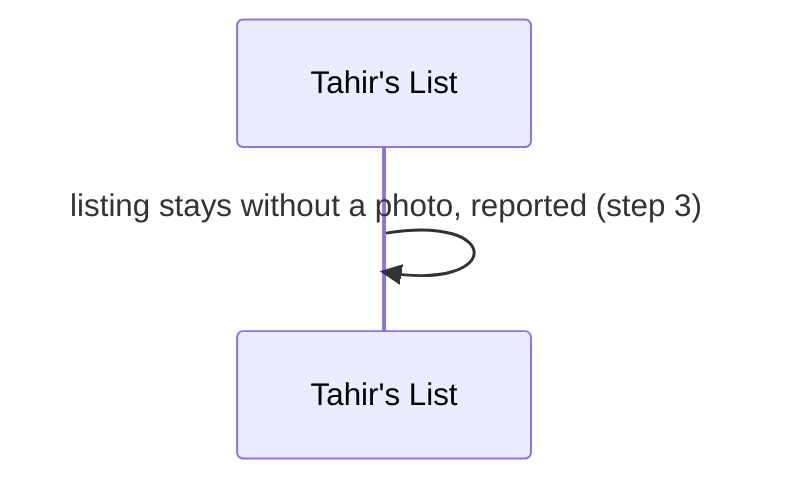
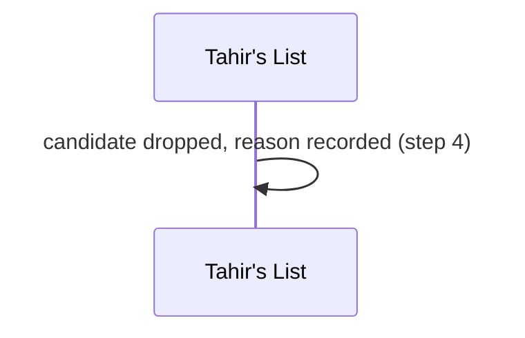
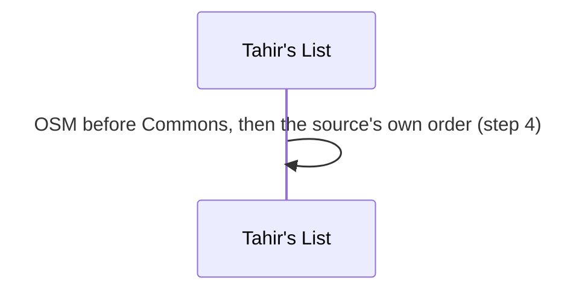
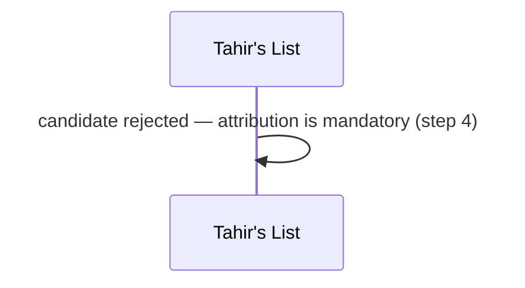
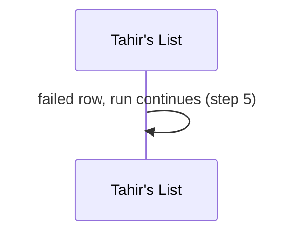
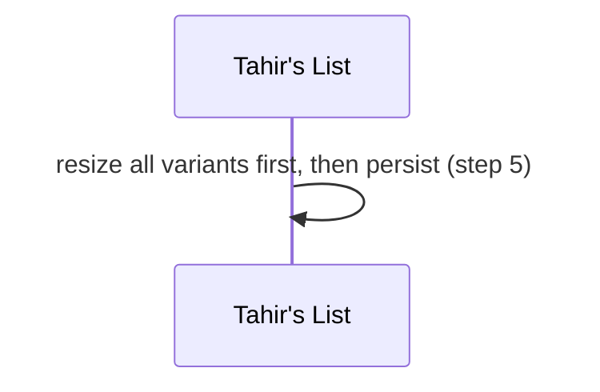
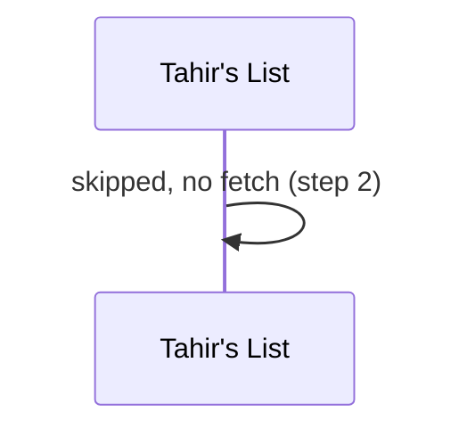
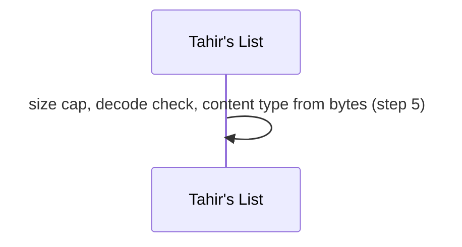

# SC-231 — Phase 4: Black-box — UC-03 Attach a licensed cover photo

> **Purpose:** actor-visible behaviour of the photo pass · **Derived from:** 02 UC-03 · **Delta:** new post-load command
> **Security:** an external, untrusted image is fetched and republished. The risks are licence breach and hostile bytes: only accepted licences are used, attribution is mandatory, the content type is derived from the bytes, and the image endpoint already serves `img-src 'self'`.

**A1 — no candidate anywhere** · a gap, not a placeholder.

**A2 — licence unknown or non-free** · refuse before fetching bytes.

**A3 — several acceptable candidates** · deterministic ordering.

**A4 — CC-BY candidate with no author or credit line** · a licence breach is not a nit.

**E1 — fetch or decode fails** · reported, existing photo kept.

**E2 — partial variant write** · impossible: thumbnails are produced before anything is stored.

**P1 — the listing already has a photo** · untouched without `--replace`.

**P2 — a hostile or oversized image** · bounded and type-derived.

