# SC-231 — Phase 4: Black-box — UC-03 Give a listing a photo it is allowed to show

> **Purpose:** actor-visible behaviour of the photo pass · **Derived from:** 02 UC-03 · **Delta:** new post-load command; Google Places as a licensed cache
> **Security:** an external image is fetched and republished. Risks are licence breach, hostile bytes, and a key leaking to the browser: only accepted sources are used, attribution is mandatory, the content type comes from the bytes, and the Places key stays server-side.

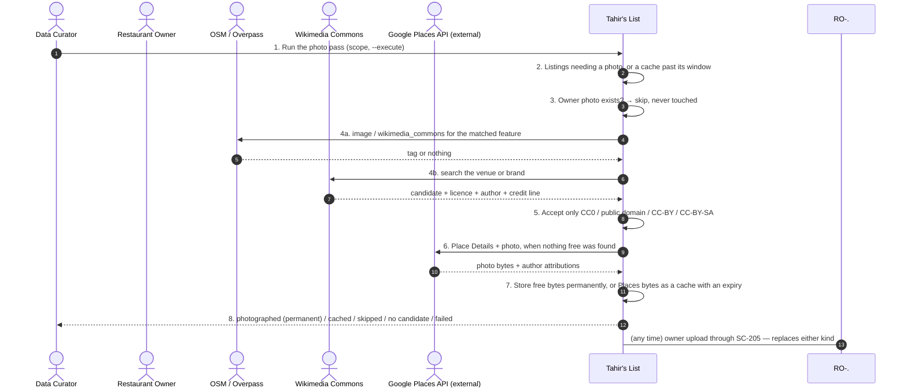
**A1 — the owner already uploaded** · the pass steps back.
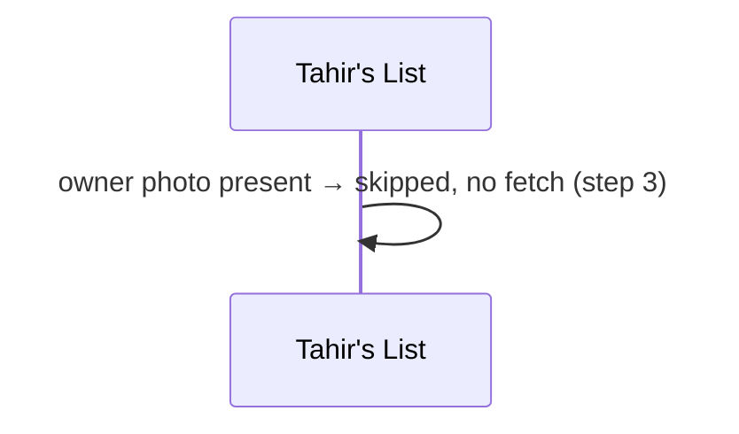
**A2 — no candidate anywhere** · a gap, not a placeholder.
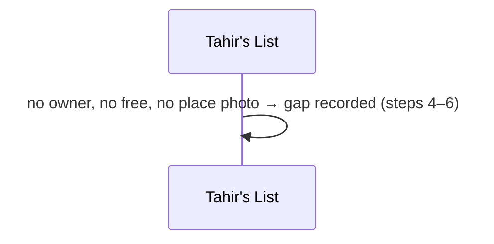
**A3 — non-free licence** · refuse before fetching bytes.
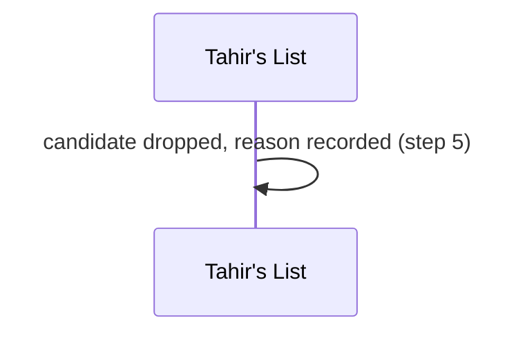
**A4 — two free candidates** · deterministic order.
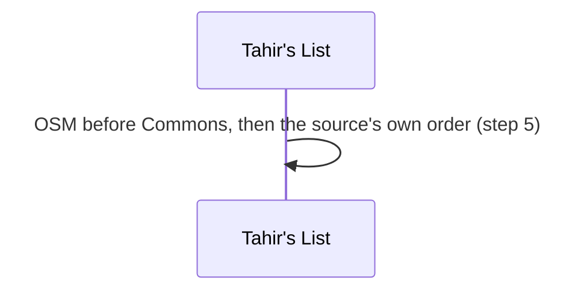
**A5 — CC-BY with no credit line** · a licence breach is not a nit.
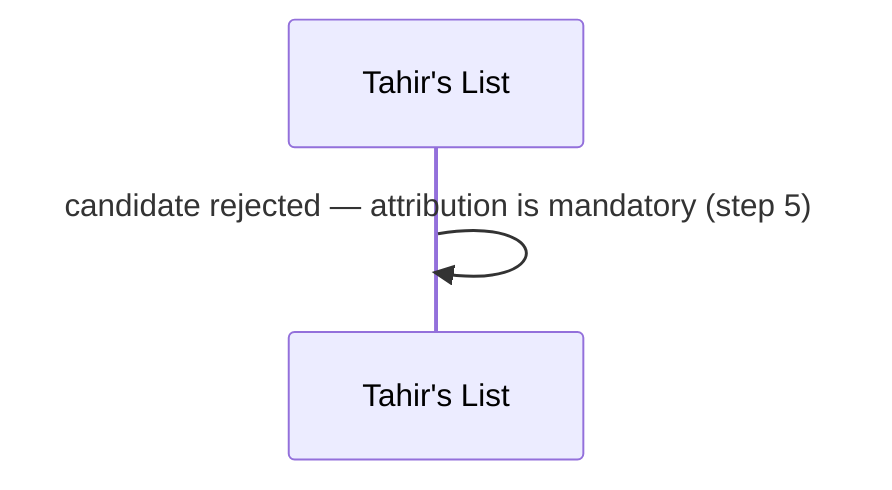
**A6 — no free photo, Places has one** · cached, not kept.
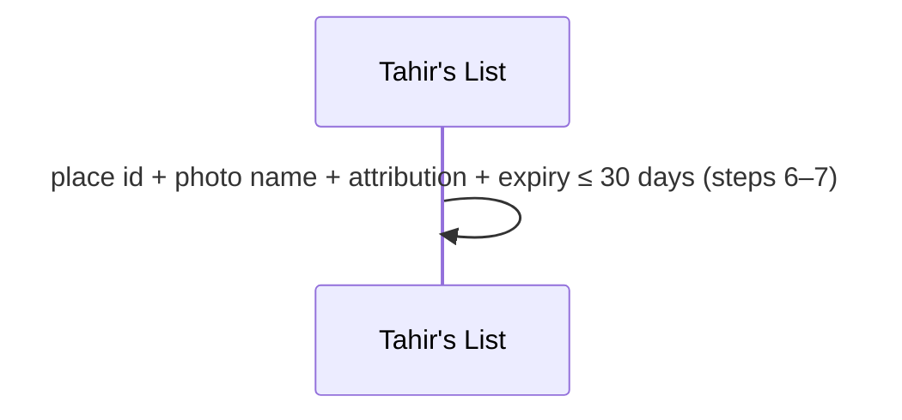
**E1 — fetch or decode fails** · reported, unexpired bytes kept.
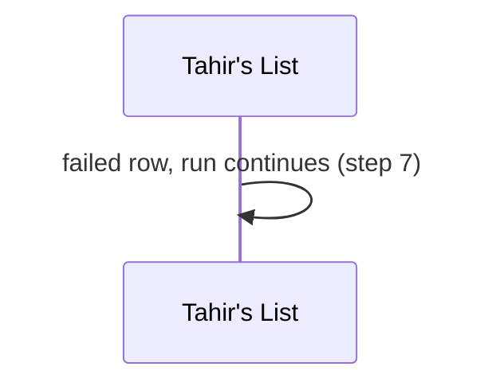
**E2 — Places quota exhausted or key rejected** · one row's failure, not the run's.
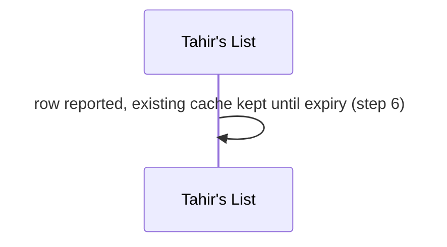
**P1 — the cache expired before the pass ran** · not served.
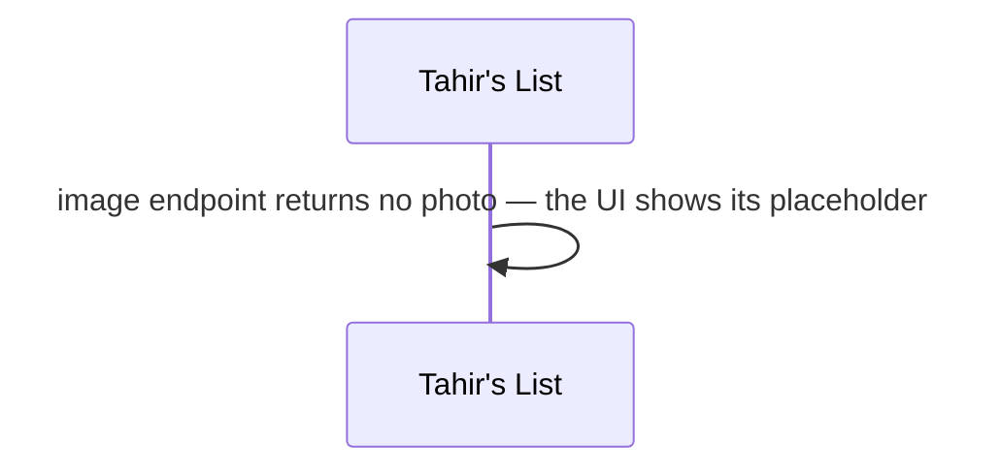
**P2 — a hostile or oversized image** · bounded and type-derived.
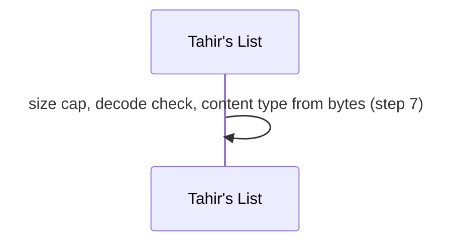
**P3 — an owner uploads over a cached photo** · last write wins, cache metadata cleared.
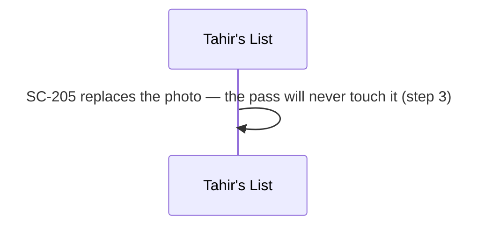
