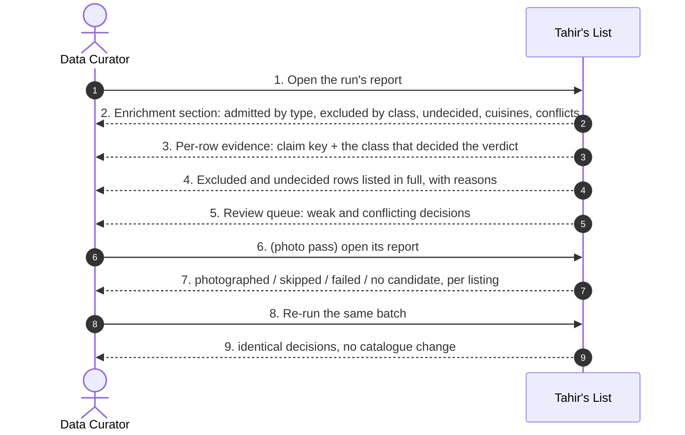
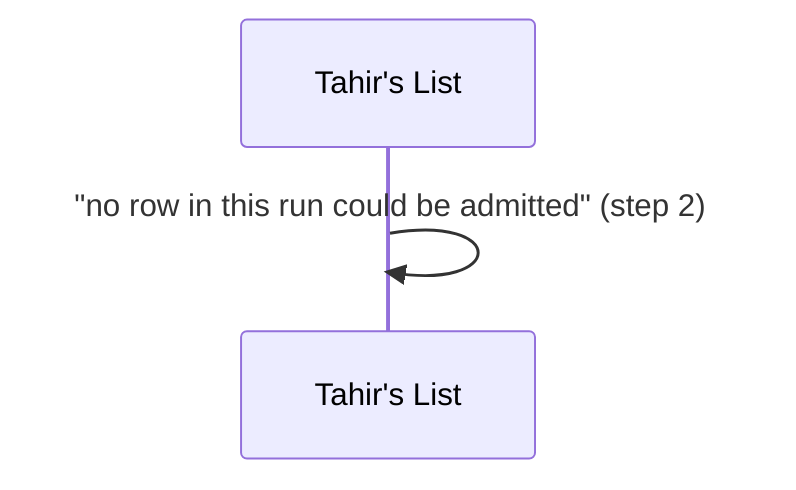
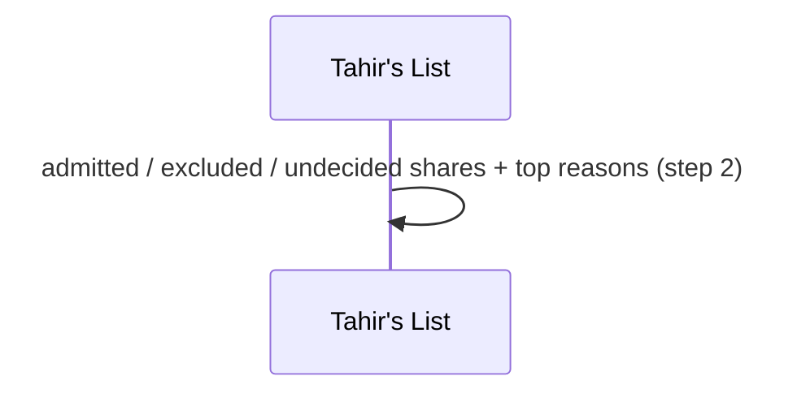
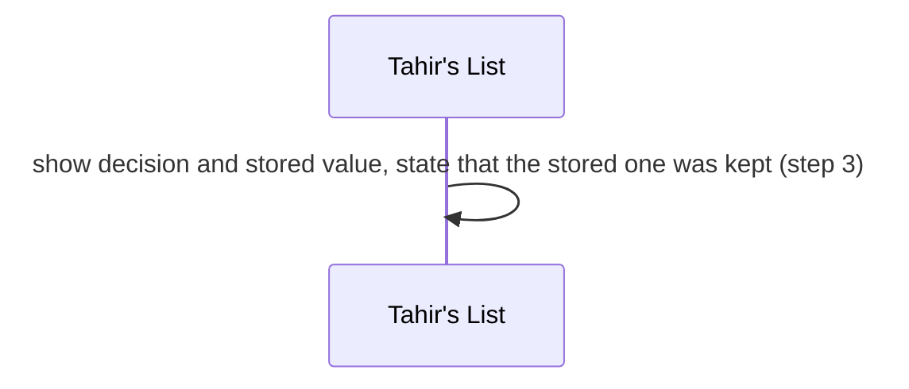
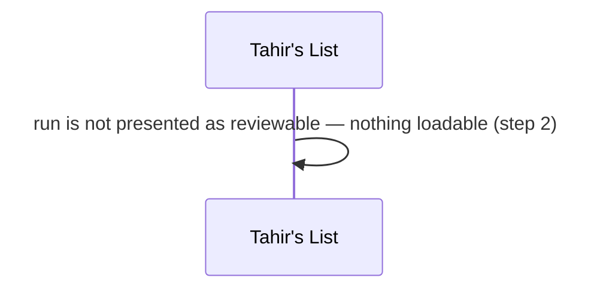
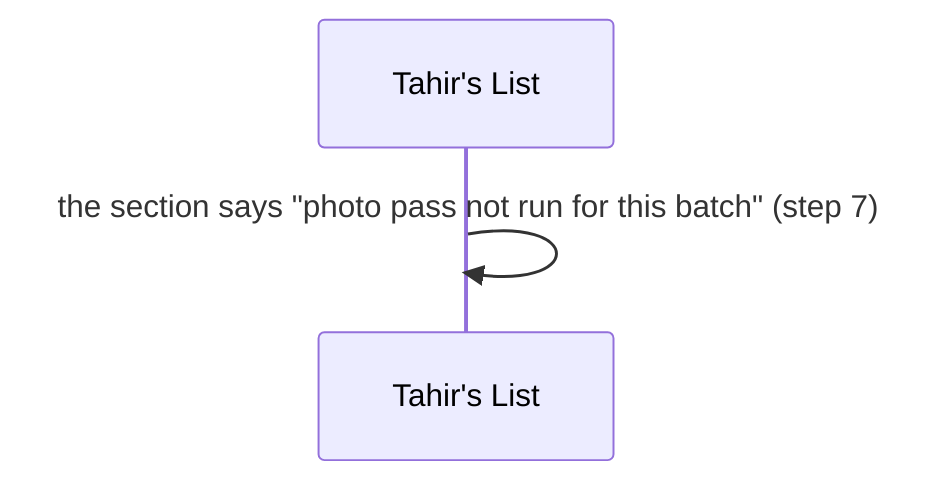

# SC-231 — Phase 4: Black-box — UC-04 Review enrichment outcomes

> **Purpose:** actor-visible behaviour of reviewing what enrichment decided · **Derived from:** 02 UC-04 · **Delta:** new report section
> **Security:** the report is the audit surface. It must not claim more than the catalogue holds, and it must show what was skipped as loudly as what was decided.

**A1 — nothing could be admitted** · said out loud.

**A2 — a large share excluded** · a classifier bug or a source change must be visible.

**A3 — a stored value differs from the decision** · the owner edited it.

**E1 — the report cannot be written** · the run is incomplete.

**P1 — a photo pass never run** · absence is not success.

