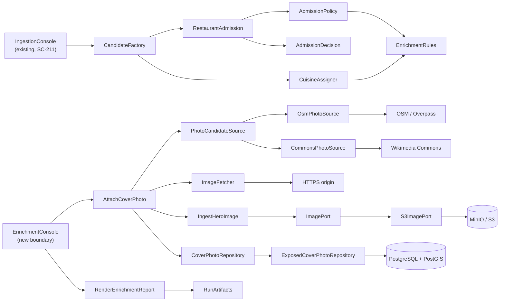
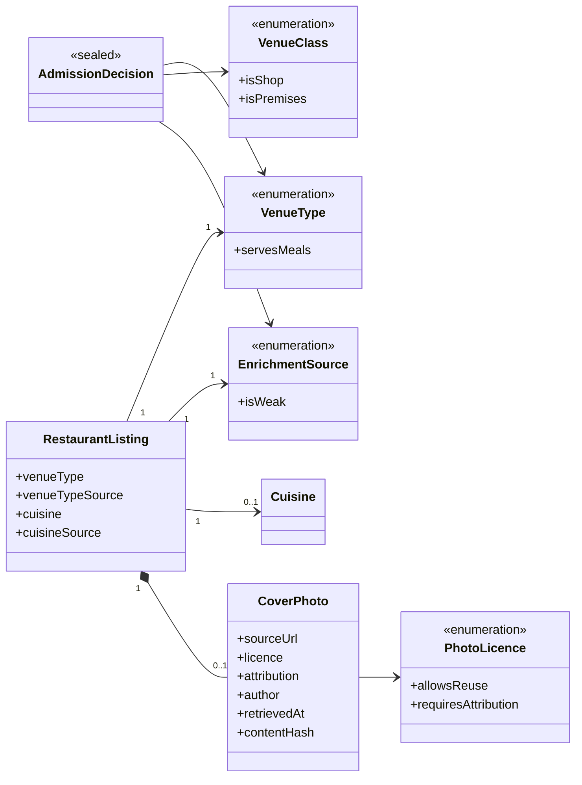
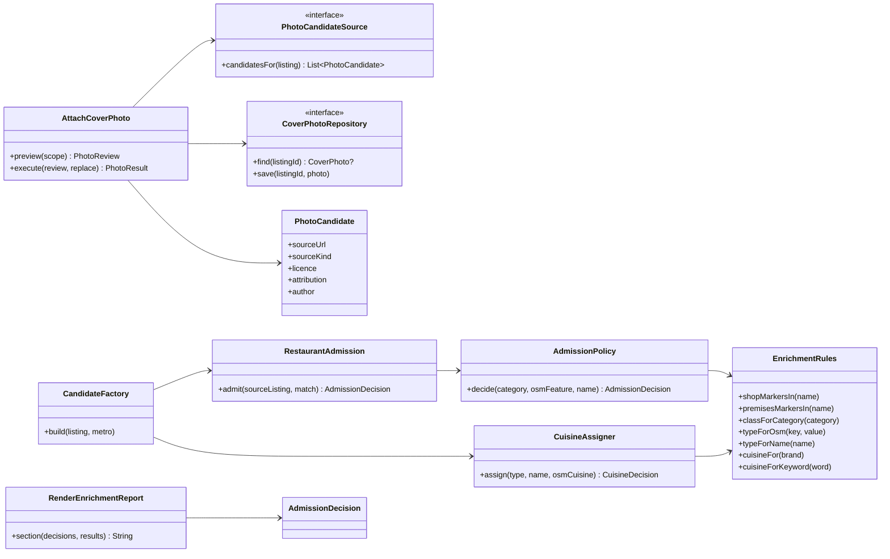

# SC-231 — Phase 5: System class diagram (conceptual)

> **Purpose:** the classes and ports that serve UC-01…UC-04 · **Derived from:** 01–04 · **Delta:** new `:domain` vocabulary, a new admission control in `:ingestion`, new photo use case/ports in `:application`, two photo-source adapters; image pipeline reused

## Overview

## Domain

**Where the rules live.** `VenueType`, `VenueClass`, `EnrichmentSource`,
`PhotoLicence`, `CoverPhoto` and `AdmissionDecision` are domain types: "only
restaurants are published", "a shop word with no premises word is not a
restaurant", and "a photo needs a reusable licence" are product rules, not
adapter detail. The *curated tables* (marker words, category → class, brand →
cuisine, keyword → cuisine) are data and live in `:ingestion` beside the policy.

## Application

`CandidateFactory` asks `RestaurantAdmission` first and only calls
`CuisineAssigner` when the verdict is `Admitted` — the dependency arrow is the
gate: no admitted type, no cuisine.

## Boundary and adapters

## Notes that the diagrams cannot carry

- **No new geocoder call.** Admission reads the tag from the match the SC-211
  run already made. Where SC-227 (PR #84) is not merged, the tag is absent
  (`GeocodedPlace` currently carries `providerRef` only), so the gate rests on
  category + name. This is a merge-order dependency, not a fallback design.
- **Exclusion is a reject, not a silent drop.** The pipeline already has an
  `IngestReject` with a reason; a non-restaurant becomes one, so the SC-211
  "every fetched row is accounted for" invariant still holds.
- **One photo per listing** is enforced by the repository (PK on listing id) and
  by the use case; a second candidate never overwrites silently.
- **The image store keeps bytes only.** Licence and credit are catalogue data,
  because the API must serve them and a bucket tag would not survive an adapter
  swap to R2.
