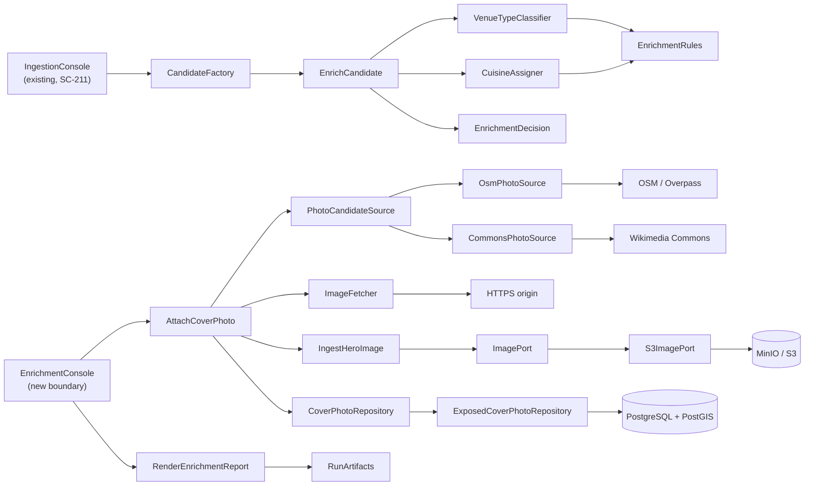
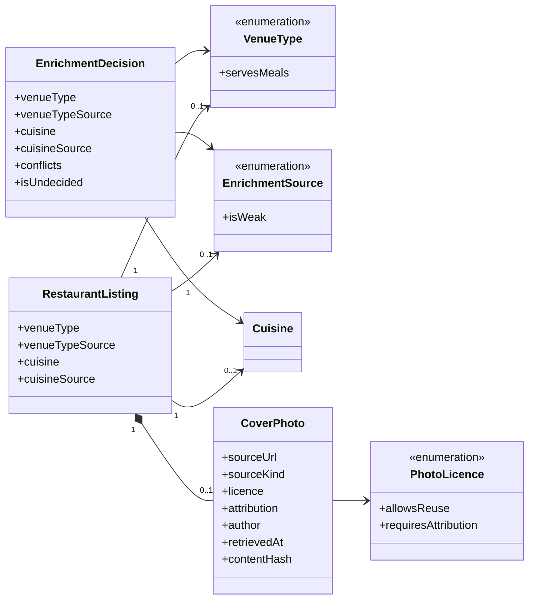
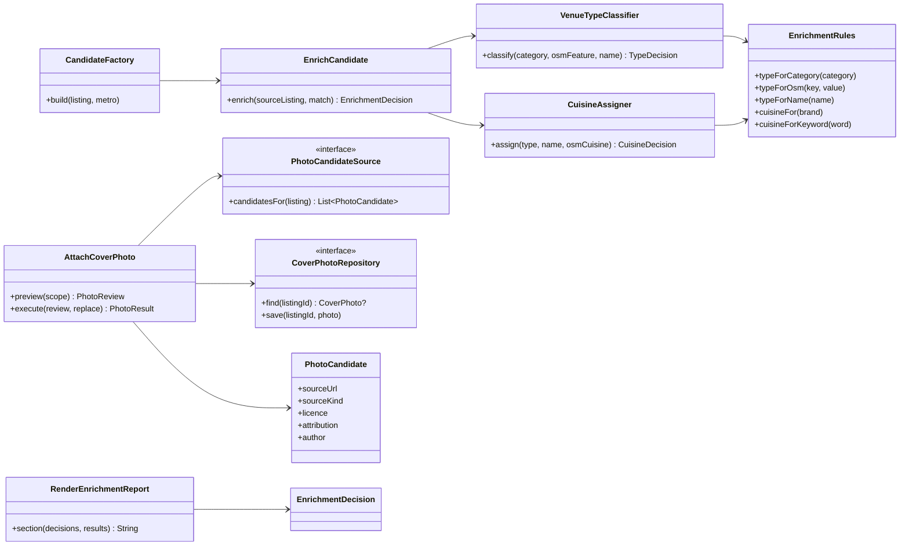
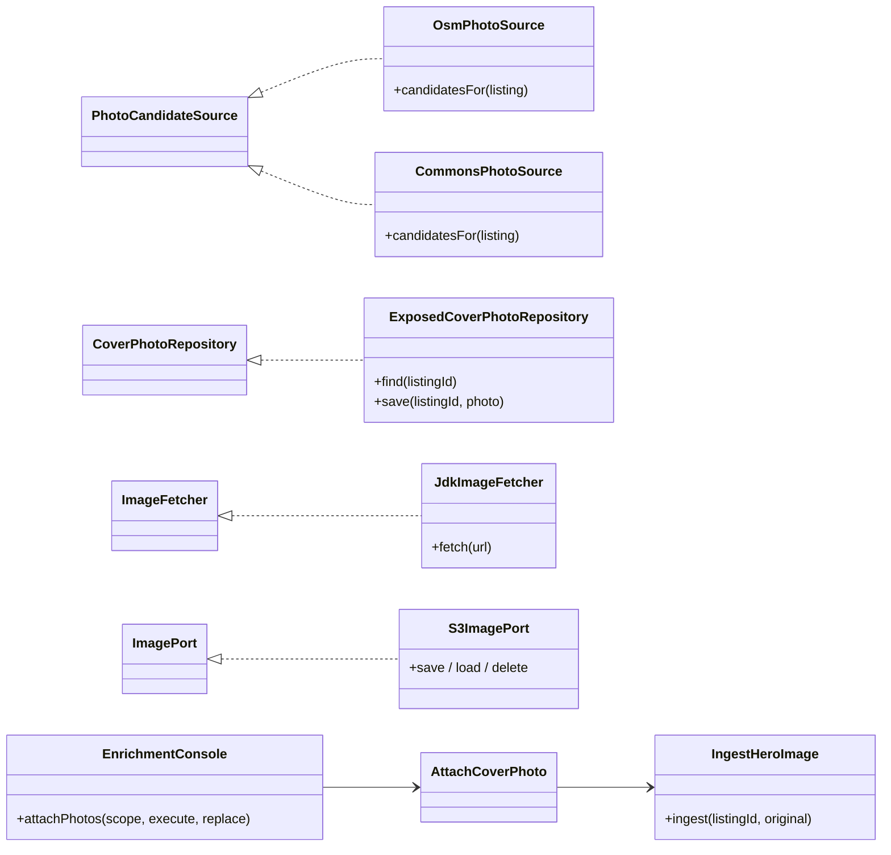

# SC-231 — Phase 5: System class diagram (conceptual)

> **Purpose:** the classes and ports that serve UC-01…UC-04 · **Derived from:** 01–04 · **Delta:** new `:domain` vocabulary, new enrichment controls in `:ingestion` and `:application`, two photo-source adapters; image pipeline reused

## Overview

## Domain

**Where the rules live.** `VenueType`, `EnrichmentSource`, `PhotoLicence`,
`CoverPhoto` and `EnrichmentDecision` are domain types: the closed vocabulary,
the "serving types may carry a cuisine" rule, and "a photo needs a reusable
licence" are product rules, not adapter detail. The *curated tables* (brand →
cuisine, keyword → cuisine, category → type, OSM tag → type) are data, and live
in `:ingestion` beside the classifier.

## Application

## Boundary and adapters

## Notes that the diagrams cannot carry

- **No new geocoder call.** UC-01/02 read the tag from the match the SC-211 run
  already made. Where SC-227 (PR #84) is not merged, the tag is absent
  (`GeocodedPlace` currently carries `providerRef` only), so classification
  degrades to category + name. This is a merge-order dependency, not a fallback
  design.
- **One photo per listing** is enforced by the repository (PK on listing id) and
  by the use case; a second candidate never overwrites silently.
- **The image store keeps bytes only.** Licence and credit are catalogue data,
  because the API must serve them and a bucket tag would not survive an adapter
  swap to R2.
