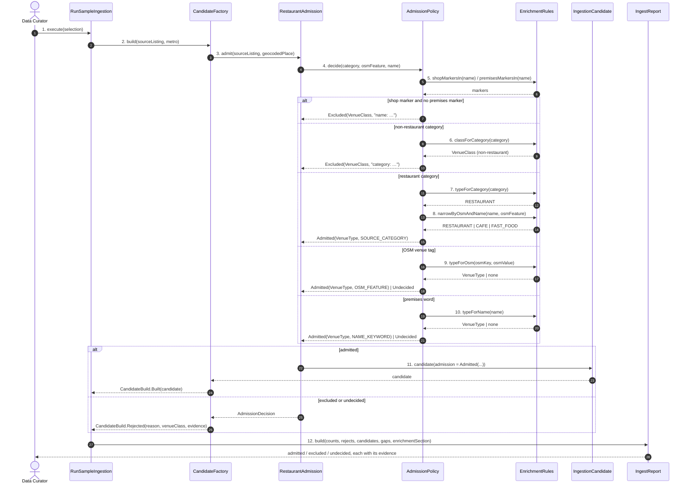

# SC-231 — Phase 6: White-box — UC-01 Add a row only if it is a restaurant

> **Purpose:** how the admission gate is served, class by class · **Derived from:** 05 + 04/UC-01 · **Delta:** new; no DB write here (the load writes)
> **Consistency:** the gate is pure — no I/O, no clock, no randomness — so the same batch always yields the same verdicts (INV-10). A row is either admitted, excluded or held; there is no fourth path.

**State transition:** `Matched → Admitted | Excluded | Undecided`. Only
`Admitted` produces an `IngestionCandidate`; the other two produce an
`IngestReject` carrying the class and evidence, so they are counted rather than
dropped. The transition to `Loaded` happens in SC-211 UC-03's transaction.

**Transaction boundary:** none. The run writes files only
(`FileRunArtifacts.complete`), and `run.json` is its commit marker.

**Authorization:** local operator only; no HTTP surface on this path.

| Phase-4 flow | Class operation and error |
|---|---|
| main 4–10 | `RestaurantAdmission.admit` → `AdmissionPolicy.decide` → `EnrichmentRules` marker and class tables; first decisive rule wins |
| A1 restaurant category, shop name | step 5 fires before the category rule: `Excluded(BUTCHER, "name: poultry/meat market")` |
| A2 market + kitchen | step 5 sees a shop marker and a premises marker → falls through to the category rule → `Admitted(RESTAURANT, SOURCE_CATEGORY)` |
| A3 bakery + grill | same as A2 |
| A4 pure bakery | "bakery" is a premises/type word, not a shop marker (L-3) → `Admitted(BAKERY, NAME_KEYWORD)` |
| A5 retail store + meat shop | step 5 fires; the category rule would have excluded anyway |
| A6 slaughter house / distributor | `classForCategory` returns a non-restaurant class → `Excluded` |
| A7 restaurant + "Coffee" | `narrowByOsmAndName` returns `CAFE`; evidence stays `SOURCE_CATEGORY` |
| E1 nothing decides | `Undecided("no evidence")` → `CandidateBuild.Rejected`, listed in full |
| E2 both marker families | step 5 requires a shop marker *without* a premises marker, so it does not fire; both words are kept in the decision |
| P1 no OSM tag | step 9 is skipped; steps 7 and 10 still decide |
| P2 source categories change | no code path; the report's excluded/undecided shares make the shift visible |
