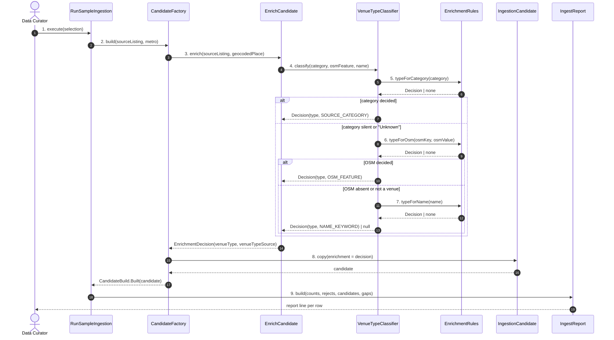

# SC-231 — Phase 6: White-box — UC-01 Classify a row's venue type

> **Purpose:** how classification is served, class by class · **Derived from:** 05 + 04/UC-01 · **Delta:** new; no DB write here (the load writes)
> **Consistency:** classification is pure — no I/O, no clock, no randomness — so the same batch always yields the same decisions (INV-8).

**State transition:** `Matched → Classified` when a decision is returned,
`Matched → Undecided` when it is null. The catalogue is not touched here; the
transition to `Loaded` happens in SC-211 UC-03's transaction.

**Transaction boundary:** none. The run writes files only
(`FileRunArtifacts.complete`), and `run.json` is its commit marker.

**Authorization:** local operator only; no HTTP surface on this path.

| Phase-4 flow | Class operation and error |
|---|---|
| main 4–7 | `VenueTypeClassifier.classify` → `EnrichmentRules.typeForCategory/typeForOsm/typeForName`; first decisive answer wins, class recorded |
| A1 retail store + butcher name | `typeForCategory` returns `OTHER`; `EnrichCandidate` narrows with `typeForName`, never to a serving type |
| A3 category beats name | `typeForCategory` returns `RESTAURANT`; steps 6–7 are skipped |
| A5 OSM hit is not a venue | `typeForOsm` returns null for `highway`/`place`/boundary keys |
| E1 undecided | both fields null; `EnrichmentDecision.isUndecided` true; the report lists the row |
| E2 name words disagree | `typeForName` uses a fixed branch order and returns the first match; the word is kept in the decision for the report |
| P1 no OSM tag | `typeForOsm` is not called (null feature); steps 5 and 7 only |
