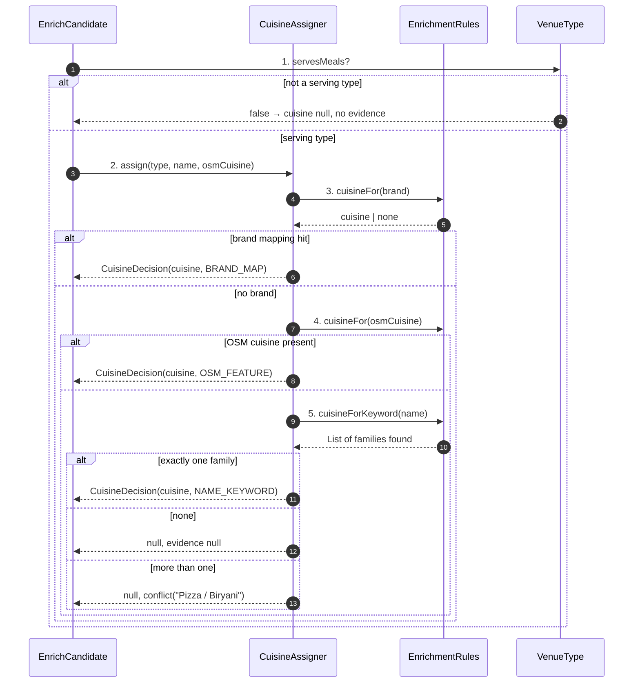

# SC-231 — Phase 6: White-box — UC-02 Assign a cuisine

> **Purpose:** how a cuisine is chosen, class by class · **Derived from:** 05 + 04/UC-02 · **Delta:** new; same pure pass as UC-01
> **Consistency:** the assigner runs only for `VenueType.servesMeals`; a non-serving type short-circuits before any lookup (INV-5).

**State transition:** `Classified → CuisineAssigned` or `Classified →
CuisineConflict`; a non-serving type goes straight to `Loaded` with no cuisine.

**Transaction boundary:** none here; the load writes `cuisine` and
`cuisine_source` inside SC-211 UC-03's single transaction, and only where the
stored value is null (INV-7).

**Authorization:** local operator only.

| Phase-4 flow | Class operation and error |
|---|---|
| main 2–6 | `CuisineAssigner.assign` → `EnrichmentRules.cuisineFor`; the first decisive source wins |
| A1 non-serving type | `EnrichCandidate` checks `VenueType.servesMeals` before calling the assigner |
| A2 brand map | `EnrichmentRules.cuisineFor(brand)`; evidence `BRAND_MAP` (not the source's own claim) |
| A3 conflict | a keyword list with more than one family returns null plus a conflict string; the report queues it |
| E1 nothing found | null; counted under "no cuisine evidence" |
| E2 malformed curated tables | the rules object fails construction at startup — the run never starts (`IllegalStateException`), so no partial classification is written |
| P1 existing value | the load's fill-null-only rule keeps the stored cuisine; the report shows the decision and the stored value |
