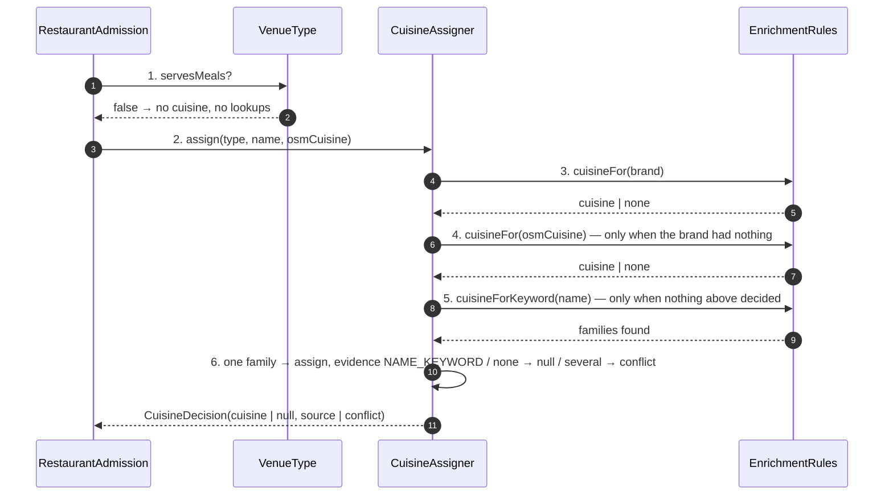
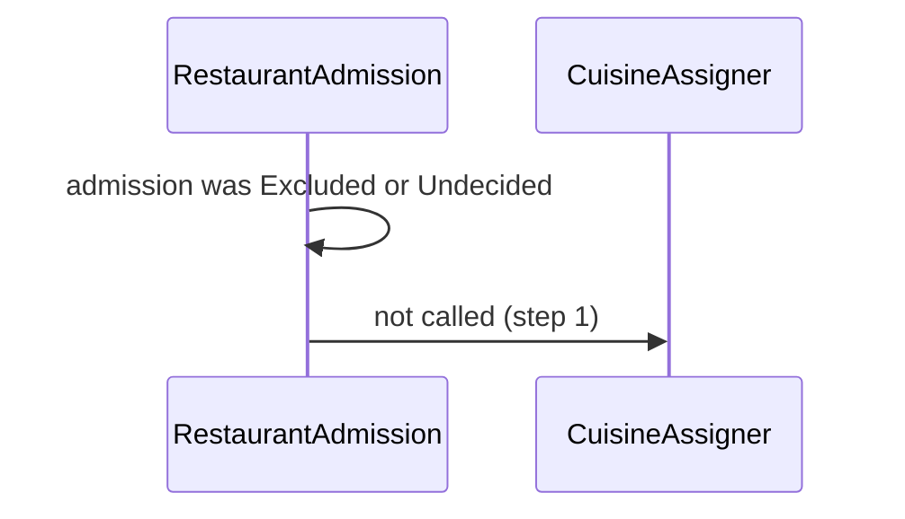
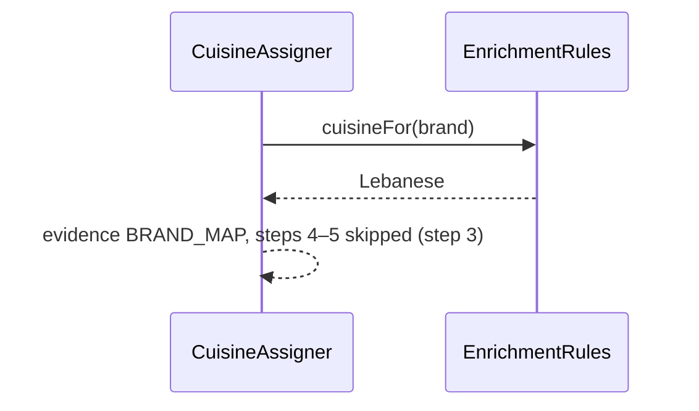
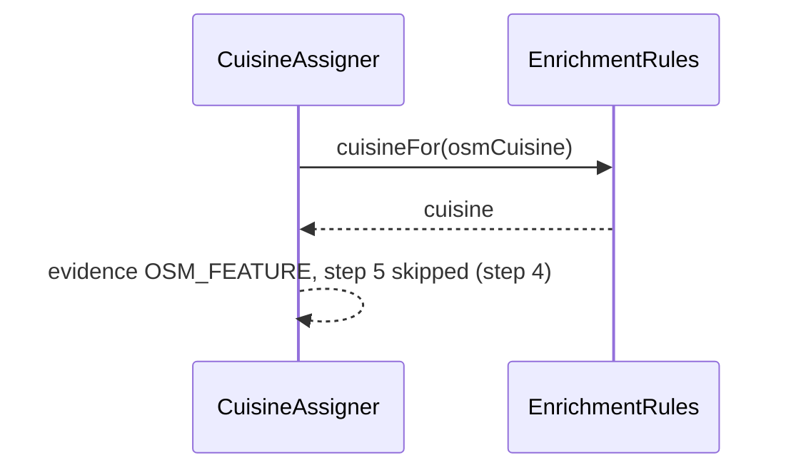
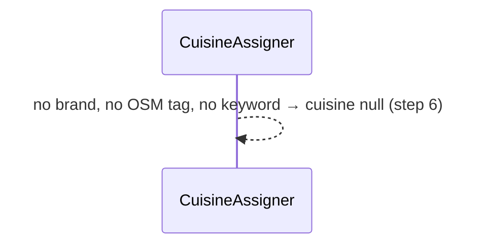
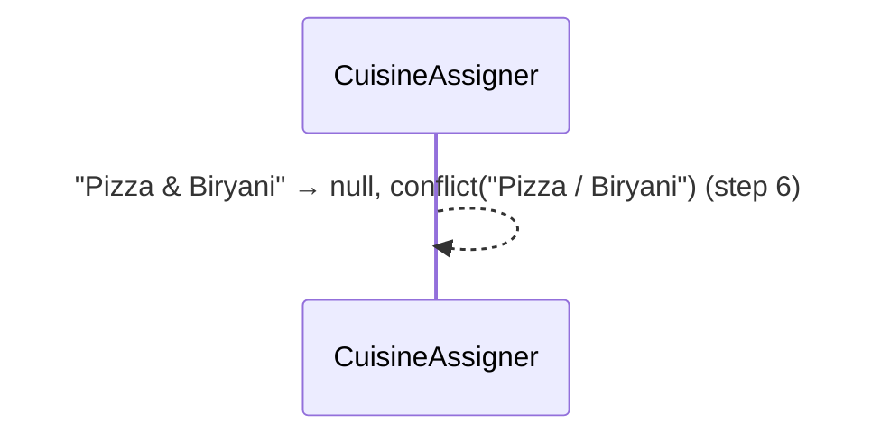
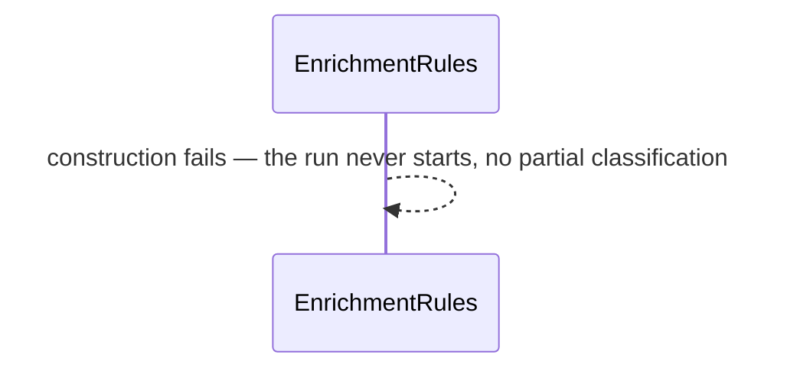

# SC-231 — Phase 6: White-box — UC-02 Assign a cuisine

> **Purpose:** how a cuisine is chosen, class by class · **Derived from:** 05 + 04/UC-02 · **Delta:** new; same pure pass as UC-01
> **Consistency:** the assigner runs only for an admitted row; `VenueType.servesMeals` short-circuits before any lookup (INV-8), and the first decisive source wins.

**A1 — not a restaurant** · short-circuit.

**A2 — brand mapping hit** · the ladder stops there.

**A3 — OSM cuisine tag** · used only when the brand had nothing.

**E1 — nothing found** · null.

**E2 — conflicting families** · null plus a conflict, never a coin flip.

**P1 — malformed curated tables** · fail at startup.

**State transition:** `Admitted → CuisineAssigned` or `Admitted → CuisineConflict`;
an unadmitted row never reaches this pass.

**Transaction boundary:** none here; the load writes `cuisine` and
`cuisine_source` inside SC-211 UC-03's single transaction, and only where the
stored value is null (INV-9).

**Authorization:** local operator only.

| Phase-4 flow | Class operation and error |
|---|---|
| main 2–6 | `CuisineAssigner.assign` → `EnrichmentRules.cuisineFor`; the first decisive source wins |
| A1 not admitted | `RestaurantAdmission` never calls the assigner |
| A2 brand map | step 3 returns and steps 4–5 are skipped; evidence `BRAND_MAP` |
| A3 OSM tag | step 4 returns and step 5 is skipped; evidence `OSM_FEATURE` |
| E1 nothing found | null; counted under "no cuisine evidence" |
| E2 conflict | a keyword list with more than one family returns null plus a conflict string; the report queues it |
| P1 malformed tables | the rules object fails construction at startup (`IllegalStateException`), so no run can half-classify |
| P2 existing value | the load's fill-null-only rule keeps the stored cuisine; the report shows the decision and the stored value |
